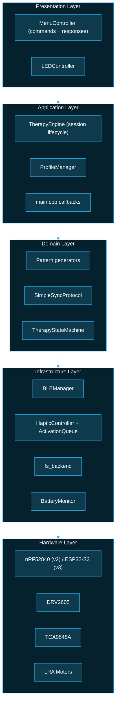
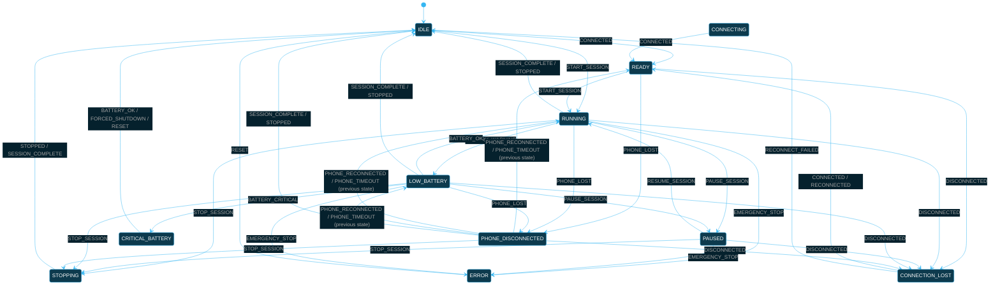
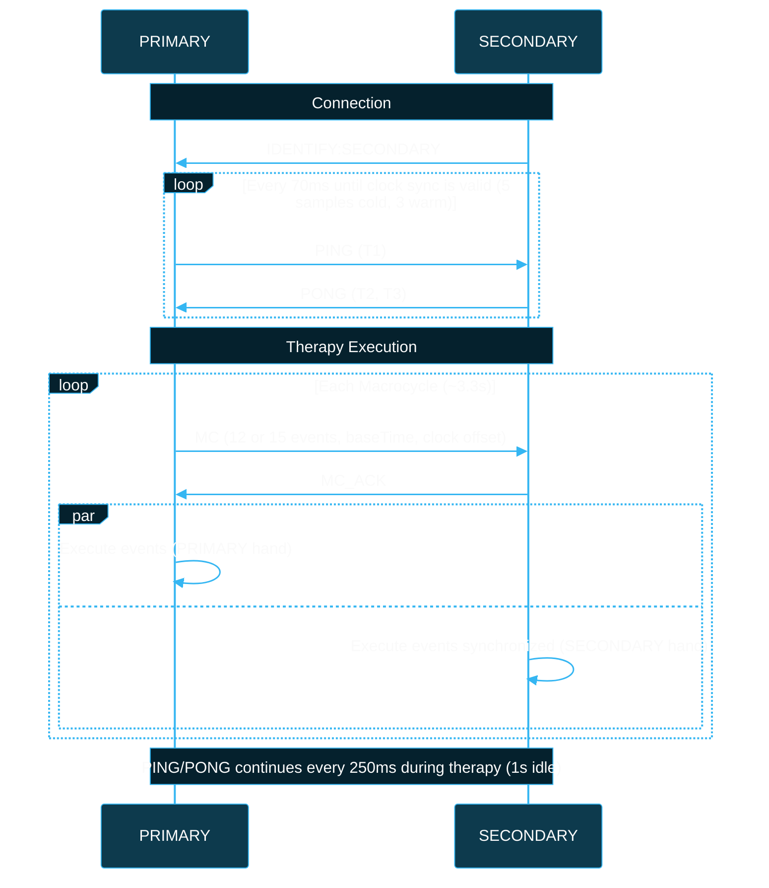
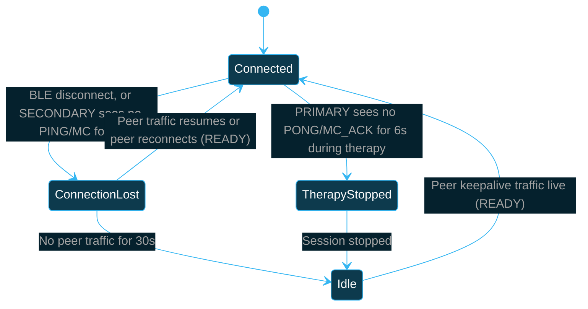
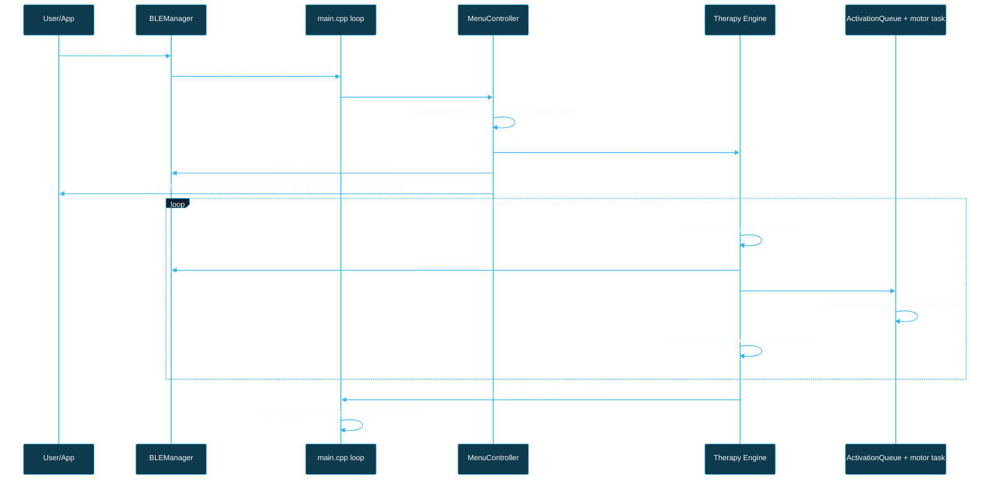
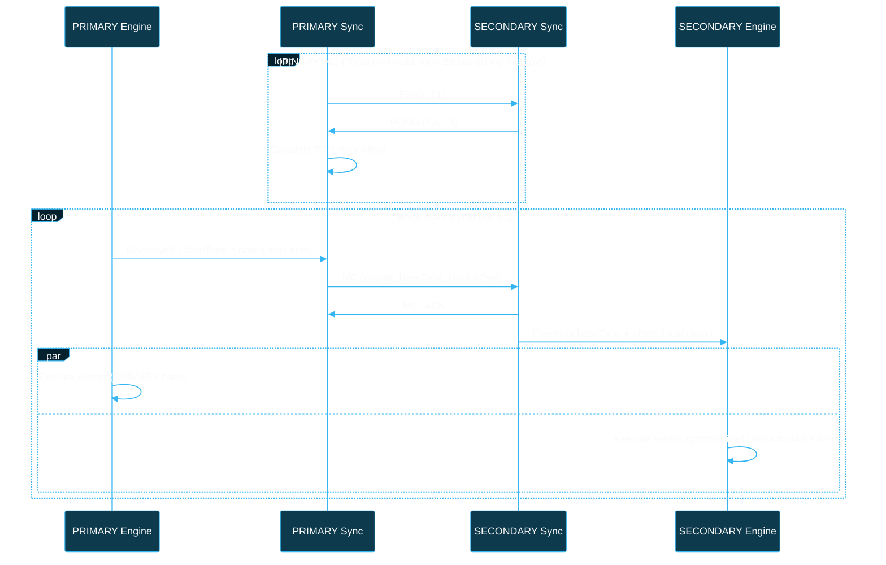

# BlueBuzzah Firmware Architecture

This document provides a detailed explanation of the BlueBuzzah firmware architecture, design patterns, and component interactions. One codebase runs on both BlueBuzzah v2 and BlueBuzzah v3 hardware.

**Platforms**: Arduino C++ on Adafruit Feather nRF52840 Express (BlueBuzzah v2, 4 motors) and Seeed XIAO ESP32-S3 (BlueBuzzah v3, 5 motors)
**Build System**: PlatformIO — one codebase, two device environments (`adafruit_feather_nrf52840`, `pentabuzzer_esp32s3`) selected by board macro

Platform-specific code is isolated behind compile-time seams: `board_config.h` (pins, `MAX_ACTUATORS`, battery availability), `platform.h` (critical sections, memory barrier, system reset, RTOS headers), a split `BLEManager` backend (`ble_manager_nrf52.cpp` Bluefruit / `ble_manager_esp32.cpp` NimBLE — identical Nordic-UART protocol, MTU 200, 7.5-10 ms glove-link connection interval (30-50 ms requested for the phone link), 0 dBm TX, 2M PHY), an `fs_backend` filesystem shim, and a `build_src_filter`-selected `PowerController` (BlueBuzzah v3 power switch + deep sleep; no-op on nRF). Everything below the seams — therapy engine, sync protocol, state machine, menus, profiles — is shared and platform-neutral.

**BlueBuzzah v3 power topology** (verified against the V2.2 PCB netlist): the ESP32-S3, TCA9548A mux, and IMU (an LSM6DS3 on SPI — present on the board but unused by firmware) run from the XIAO's onboard 3V3 LDO; the five DRV2605 drivers and the WS2812 LED run **directly from VBat**. There is no switched power rail. **Motors cannot run on USB alone** — without a battery, VBat is only the XIAO charger's current-limited output, and any LRA drive browns the drivers out to power-on defaults (standby → silent motors while I2C still works). GPIO1 is the shared DRV2605 EN + mux reset: a LOW→HIGH toggle resets every DRV2605 register, so any runtime toggle must be followed by full haptic reconfiguration. Motor JST ports are silk-labeled 1–5 in reverse of firmware channels (finger N ↔ port 5−N, `MOTOR_SILK_PORT()`). Serial QA commands `MOTOR_DIAG` (buzz every channel + supply-reset canary), `MOTOR_TEST:<n>` (single channel, 2 s), and `MOTOR_PRESENT` (per-port open-load probe via LRA auto-calibration) validate assembly. The presence probe also runs at every boot and feeds the therapy engine's active-finger map, so macrocycles skip motor ports found empty on the PRIMARY glove; fewer than 4 detected motors is signaled by a red double-blink LED at boot.

## Table of Contents

- [Overview](#overview)
- [Design Principles](#design-principles)
- [Module Organization](#module-organization)
- [Role-Based Architecture](#role-based-architecture)
- [Entry Point Flow](#entry-point-flow)
- [Layer Architecture](#layer-architecture)
- [Component Details](#component-details)
- [Hardware Abstraction](#hardware-abstraction)
- [Design Patterns](#design-patterns)
- [Data Flow](#data-flow)
- [Error Handling Strategy](#error-handling-strategy)
- [Memory Management](#memory-management)
- [Integration Points](#integration-points)
- [Scalability and Extensibility](#scalability-and-extensibility)
- [Development Guidelines](#development-guidelines)

## Overview

The BlueBuzzah firmware is built using Clean Architecture principles, separating concerns into distinct layers with clear boundaries and dependencies flowing inward.

### Architecture Goals

1. **Testability**: Easy to test business logic without hardware
2. **Maintainability**: Clear module boundaries and responsibilities
3. **Extensibility**: Simple to add new features or change implementations
4. **Portability**: Hardware abstraction enables platform changes
5. **Reliability**: Explicit state management and error handling

### High-Level Structure



## Design Principles

### 1. Clean Architecture

**Dependency Rule**: Dependencies point inward

- Presentation -> Application -> Domain -> Infrastructure -> Hardware
- Inner layers know nothing about outer layers
- Interfaces define boundaries

**Benefits**:

- Business logic independent of frameworks
- Testable without external dependencies
- UI and database can change independently

### 2. SOLID Principles

**Single Responsibility**: Each class has one reason to change

```cpp
// Each class has one responsibility
class TherapyEngine;        // Generates patterns and macrocycles, schedules activations
class HapticController;     // Drives the DRV2605s through the TCA9548A mux
class TherapyStateMachine;  // Owns the therapy state and its transitions
class BLEManager;           // BLE radio, connections, EOT message framing
```

**Open/Closed**: Open for extension, closed for modification

```cpp
// include/therapy_engine.h

// Pattern generators are free functions selected by PatternType
enum class PatternType {
    RNDP = 0,
    SEQUENTIAL = 1,
    MIRRORED  = 2,
};

Pattern generateRandomPermutation(uint8_t numFingers, float timeOnMs, float timeOffMs,
                                  float jitterPercent, bool mirrorPattern);
Pattern generateSequentialPattern(uint8_t numFingers, float timeOnMs, float timeOffMs,
                                  float jitterPercent, bool mirrorPattern, bool reverse);
Pattern generateMirroredPattern(uint8_t numFingers, float timeOnMs, float timeOffMs,
                                float jitterPercent, bool randomize);
```

A new pattern is a new generator function, a new `PatternType` value, and a new case in `TherapyEngine::generateMacrocycle()`. Existing generators stay untouched.

**Liskov Substitution**: Subtypes must be substitutable

Platform implementations are substituted at build time: `build_src_filter` compiles exactly one implementation of each platform seam.

```cpp
// include/fs_backend.h - one declaration, three implementations
namespace fsb {
bool begin();
bool readFile(const char* path, uint8_t* buf, size_t cap, size_t& outLen);
bool writeFile(const char* path, const uint8_t* buf, size_t len);
}
// fs_backend_nrf52.cpp (InternalFS), fs_backend_esp32.cpp (LittleFS),
// fs_backend_mock.cpp (in-memory, native tests)
```

**Interface Segregation**: Clients shouldn't depend on unused interfaces

```cpp
// include/therapy_engine.h - one small callback type per concern
typedef void (*ActivateCallback)(uint8_t finger, uint8_t amplitude);
typedef void (*DeactivateCallback)(uint8_t finger);
typedef void (*SendMacrocycleCallback)(const Macrocycle& macrocycle);
typedef void (*ScheduleActivationCallback)(uint64_t activateTimeUs, uint8_t finger,
                                           uint8_t amplitude, uint16_t durationMs, uint16_t frequencyHz);

// Not one massive "DeviceController" interface
```

**Dependency Inversion**: Depend on abstractions, not concretions

`TherapyEngine` never includes `hardware.h` or `ble_manager.h`. `main.cpp` wires it to the hardware and the radio through callbacks:

```cpp
// src/main.cpp - initializeTherapy()
therapy.setActivateCallback(onActivate);
therapy.setDeactivateCallback(onDeactivate);
therapy.setCycleCompleteCallback(onCycleComplete);

if (deviceRole == DeviceRole::PRIMARY)
{
    therapy.setSendMacrocycleCallback(onSendMacrocycle);
    therapy.setSchedulingCallbacks(onScheduleActivation, onStartScheduling, onIsSchedulingComplete);
    therapy.setGetLeadTimeCallback(onGetLeadTime);
}
```

### 3. Domain-Driven Design

**Ubiquitous Language**: Common terminology

- **Session**: A therapy session from start to completion
- **Cycle**: One pattern: every active finger buzzed once in the generated order (one CR period). `TherapyEngine`'s cycle counter counts macrocycles
- **Burst**: One finger activation lasting TIME_ON (default 100ms), followed by TIME_OFF (default 67ms, plus jitter)
- **Macrocycle**: Three patterns sent to the SECONDARY as one batch (12 events on v2, 15 on v3), followed by a relax interval of two CR periods (`calculateRelaxIntervalMs()`)
- **Profile**: Configuration for a therapy protocol

**Bounded Contexts**:

- **Therapy Context**: Pattern generation, cycle execution
- **Communication Context**: BLE protocol, messages
- **Hardware Context**: Device control, I2C communication
- **State Context**: Session states, transitions

## Module Organization

### File Structure

```text
BlueBuzzah-Firmware/
├── platformio.ini                    # Build configuration (device + native test envs)
├── partitions_penta.csv              # ESP32-S3 flash partition table (v3)
├── include/
│   ├── board_config.h                # Per-board pins, MAX_ACTUATORS, battery availability
│   ├── platform.h                    # Critical sections, memory barrier, system reset, RTOS headers
│   ├── config.h                      # Shared constants, BLE parameters, PARAM_* bounds
│   ├── types.h                       # Enums, structs (DeviceRole, TherapyState, Macrocycle)
│   ├── internal_messages.h           # Device-to-device prefixes the menu must ignore
│   ├── hardware.h                    # HapticController, BatteryMonitor, LEDController classes
│   ├── vbat_estimator.h              # DRV2605 VBAT burst/median/EMA estimator
│   ├── ble_manager.h                 # BLE management class (both backends)
│   ├── therapy_engine.h              # Therapy execution class, pattern generators
│   ├── sync_protocol.h               # Sync command serialization, PTP clock sync
│   ├── state_machine.h               # Therapy state machine
│   ├── menu_controller.h             # Command processing
│   ├── profile_manager.h             # Profile handling
│   ├── fs_backend.h                  # Filesystem shim
│   ├── power_controller.h            # Power switch + deep sleep (v3)
│   ├── hires_clock.h                 # 1MHz sync timebase
│   ├── radio_anchor.h                # BLE radio-event timestamps (nRF)
│   ├── activation_queue.h            # Motor event scheduling queue
│   ├── motor_event_buffer.h          # Motor event staging buffer
│   ├── deferred_queue.h              # ISR-safe work queue
│   └── latency_metrics.h             # Performance tracking
└── src/
    ├── main.cpp                      # Entry point: setup() + loop(), BLE/therapy callbacks
    ├── hardware.cpp                  # HapticController, BatteryMonitor, LEDController implementations
    ├── vbat_estimator.cpp            # VBAT estimator implementation
    ├── ble_manager_nrf52.cpp         # BLEManager backend: Bluefruit (v2)
    ├── ble_manager_esp32.cpp         # BLEManager backend: NimBLE (v3)
    ├── therapy_engine.cpp            # Therapy implementations
    ├── sync_protocol.cpp             # Sync implementations
    ├── state_machine.cpp             # State machine implementations
    ├── menu_controller.cpp           # Menu implementations
    ├── profile_manager.cpp           # Profile implementations
    ├── fs_backend_nrf52.cpp          # InternalFS (v2)
    ├── fs_backend_esp32.cpp          # LittleFS (v3)
    ├── fs_backend_mock.cpp           # In-memory filesystem (native tests)
    ├── power_controller_nrf52.cpp    # No-op (v2)
    ├── power_controller_esp32.cpp    # Power switch + deep sleep (v3)
    ├── hires_clock.cpp               # NRF_TIMER4 (v2) / esp_timer (v3)
    ├── radio_anchor.cpp              # SoftDevice radio notifications (v2); stubs elsewhere
    ├── activation_queue.cpp          # Motor event queue implementations
    ├── motor_event_buffer.cpp        # Motor event buffer implementations
    ├── deferred_queue.cpp            # ISR-safe work queue implementations
    └── latency_metrics.cpp           # Performance tracking implementations
```

Settings are stored as packed binary files on the board's flash filesystem (`/settings.bin` and `/custom.bin`, written through `fs_backend`); there is no uploaded filesystem image.

### Module Responsibilities

| Module                          | Responsibility                              | Depends On                      |
| ------------------------------- | ------------------------------------------- | ------------------------------- |
| `main.cpp`                      | Entry point (setup/loop), callback wiring   | All modules                     |
| `ble_manager_nrf52.cpp` / `ble_manager_esp32.cpp` | BLE radio, connection management, EOT framing | `bluefruit.h` (v2) / `NimBLEDevice.h` (v3) |
| `therapy_engine.h/.cpp`         | Therapy execution, pattern gen              | `config.h`, `types.h`, `sync_protocol.h` (`getMicros()`); callbacks to `main.cpp` |
| `hardware.h/.cpp`               | HapticController, LEDController, battery    | DRV2605, TCA9548A, NeoPixel, `vbat_estimator.h` |
| `menu_controller.h/.cpp`        | Phone/serial command processing             | `therapy_engine.h`, `profile_manager.h`, `state_machine.h`, `ble_manager.h`, `internal_messages.h` |
| `sync_protocol.h/.cpp`          | PRIMARY-SECONDARY messaging, clock sync     | `types.h`, `hires_clock.h`      |
| `profile_manager.h/.cpp`        | Therapy parameter management                | `fs_backend.h`                  |
| `state_machine.h/.cpp`          | Therapy state machine                       | `types.h`                       |
| `power_controller_*.cpp`        | Power switch + deep sleep (v3); no-op (v2)  | `hardware.h`                    |
| `activation_queue.h/.cpp`       | FreeRTOS motor event scheduling             | `hardware.h`, FreeRTOS          |
| `motor_event_buffer.h/.cpp`     | Lock-free staging buffer (BLE→main loop)    | `platform.h`                    |
| `deferred_queue.h/.cpp`         | ISR-safe work queue for blocking ops        | `platform.h`                    |
| `latency_metrics.h/.cpp`        | Performance tracking, RTT measurement       | `config.h`                      |

### Architecture Layers

- **Presentation**: `LEDController` (in hardware.h), `menu_controller` (BLE command interface)
- **Application**: `therapy_engine` (session orchestration via callbacks)
- **Domain**: `therapy_engine`, `sync_protocol`, `state_machine`
- **Infrastructure**: `ble_manager_*`, `HapticController`, `BatteryMonitor`, `profile_manager`, `fs_backend_*`

## Role-Based Architecture

BlueBuzzah implements a **PRIMARY-SECONDARY architecture** for bilateral haptic therapy using two synchronized gloves communicating via BLE.

### Unified Codebase

Both gloves run identical firmware. The role is stored in the binary settings file (`/settings.bin`, `SettingsData.role`) and is set over USB serial with `SET_ROLE:PRIMARY` or `SET_ROLE:SECONDARY`, which saves the role and restarts the device:

```cpp
// src/main.cpp - setup()
profiles.begin();

// Check if device has a configured role
if (!profiles.hasStoredRole())
{
    // Block and wait for role configuration via Serial
    waitForRoleConfiguration();   // orange slow blink; accepts only SET_ROLE:
}

// Determine device role (from settings or button override)
deviceRole = determineRole();
```

`determineRole()` returns the stored role, except that on v2 hardware holding the USER button at boot forces SECONDARY. v3 hardware has no user button.

### Role Polymorphism

Modules adapt behavior based on `deviceRole`:

```cpp
// BLE Connection - src/main.cpp, initializeBLE()
// PRIMARY advertising starts inside ble.begin()
ble.begin(deviceRole, BLE_NAME);
if (deviceRole == DeviceRole::SECONDARY)
{
    ble.startScanning(BLE_NAME);
}

// Therapy Engine - src/main.cpp, initializeTherapy()
// Only the PRIMARY generates macrocycles and sends them to the SECONDARY
if (deviceRole == DeviceRole::PRIMARY)
{
    therapy.setSendMacrocycleCallback(onSendMacrocycle);
    therapy.setSchedulingCallbacks(onScheduleActivation, onStartScheduling, onIsSchedulingComplete);
}
```

The SECONDARY never generates patterns during a session. It schedules the events it receives in each macrocycle message (`onBLEMessage()`, `MC:` branch).

### Command-Driven Synchronization

PRIMARY explicitly commands SECONDARY for every action using the sync protocol:

```
PRIMARY -> SECONDARY: MC:seq|baseHigh|baseLow|offHigh|offLow|dur|count|d,f,a[,fo]|...
PRIMARY: <enqueues all events to its ActivationQueue>
SECONDARY: <receives macrocycle, converts baseTime to its own clock, enqueues all events>
SECONDARY -> PRIMARY: MC_ACK:seq
```

Benefits:

- Eliminates clock drift over 2-hour sessions: every macrocycle carries the current PTP clock offset
- Absorbs BLE latency: events are scheduled at an absolute `baseTime` one adaptive lead time (70-150ms, `SYNC_MIN_LEAD_TIME_US`/`SYNC_MAX_LEAD_TIME_US`) in the future
- Simplifies error recovery (SECONDARY stops its motors if PRIMARY disconnects or its keepalive times out)

### Multi-Connection Support (PRIMARY Only)

PRIMARY supports **simultaneous connections** (`MAX_CONNECTIONS` = 2) to:

1. **Smartphone** (`ConnectionType::PHONE`) - Configuration, monitoring, control
2. **SECONDARY glove** (`ConnectionType::SECONDARY`) - Bilateral therapy coordination

Each connection is classified by the `IDENTIFY:PHONE` / `IDENTIFY:SECONDARY` handshake it sends after connecting (`BLEManager::deliverMessage()`).

### PRIMARY Responsibilities

1. **Advertise** as BLE peripheral ("BlueBuzzah")
2. **Accept connections** from smartphone + SECONDARY
3. **Run the boot window**: after the SECONDARY connects, wait up to 30s (`STARTUP_WINDOW_MS`) for a phone; if none connects, auto-start therapy
4. **Orchestrate therapy**: Send MACROCYCLE batches (12 events on v2, 15 on v3, every ~3.3s)
5. **Send PING/PONG** for keepalive + clock sync (every 70ms until clock sync is valid, 250ms during therapy, 1s idle)
6. **Relay settings** to SECONDARY: therapy LED (`LED_OFF_SYNC:`), debug mode (`DEBUG_SYNC:`), calibration buzzes (`CALIB_BUZZ:`/`CALIB_STOP`). Profile parameters travel inside each macrocycle
7. **Process smartphone commands** via MenuController

| Function                         | Location              | Description                       |
| -------------------------------- | --------------------- | --------------------------------- |
| `onBLEConnect()`                 | `main.cpp`            | Starts the boot window and clock sync when the SECONDARY connects |
| `autoStartTherapy()`             | `main.cpp`            | Starts therapy when the boot window expires without a phone |
| `sendPing()`                     | `main.cpp`            | PING for keepalive + clock sync   |
| `TherapyEngine::startSession()`  | `therapy_engine.cpp`  | Initiates therapy, generates first pattern |
| `TherapyEngine::update()`        | `therapy_engine.cpp`  | Macrocycle generation and scheduling (`executeMacrocycleStep()`) |

### SECONDARY Responsibilities

1. **Scan** for the PRIMARY's BLE advertisement (Nordic UART service + BlueBuzzah manufacturer data; name "BlueBuzzah" as fallback)
2. **Connect** to PRIMARY and send `IDENTIFY:SECONDARY`
3. **Receive sync commands**: START_SESSION, PAUSE_SESSION, RESUME_SESSION, STOP_SESSION, MC (macrocycle), PING
4. **Execute synchronized motor events** from macrocycle batches
5. **Respond to PING with PONG** for keepalive + clock sync
6. **Monitor keepalive timeout** (6 seconds without PING/MACROCYCLE)
7. **Safety stop** if PRIMARY disconnects or keepalive times out

| Function                   | Location            | Description                 |
| -------------------------- | ------------------- | --------------------------- |
| `initializeBLE()`          | `main.cpp`          | Starts scanning for PRIMARY |
| `onBLEMessage()`           | `main.cpp`          | Process sync messages       |
| `SyncCommand::deserialize()` / `deserializeMacrocycle()` | `sync_protocol.cpp` | Parse sync messages |
| `handleKeepaliveTimeout()` | `main.cpp`          | Connection recovery         |

## Entry Point Flow

### Arduino setup()/loop() Paradigm

Arduino uses two entry functions:

- `setup()` - Called once at boot
- `loop()` - Called repeatedly forever

```cpp
// src/main.cpp (trimmed - logging, LED feedback and error branches omitted)

// Global instances
HapticController haptic;
BatteryMonitor battery;
LEDController led;
PowerController power;
BLEManager ble;
TherapyEngine therapy;
TherapyStateMachine stateMachine;
MenuController menu;
ProfileManager profiles;
SimpleSyncProtocol syncProtocol;

void setup()
{
    Serial.begin(115200);               // waits up to 3s for USB serial

    power.begin();                      // v3 power path; no-op on v2
    led.begin();

    profiles.begin();                   // loads /settings.bin
    if (!profiles.hasStoredRole())
    {
        waitForRoleConfiguration();     // never returns: SET_ROLE saves and restarts
    }
    deviceRole = determineRole();

    hardwareReady = initializeHardware();   // DRV2605s, motor task, battery monitor
    bleReady = initializeBLE();             // advertise (PRIMARY) or scan (SECONDARY)
    initializeTherapy();                    // therapy engine callbacks

    stateMachine.begin(TherapyState::IDLE);
    stateMachine.onStateChange(onStateChange);   // LED follows the state

    menu.begin(&therapy, &battery, &haptic, &stateMachine, &profiles, &ble);
    deferredQueue.setExecutor(executeDeferredWork);
}

void loop()
{
    // Safety shutdown requested by a BLE callback, motor event forwarding,
    // deferred work, one queued menu command, LED animation, BLE TX queue,
    // serial commands, therapy.update(), keepalive checks, boot window,
    // PING scheduling (PRIMARY) - the same loop runs on both roles
}
```

An initialization failure sets the LED to red slow blink and boot continues; `setup()` never halts. After a hardware failure, a successful BLE init replaces the red blink with breathing blue.

### Boot Sequence

**PRIMARY:**

1. Initialize BLE and advertise as "BlueBuzzah"
2. LED: breathing blue (IDLE) while waiting to pair
3. SECONDARY connects (`IDENTIFY:SECONDARY`): solid green LED (READY), clock sync starts, 30s boot window starts
4. If no phone connects within the window, therapy auto-starts

**SECONDARY:**

1. Initialize BLE and scan for the PRIMARY
2. LED: breathing blue (IDLE) while scanning
3. Connect to PRIMARY (scanning has no timeout)
4. Success: solid green LED (READY)

### Timing Breakdown

- Boot window: 30s after the SECONDARY connects (`STARTUP_WINDOW_MS`)
- Clock sync: at best ~350ms cold start (5 samples at 70ms), ~210ms warm start (3 samples); samples must pass RTT quality gates
- Therapy execution: 1-240 minutes (`PARAM_MIN_SESSION_MIN`-`PARAM_MAX_SESSION_MIN`), 120 minutes in the vCR profiles
- Shutdown: <1s

## Layer Architecture

### Presentation Layer

**Purpose**: Handle external interactions (BLE commands, LED feedback)

**Components**:

- `menu_controller.h/.cpp`: Parse and validate BLE and serial commands
- `hardware.h` (`LEDController`): visual status feedback

**Characteristics**:

- No business logic
- Transforms external data to/from domain models
- Handles user interaction protocols

**Example**:

```cpp
// src/menu_controller.cpp (trimmed)

bool MenuController::handleCommand(const char* message, bool allowInternal) {
    // Device-to-device traffic (INTERNAL_MESSAGES[]) is never a command
    if (!allowInternal && isInternalMessage(message)) {
        return false;
    }

    char command[32];
    char params[MAX_COMMAND_PARAMS][PARAM_BUFFER_SIZE];
    uint8_t paramCount = 0;

    // COMMAND:param1:param2... (command upper-cased)
    if (!parseCommand(message, command, params, paramCount)) {
        _currentCommand[0] = '\0';
        sendError("Invalid command format");
        return false;
    }
    strncpy(_currentCommand, command, sizeof(_currentCommand) - 1);  // echoed as CMD:<command>

    // Route to application layer
    if (strcmp(command, "SESSION_START") == 0) {
        handleSessionStart();
    } else if (strcmp(command, "SESSION_STATUS") == 0) {
        handleSessionStatus();
    }
    // ... INFO, BATTERY, PROFILE_*, PARAM_SET, CALIBRATE_*, etc.
    else {
        char errorMsg[64];
        snprintf(errorMsg, sizeof(errorMsg), "Unknown command: %s", command);
        sendError(errorMsg);
        return false;
    }
    return true;
}
```

### Application Layer

**Purpose**: Orchestrate use cases and coordinate domain objects

**Components**:

- `therapy_engine.h/.cpp`: Session lifecycle via callback-driven architecture
- `profile_manager.h/.cpp`: Profile loading and validation
- `menu_controller.h/.cpp`: Command routing and response formatting

**Characteristics**:

- Use case implementations
- Callback-driven coordination
- Error handling and recovery

**Example**:

```cpp
// src/therapy_engine.cpp - callback-driven session start (trimmed)

void TherapyEngine::startSession(
    uint32_t durationSec,
    PatternType patternType,
    float timeOnMs,
    float timeOffMs,
    float jitterPercent,
    uint8_t numFingers,
    bool mirrorPattern,
    uint8_t amplitudeMin,
    uint8_t amplitudeMax,
    bool isTestMode
) {
    // Reset session state
    _isRunning = true;
    _isPaused = false;
    _cyclesCompleted = 0;

    // Store session parameters
    _sessionStartTime = millis();
    _sessionDurationSec = durationSec;
    _patternType = patternType;
    // Never more fingers than the active (physically present) set
    _numFingers = (numFingers < _fingerMapCount) ? numFingers : _fingerMapCount;
    // ... additional parameters

    // Generate first pattern
    generateNextPattern();

    // Notify macrocycle start (first macrocycle)
    if (_macrocycleStartCallback) {
        _macrocycleStartCallback(_cyclesCompleted);
    }
}
```

### Domain Layer

**Purpose**: Core business logic and rules

**Components**:

- `therapy_engine.h/.cpp`: Therapy execution logic
- `sync_protocol.h/.cpp`: Bilateral synchronization
- `state_machine.h/.cpp`: Therapy state machine

**Characteristics**:

- Pure business logic
- No external dependencies
- Framework-agnostic
- Highly testable

**Example**:

```cpp
// src/therapy_engine.cpp - executeMacrocycleStep(), IDLE case (trimmed)

// Generate pattern (domain logic)
_currentMacrocycle = generateMacrocycle();   // 3 patterns x numFingers events

// Schedule against an absolute time one adaptive lead time ahead
uint32_t leadTimeUs = _getLeadTimeCallback ? _getLeadTimeCallback() : 50000;
_macrocycleBaseTime = getMicros() + leadTimeUs;
_currentMacrocycle.baseTime = _macrocycleBaseTime;

// Send macrocycle to SECONDARY (infrastructure call through a callback)
if (_sendMacrocycleCallback) {
    _sendMacrocycleCallback(_currentMacrocycle);
}

// Schedule all PRIMARY activations locally; the motor task does the timing
for (uint8_t i = 0; i < _currentMacrocycle.eventCount; i++) {
    const MacrocycleEvent& evt = _currentMacrocycle.events[i];
    uint64_t activateTime = _macrocycleBaseTime + (evt.deltaTimeMs * 1000ULL);
    _scheduleActivationCallback(activateTime, evt.primaryFinger, evt.amplitude,
                                evt.durationMs, evt.getFrequencyHz());
}

_buzzFlowState = BuzzFlowState::ACTIVE;   // then WAITING_RELAX (2x relax interval)
```

The engine never blocks: `update()` advances this state machine on each `loop()` pass.

### Infrastructure Layer

**Purpose**: Interface with external systems and hardware

**Components**:

- `ble_manager.h` + `ble_manager_nrf52.cpp` / `ble_manager_esp32.cpp`: BLE communication
- `hardware.h/.cpp`: HapticController (DRV2605), LEDController, battery
- `profile_manager.h/.cpp`: profile storage through `fs_backend` (InternalFS on v2, LittleFS on v3)

**Characteristics**:

- Implements interfaces defined by domain
- Handles external resource management
- Deals with framework-specific code
- May have side effects

**Example**:

```cpp
// src/hardware.cpp (trimmed)

Result HapticController::activate(uint8_t finger, uint8_t amplitude) {
    if (finger >= MAX_ACTUATORS) {
        return Result::ERROR_INVALID_PARAM;
    }
    if (!_fingerEnabled[finger]) {
        return Result::ERROR_DISABLED;
    }

    // Infrastructure-level details: shared I2C bus
    I2CMutexLock lock(_i2cMutex);
    if (!lock.acquired()) {
        return Result::ERROR_BUSY;
    }
    selectChannel(finger);                       // TCA9548A channel

    // Hardware-specific protocol: 0-100% -> RTP 0-127
    _drv[finger].setRealtimeValue(amplitudeToRTP(amplitude));
    closeChannels();

    _fingerActive[finger] = (amplitude > 0);
    return Result::OK;
}
```

## Component Details

### FreeRTOS Motor Task

A dedicated FreeRTOS task handles motor activation with sub-millisecond precision:

```cpp
// src/main.cpp (trimmed)
// Motor task runs at Priority 4 (TASK_PRIO_HIGHEST), preempting the loop task (Priority 1)
static void motorTask(void* pvParameters) {
    ulTaskNotifyTake(pdTRUE, portMAX_DELAY);   // wait until activationQueue.begin() ran

    for (;;) {
        MotorEvent event;
        if (!activationQueue.peekNextEvent(event)) {
            ulTaskNotifyTake(pdTRUE, portMAX_DELAY);   // sleep until an event is enqueued
            continue;
        }

        int64_t delayUs = static_cast<int64_t>(event.timeUs - getMicros());
        if (delayUs <= 0) {
            if (activationQueue.dequeueNextEvent(event)) executeMotorEvent(event);
            continue;
        }

        // Hybrid sleep + busy-wait for precision
        if (delayUs > 2000) {
            // (pre-selects the next activation's mux channel here when idle)
            TickType_t ticks = pdMS_TO_TICKS((delayUs - 1000) / 1000);
            if (ticks > 0) {
                ulTaskNotifyTake(pdTRUE, ticks);   // wakes early if an earlier event arrives
                continue;
            }
        }

        // Busy-wait for final precision
        while (getMicros() < event.timeUs) {
            taskYIELD();
        }

        if (activationQueue.dequeueNextEvent(event)) {
            executeMotorEvent(event);   // ACTIVATE or DEACTIVATE
        }
    }
}
```

**Key Features:**
- **Non-blocking**: Allows BLE callbacks to process during sleep
- **Sub-millisecond precision**: Sleeps until ~1ms before the event, then busy-waits
- **I2C pre-selection**: Moves mux selection off critical path (~100μs vs ~500μs)
- **Queue-based**: Events scheduled via ActivationQueue; each activation auto-enqueues its deactivation

**I2C Pre-Selection Optimization:**

```cpp
// src/main.cpp - executeMotorEvent()
// Fast path when channel is pre-selected
if (haptic.getPreSelectedFinger() == static_cast<int8_t>(event.finger)) {
    haptic.activatePreSelected(event.finger, event.amplitude);  // ~100μs
    haptic.closeAllChannels();
} else {
    haptic.setFrequency(event.finger, event.frequencyHz);
    haptic.activate(event.finger, event.amplitude);             // ~500μs
}
```

### State Management

The system has 11 distinct states to handle all operational scenarios:



`BATTERY_CRITICAL` and `ERROR_OCCURRED` lead to `CRITICAL_BATTERY` and `ERROR` from any state, and `RESET` / `FORCED_SHUTDOWN` return any state to `IDLE` (`determineNextState()` in `src/state_machine.cpp`). A trigger that is not valid in the current state is ignored.

After a session stops, the FSM lands in `IDLE`; `loop()` promotes it to `READY` while the peer glove's keepalive traffic is live.

Current firmware fires only `CONNECTED`, `DISCONNECTED`, `START_SESSION`, `PAUSE_SESSION`, `RESUME_SESSION`, `STOP_SESSION`, `STOPPED`, `RECONNECT_FAILED`, `PHONE_LOST`, `PHONE_RECONNECTED`, and the battery triggers `BATTERY_WARNING`, `BATTERY_CRITICAL`, and `BATTERY_OK`. `CONNECTING` and `ERROR` are defined but never entered.

`reconcileBatteryState()` in `src/main.cpp` runs every loop pass and matches the FSM to this glove's battery level: `RUNNING` becomes `LOW_BATTERY` when the level is low and returns on recovery (so resuming a paused session on a low battery goes `RUNNING` then straight to `LOW_BATTERY`), and a critical level enters `CRITICAL_BATTERY` from any state except during a bench `TEST`, leaving to `IDLE` once the glove charges to `BATTERY_LOW_VOLTAGE`. `LOW_BATTERY` behaves like `RUNNING` (`isRunning()` is true for both).

**State Descriptions**:

| State                | Value | Description                                |
| -------------------- | ----- | ------------------------------------------ |
| `IDLE`               | 0     | No active session; not paired with the peer glove |
| `CONNECTING`         | 1     | Establishing BLE connection (never entered) |
| `READY`              | 2     | Connected, ready for therapy               |
| `RUNNING`            | 3     | Active therapy session                     |
| `PAUSED`             | 4     | Session paused, can resume                 |
| `STOPPING`           | 5     | Session ending, cleanup                    |
| `ERROR`              | 6     | Error condition, motors stopped (never entered) |
| `LOW_BATTERY`        | 7     | Session running on a low battery (below `BATTERY_LOW_VOLTAGE`) |
| `CRITICAL_BATTERY`   | 8     | Critical battery, motors stopped until the glove charges |
| `CONNECTION_LOST`    | 9     | Inter-device BLE lost; purple LED for 30s, then IDLE |
| `PHONE_DISCONNECTED` | 10    | Phone BLE lost (PRIMARY only, informational) |

**Implementation**:

```cpp
// src/state_machine.cpp

bool TherapyStateMachine::transition(StateTrigger trigger) {
    TherapyState expected = _currentState.load(std::memory_order_acquire);
    TherapyState newState = determineNextState(expected, trigger);

    if (newState == expected) {
        return false;  // Invalid transition
    }

    // Atomic: a concurrent transition from another task wins, this one is dropped
    if (!_currentState.compare_exchange_strong(expected, newState,
                                               std::memory_order_acq_rel,
                                               std::memory_order_acquire)) {
        return false;
    }

    _previousState.store(expected, std::memory_order_release);

    // Notify registered callbacks
    StateTransition trans(expected, newState, trigger);
    notifyCallbacks(trans);

    return true;
}

TherapyState TherapyStateMachine::determineNextState(TherapyState current, StateTrigger trigger) {
    switch (trigger) {
        case StateTrigger::START_SESSION:
            if (current == TherapyState::READY || current == TherapyState::IDLE) {
                return TherapyState::RUNNING;
            }
            break;

        case StateTrigger::DISCONNECTED:
            if (current == TherapyState::RUNNING ||
                current == TherapyState::PAUSED ||
                current == TherapyState::READY) {
                return TherapyState::CONNECTION_LOST;
            }
            break;

        // ... additional state transitions
    }
    return current;
}
```

### Bilateral Mirroring

The `mirrorPattern` parameter controls whether both hands receive the same finger sequence or independent sequences. This is based on vCR research findings:

| vCR Type        | `mirrorPattern` | Behavior                       | Rationale                                               |
| --------------- | --------------- | ------------------------------ | ------------------------------------------------------- |
| **Noisy vCR**   | `true`          | Same finger on both hands      | Avoids bilateral masking interference                   |
| **Regular vCR** | `false`         | Independent sequences per hand | Increases spatial randomization for synaptic decoupling |

**Implementation**:

```cpp
// src/therapy_engine.cpp - generateRandomPermutation() (trimmed)

// Generate PRIMARY device sequence (random permutation)
for (uint8_t i = 0; i < numFingers; i++) {
    pattern.primarySequence[i] = i;
}
shuffleArray(pattern.primarySequence);   // Fisher-Yates

// Generate SECONDARY device sequence based on mirror setting
if (mirrorPattern) {
    // Mirrored: same finger on both devices (noisy vCR)
    for (uint8_t i = 0; i < numFingers; i++) {
        pattern.secondarySequence[i] = pattern.primarySequence[i];
    }
} else {
    // Non-mirrored: independent random sequence (regular vCR)
    for (uint8_t i = 0; i < numFingers; i++) {
        pattern.secondarySequence[i] = i;
    }
    shuffleArray(pattern.secondarySequence);
}
```

`numFingers` is 4 on v2 and 5 on v3 by default (or fewer with the `FINGERS` parameter). `remapPatternFingers()` then maps these slots onto the physically present motors.

**Hardware Note**: Both gloves use identical channel-to-finger mapping (channel 0 = index on both gloves; channel 4 = thumb on v3). Each macrocycle event carries both indices: `finger` (sent to the SECONDARY) and `primaryFinger` (used locally, never serialized). In mirrored mode they are equal.

### Configuration System

**Layered Configuration**:

1. **Device Configuration** (`/settings.bin`): Device role, selected profile, profile overrides, therapy LED and debug flags
2. **Therapy Configuration** (profiles): Built-in profiles in `ProfileManager`; Custom profile edits in `/custom.bin`
3. **Runtime Configuration**: `PARAM_SET` / `PROFILE_CUSTOM` adjustments, validated against the `PARAM_*` bounds in `config.h`

**Loading Hierarchy**:

```cpp
// src/profile_manager.cpp - loadSettings() (trimmed)

bool ProfileManager::loadSettings() {
    if (!fsb::exists(SETTINGS_FILE)) {          // "/settings.bin"
        return false;                           // no role: setup() waits for SET_ROLE
    }

    SettingsData data;
    size_t bytesRead = 0;
    if (!fsb::readFile(SETTINGS_FILE, (uint8_t*)&data, sizeof(data), bytesRead)) {
        return false;
    }
    if (bytesRead != sizeof(data) || data.magic != SETTINGS_MAGIC) {
        return false;
    }

    // Load device role
    _deviceRole = (data.role == 1) ? DeviceRole::SECONDARY : DeviceRole::PRIMARY;
    _roleFromSettings = true;

    // Load profile, then apply saved values that pass the PARAM_* bounds
    if (data.profileId > 0 && data.profileId <= _profileCount) {
        _currentProfile = _builtInProfiles[data.profileId - 1];
        // ...
    }
    // ...
}
```

### Synchronization Protocol

**PRIMARY-SECONDARY Communication**:



**Time Synchronization**:

```cpp
// src/sync_protocol.cpp

int64_t SimpleSyncProtocol::calculatePTPOffset(uint64_t t1, uint64_t t2, uint64_t t3, uint64_t t4) {
    // IEEE 1588 PTP clock offset formula:
    // offset = ((T2 - T1) + (T3 - T4)) / 2
    // Positive offset means SECONDARY clock is ahead of PRIMARY.
    int64_t term1 = (int64_t)t2 - (int64_t)t1;  // Forward delay + offset
    int64_t term2 = (int64_t)t3 - (int64_t)t4;  // Reverse delay - offset

    int64_t offset = (term1 + term2) / 2;

    _lastSyncTime = syncNowMs();
    return offset;
}
```

T1 is the PRIMARY's PING send time, T2 and T3 are the SECONDARY's receive and PONG send times, and T4 is the PRIMARY's PONG receive time. Samples pass RTT quality gates (`addOffsetSampleWithQuality()`) before they update the offset. Clock sync is valid after 5 samples (`SYNC_MIN_VALID_SAMPLES`), or 3 confirmatory samples on a warm start. The PRIMARY puts the current offset in every macrocycle, and the SECONDARY adds it to `baseTime` to get its local schedule.

### Keepalive Protocol (PING/PONG)

Connection monitoring uses a unified PING/PONG mechanism that provides both keepalive and clock synchronization:

| Parameter         | Value     | Description                           |
| ----------------- | --------- | ------------------------------------- |
| Interval          | 70ms / 250ms / 1s | Until clock sync is valid (cold or warm start) / during therapy / idle |
| Timeout (SECONDARY) | 6 seconds | No PING or MC for 6s = connection lost |
| Timeout (PRIMARY)   | 6 seconds | No PONG or MC_ACK for 6s during therapy (therapy stopped, STOP_SESSION sent) |
| Connection-lost window | 30 seconds | Purple LED, then IDLE; scanning/advertising continue throughout |

**Unified Mechanism:**
- **PING** (PRIMARY → SECONDARY): Proves PRIMARY alive + carries T1 timestamp
- **PONG** (SECONDARY → PRIMARY): Proves SECONDARY alive + carries T2, T3 timestamps
- Same mechanism in idle and therapy states — no separate keepalive messages
- Continuous clock synchronization prevents drift during long therapy sessions

**Connection Recovery Flow**:



Motors stop on every path out of `Connected`. Scanning (SECONDARY) and advertising (PRIMARY) continue throughout; there is no retry limit.

**Implementation**:

```cpp
// include/config.h
#define SYNC_ACQUIRE_INTERVAL_MS 70  // PING cadence until clock sync is valid (cold or warm start)
#define SYNC_ACTIVE_INTERVAL_MS 250  // PING cadence while therapy is running
#define KEEPALIVE_INTERVAL_MS 1000  // PING cadence when idle (unified keepalive + sync)
#define KEEPALIVE_TIMEOUT_MS 6000   // SECONDARY: no PING/MC for 6s = connection lost

// src/main.cpp - PRIMARY keepalive (unified mechanism)
uint32_t pingIntervalMs = therapy.isRunning() ? SYNC_ACTIVE_INTERVAL_MS : KEEPALIVE_INTERVAL_MS;
if (!syncProtocol.isClockSyncValid() || syncProtocol.isWarmStartMode())
{
    pingIntervalMs = SYNC_ACQUIRE_INTERVAL_MS;
}
if (deviceRole == DeviceRole::PRIMARY &&
    isConnected &&
    (now - lastKeepalive >= pingIntervalMs))
{
    lastKeepalive = now;
    sendPing();  // PING provides both keepalive and clock sync
}

// src/main.cpp - SECONDARY timeout detection (in loop())
// PING and MACROCYCLE both update lastKeepaliveReceived
if (deviceRole == DeviceRole::SECONDARY && ble.isPrimaryConnected())
{
    uint32_t lastKA = lastKeepaliveReceived;
    if (lastKA > 0 && (millis() - lastKA > KEEPALIVE_TIMEOUT_MS))
    {
        handleKeepaliveTimeout();  // stop motors, CONNECTION_LOST, restart scanning
    }
}
```

### SYNC Message Format

Inter-device communication uses a structured message format:

**Format**:

```
<COMMAND>:<sequence_id>|<timestamp_us>[|<value1>|<value2>...]<EOT>
```

**Components**:

- `<COMMAND>` - Command type (see table below)
- `:` - Separates the command from its fields
- `<sequence_id>` - Sequence number (`SequenceGenerator`)
- `<timestamp_us>` - Sender's clock in microseconds at creation
- `|<value>` - Positional values separated by pipe (keys are not serialized)
- `<EOT>` - End of transmission marker (ASCII 0x04), appended by `BLEManager` when the message is queued

Macrocycles use their own compact format (`SyncCommand::serializeMacrocycle()`):

```
MC:<seq>|<baseHigh>|<baseLow>|<offHigh>|<offLow>|<durationMs>|<count>|<delta>,<finger>,<amplitude>[,<freqOffset>]|...
```

**Command Reference** (`SyncCommandType`):

| Command              | Wire name        | Direction | Description                  |
| -------------------- | ---------------- | --------- | ---------------------------- |
| `START_SESSION`      | `START_SESSION`  | P->S      | Begin therapy session        |
| `PAUSE_SESSION`      | `PAUSE_SESSION`  | P->S      | Pause current session        |
| `RESUME_SESSION`     | `RESUME_SESSION` | P->S      | Resume paused session        |
| `STOP_SESSION`       | `STOP_SESSION`   | P->S      | Stop and end session         |
| `MACROCYCLE`         | `MC`             | P->S      | Batch of motor events (12 on v2, 15 on v3) |
| `MACROCYCLE_ACK`     | `MC_ACK`         | S->P      | Macrocycle acknowledgment    |
| `PING`               | `PING`           | P->S      | Keepalive + clock sync (T1)  |
| `PONG`               | `PONG`           | S->P      | Keepalive + clock sync (T2, T3) |
| `DEBUG_FLASH`        | `DEBUG_FLASH`    | P->S      | Synchronized LED flash (debug mode) |
| `BUZZ`               | `BUZZ`           | P->S      | Deprecated; the SECONDARY logs a warning and ignores it |
| `DEACTIVATE`         | `DEACTIVATE`     | P->S      | Defined but not sent         |

Other device-to-device messages are plain strings: `IDENTIFY:SECONDARY` (S->P, on connect), `GET_BATTERY` / `BATRESPONSE:<volts>` (battery query, answered with the SECONDARY's last motor-idle reading; the SECONDARY also pushes `BATRESPONSE:<volts>|<level>` with its own battery level, 0 normal / 1 low / 2 critical, after every motor-idle battery check), `LED_OFF_SYNC:<0|1>`, `DEBUG_SYNC:<0|1>`, `CALIB_BUZZ:<finger>:<intensity>:<ms>`, and `CALIB_STOP` (all P->S except `BATRESPONSE`). Every prefix the menu must ignore is listed in `INTERNAL_MESSAGES[]` (`include/internal_messages.h`).

**Example Messages** (EOT not shown):

```text
START_SESSION:7|81234567
MC:42|0|5000000|0|1250|100|12|0,2,100|167,0,100|334,3,100|...
PING:1|1234567890
PONG:1|1234567925|1234567900|1234567950
MC_ACK:42|5070210
IDENTIFY:SECONDARY
```

## Hardware Abstraction

### Haptic Controller Architecture

```text
[HapticController]
    └── I2C Bus (Wire @ 400kHz)
        └── TCA9548A Multiplexer (0x70)
            ├── Port 0: DRV2605 (Index)   @ 0x5A
            ├── Port 1: DRV2605 (Middle)  @ 0x5A
            ├── Port 2: DRV2605 (Ring)    @ 0x5A
            ├── Port 3: DRV2605 (Pinky)   @ 0x5A
            └── Port 4: DRV2605 (Thumb)   @ 0x5A   (v3 only)
```

### I2C Initialization

```cpp
// src/hardware.cpp (trimmed)

bool HapticController::begin() {
    _i2cMutex = xSemaphoreCreateMutex();   // shared by loop and motor task

#if defined(BOARD_PENTABUZZER_ESP32S3)
    Wire.begin(SDA_PIN_OVERRIDE, SCL_PIN_OVERRIDE);
#else
    Wire.begin();
#endif
    Wire.setClock(I2C_FREQUENCY);  // 400kHz I2C

    // Initialize multiplexer (TCA9548A library)
    _tca.begin(Wire);
    _tca.closeAll();

    // Initialize each DRV2605 (MAX_ACTUATORS: 4 on v2, 5 on v3)
    uint8_t successCount = 0;
    for (uint8_t finger = 0; finger < MAX_ACTUATORS; finger++) {
        if (initializeFinger(finger)) {   // select channel, drv.begin(), configure; 3 retries
            successCount++;
        }
    }

    // Boot continues with the fingers that initialized; failed ones stay disabled
    _initialized = (successCount > 0);
    return _initialized;
}
```

### DRV2605 Configuration

```cpp
void HapticController::configureDRV2605(Adafruit_DRV2605& drv) {
    // 0. Read STATUS (register 0x00)
    drv.readRegister8(DRV2605_REG_STATUS);

    // 1. Set actuator type (LRA - Linear Resonant Actuator)
    drv.useLRA();

    // 2. Enable open-loop mode (bypass auto-resonance)
    uint8_t control3 = drv.readRegister8(0x1D);
    drv.writeRegister8(0x1D, control3 | 0x21);  // Set bits 5 and 0

    // 3. Set peak voltage to 2.50V (register 0x17)
    // Formula: voltage / 0.02122 = 118
    drv.writeRegister8(0x17, 118);

    // 4. Set driving frequency to 250Hz (register 0x20)
    // Formula: 1 / (frequency * 0.00009849) = 40
    drv.writeRegister8(0x20, 40);

    // 5. Activate Real-Time Playback (RTP) mode, motor off
    drv.setMode(DRV2605_MODE_REALTIME);
    drv.setRealtimeValue(0);
}
```

### DRV2605 Register Map

| Register | Name       | Purpose                                |
| -------- | ---------- | -------------------------------------- |
| `0x1D`   | Control3   | Open-loop enable, N/ERM+ mode          |
| `0x17`   | OD_CLAMP   | Peak voltage clamping (0-255 = 0-5.6V) |
| `0x20`   | LRA_PERIOD | Driving period for LRA resonance       |
| `0x00`   | STATUS     | Device status (read at configuration)  |
| `0x1A`   | FEEDBACK   | LRA mode bit, doubles as reset canary  |
| `0x21`   | VBAT       | Supply voltage monitor (v3 battery)    |

### Battery Monitor

Battery sensing has two backends selected by the `BATTERY_SENSE_ADC` build flag, one per board. Both feed the same LiPo discharge curve, the same thresholds (`BATTERY_LOW_VOLTAGE` low, per board in `board_config.h`, 3.8V on both until bench-calibrated per [CALIBRATION_GUIDE.md](CALIBRATION_GUIDE.md#low-battery-threshold) / 3.3V critical), and the same reporting paths (serial log, BLE `BATP`/`BATS` voltages and `BATLP`/`BATLS` levels, the low-battery LED and states, the `SESSION_START` low-battery check, and the PRIMARY's in-session critical-battery stop).

#### ADC (v2, nRF52840)

The VBAT divider is sampled directly via `analogRead`:

```cpp
// src/hardware.cpp - BatteryMonitor::readVoltage(), BATTERY_SENSE_ADC branch
uint32_t total = 0;
for (uint8_t i = 0; i < BATTERY_SAMPLE_COUNT; i++) {   // 10 samples
    total += analogRead(BATTERY_PIN);
    delay(1);
}
float average = (float)total / BATTERY_SAMPLE_COUNT;

// nRF52840: 3.6V reference, 14-bit ADC, 2:1 voltage divider
float voltage = (average / (float)ADC_MAX_VALUE) * ADC_REFERENCE_VOLTAGE * BATTERY_VOLTAGE_DIVIDER;
```

Percentage is interpolated from a 21-point LiPo discharge curve (`VOLTAGE_CURVE`: 4.20V = 100%, 3.27V = 0%).

#### DRV2605 VBAT Register (v3, ESP32-S3)

BlueBuzzah v3 has no battery ADC. All five DRV2605 drivers run directly off the VBat rail, so each chip's VBAT monitor register (`0x21`, `VDD = raw * 5.6V / 255`, ~22 mV resolution) doubles as the battery voltmeter — no extra hardware required.

- **Sampled only while idle.** An LRA pulse sags VBat by hundreds of millivolts, so the register is only read when `anyMotorActive()` is false; the last idle estimate is held during therapy.
- **Burst + median + EMA.** Each read is a 9-sample burst (`VBAT_BURST_SAMPLES`) reduced by median to reject sag/noise outliers, then folded into an EMA across bursts for a stable running estimate.
- **Brownout handling.** A chip that browned out reverts to standby, where the VBAT register is invalid. The FEEDBACK-register (`0x1A`) POR canary bit detects this and skips the burst until `verifyAndHeal()` reconfigures the chip.
- **USB-charging artifact.** While USB-charging, the reading is elevated (~4.2V) — the same artifact the v2 ADC divider exhibits, preserved deliberately for parity between backends.

## Design Patterns

### 1. Strategy Pattern (Pattern Generators)

**Purpose**: Pluggable algorithms for pattern generation

```cpp
// src/therapy_engine.cpp - generateMacrocycle()

Pattern pattern;
switch (_patternType) {
    case PatternType::RNDP:
        pattern = generateRandomPermutation(_numFingers, _timeOnMs, _timeOffMs, _jitterPercent, _mirrorPattern);
        break;
    case PatternType::SEQUENTIAL:
        pattern = generateSequentialPattern(_numFingers, _timeOnMs, _timeOffMs, _jitterPercent, _mirrorPattern, false);
        break;
    case PatternType::MIRRORED:
        pattern = generateMirroredPattern(_numFingers, _timeOnMs, _timeOffMs, _jitterPercent, true);
        break;
    default:
        pattern = generateRandomPermutation(_numFingers, _timeOnMs, _timeOffMs, _jitterPercent, _mirrorPattern);
        break;
}
```

The profile's `patternType` string (`"rndp"`, `"sequential"`, `"mirrored"`) selects the `PatternType` when a session starts.

### 2. Repository Pattern (Hardware Abstraction)

**Purpose**: Abstract data/hardware access

Board differences live behind build-time seams rather than virtual interfaces:

| Seam | v2 (nRF52840) | v3 (ESP32-S3) | Native tests |
| ---- | ------------- | ------------- | ------------ |
| `BLEManager` (`ble_manager.h`) | `ble_manager_nrf52.cpp` (Bluefruit) | `ble_manager_esp32.cpp` (NimBLE) | not compiled |
| `fsb::` (`fs_backend.h`) | `fs_backend_nrf52.cpp` (InternalFS) | `fs_backend_esp32.cpp` (LittleFS) | `fs_backend_mock.cpp` (in-memory) |
| `PowerController` (`power_controller.h`) | `power_controller_nrf52.cpp` (no-op) | `power_controller_esp32.cpp` | — |
| Pins, `MAX_ACTUATORS`, battery sensing | `board_config.h` | `board_config.h` | `board_config.h` |

```cpp
// Application code doesn't know which implementation it was built with
if (!fsb::readFile(SETTINGS_FILE, (uint8_t*)&data, sizeof(data), bytesRead)) {
    return false;
}
```

### 3. Dependency Injection

**Purpose**: Invert dependencies for testability

```cpp
// src/main.cpp - dependencies injected through begin() and callback setters
menu.begin(&therapy, &battery, &haptic, &stateMachine, &profiles, &ble);
menu.setSendCallback(onMenuSendResponse);
menu.setSendToSecondaryCallback(onMenuSendToSecondary);

activationQueue.begin(&haptic, motorTaskHandle);
battery.attachHaptic(&haptic);   // DRV2605 VBAT voltmeter on v3
```

Native unit tests exercise `TherapyEngine`, `SimpleSyncProtocol`, `TherapyStateMachine`, and `ProfileManager` without hardware by registering test callbacks or using the mock filesystem.

### 4. Observer Pattern (State Changes)

**Purpose**: Notify interested parties of state changes

```cpp
// include/state_machine.h

typedef void (*StateChangeCallback)(const StateTransition& transition);

class TherapyStateMachine {
public:
    bool transition(StateTrigger trigger);
    bool onStateChange(StateChangeCallback callback);  // up to MAX_STATE_CALLBACKS
    // ...
private:
    std::atomic<TherapyState> _currentState;
    StateChangeCallback _callbacks[MAX_STATE_CALLBACKS];
};

// src/main.cpp - usage
void onStateChange(const StateTransition &transition)
{
    applyLed();   // LED from the new state and this glove's battery level
    switch (transition.toState)
    {
    case TherapyState::CRITICAL_BATTERY:
        haptic.emergencyStop();
        therapy.stop(SessionEndReason::BATTERY);
        break;
    // ... motor stops for ERROR and CONNECTION_LOST
    }
}

stateMachine.onStateChange(onStateChange);
```

### 5. Factory Pattern (Object Creation)

**Purpose**: Encapsulate object creation logic

Built-in profiles are created once in `ProfileManager` (`src/profile_manager.cpp`) and loaded by ID or name:

```cpp
// src/profile_manager.cpp - initBuiltInProfiles() (trimmed)
TherapyProfile& noisy = _builtInProfiles[_profileCount];
strcpy(noisy.name, "noisy_vcr");
strcpy(noisy.description, "Noisy vCR - mirrored with 23.5% jitter");
noisy.frequencyHz = 250;
noisy.timeOnMs = 100.0f;
noisy.timeOffMs = 67.0f;
noisy.jitterPercent = 23.5f;
noisy.amplitudeMin = 100;
noisy.amplitudeMax = 100;
strcpy(noisy.patternType, "rndp");
noisy.mirrorPattern = true;

// Usage
profiles.loadProfileByName("noisy_vcr");
```

| ID | Name | Pattern | Mirror | Jitter | Amplitude |
| -- | ---- | ------- | ------ | ------ | --------- |
| 1 | `regular_vcr` | `rndp` | no | 0% | 100% |
| 2 | `noisy_vcr` | `rndp` | yes | 23.5% | 100% |
| 3 | `hybrid_vcr` | `rndp` | no | 23.5% | 100% |
| 4 | `custom_vcr` | `rndp` | no | 23.5% | 70-100% |
| 5 | `gentle` | `sequential` | yes | 15% | 30-70% |
| 6 | `quick_test` | `rndp` | yes | 23.5% | 50-100% |

`SyncCommand`'s static factory methods (`createStartSession()`, `createPingWithT1()`, `createMacrocycleAck()`, ...) build every sync message.

## Data Flow

### Session Start Flow



### Bilateral Synchronization Flow



## Error Handling Strategy

### Hierarchical Error Responses

**Level 1: Safety Stops** (Motors off, keep running)

- Hardware initialization failure -> Diagnostic message and red slow-blink LED (until BLE init succeeds); boot continues with the fingers that initialized
- No stored role -> Orange slow-blink LED; boot waits for `SET_ROLE:` over serial
- Peer disconnect or keepalive timeout -> Stop therapy and motors, CONNECTION_LOST (purple LED), keep scanning/advertising
- v3: fewer than 4 motors detected at boot -> Red double-blink LED for 5s

```cpp
// src/main.cpp - centralized safe motor shutdown
void safeMotorShutdown()
{
    therapy.stop();            // 1. no new activations
    deferredQueue.clear();     // 2. no queued haptic work
    activationQueue.clear();   // 3. no scheduled macrocycle events
    haptic.emergencyStop();    // 4. all motors off
}
```

BLE callbacks never touch I2C. A disconnect callback signals `safetyShutdownSema`, and `loop()` runs `safeMotorShutdown()` at the top of its next pass.

**Level 2: Recoverable Errors** (Log + Continue)

- Macrocycle with an implausible `baseTime` (>5s from now) -> Log `[ERROR]`, still send `MC_ACK`, skip it
- Macrocycle that cannot be queued for the SECONDARY -> Skipped on both gloves
- SECONDARY battery query unanswered within 1s -> Reply with `BATS:0.00`
- DRV2605 reset by a supply brownout -> Detected by `verifyAndHeal()`, all drivers reconfigured
- Settings file read failure -> Profile falls back to `regular_vcr` (a missing role still blocks boot at `waitForRoleConfiguration()`)

**Level 3: User Errors** (BLE Error Response)

- Invalid command -> `ERROR:Unknown command: <COMMAND>`
- Invalid parameter -> `ERROR:Invalid parameter name or value out of range`
- Command during session -> `ERROR:Cannot modify parameters during active session`
- `SESSION_START` while the SECONDARY is connected but clock sync is not yet valid -> `ERROR:Sync not ready` (accepted with degraded timing once the SECONDARY has been connected for `SYNC_START_FALLBACK_MS`, 10s)

Every menu reply, success or error, begins with a `CMD:<command>` line naming the command it answers. Only `ERROR:Invalid command format` has no `CMD:` line, since the command was never parsed.

```cpp
// src/menu_controller.cpp
void MenuController::sendError(const char* message) {
    beginResponse();                    // CMD:<command> line
    addResponseLine("ERROR", message);  // ERROR:<message>
    sendResponse();                     // append EOT, send, log [MENU-TX]
}
```

### Timeout Handling Matrix

| Operation            | Timeout      | Failure Action    | Location            |
| -------------------- | ------------ | ----------------- | ------------------- |
| Boot window          | 30s          | Auto-start therapy if SECONDARY connected and no phone | `main.cpp` |
| BLE scan (SECONDARY) | None         | Scans until the PRIMARY is found | `ble_manager_nrf52.cpp` / `ble_manager_esp32.cpp` |
| Keepalive (PING/PONG)| 6s           | Connection lost (purple LED), keep scanning/advertising | `main.cpp` |
| Connection lost      | 30s          | Return to IDLE    | `main.cpp`          |
| Phone `SESSION_START` before clock sync | 10s after SECONDARY connects | Start with degraded timing | `main.cpp` (`phoneStartSyncReady()`) |
| SECONDARY battery query | 1s        | Reply `BATS:0.00` | `menu_controller.cpp` |
| BLE receive          | Non-blocking | Callback-based    | `ble_manager_nrf52.cpp` / `ble_manager_esp32.cpp` |

### Return Code Pattern

```cpp
// include/types.h
enum class Result : uint8_t {
    OK = 0,
    ERROR_TIMEOUT,
    ERROR_INVALID_PARAM,
    ERROR_NOT_CONNECTED,
    ERROR_HARDWARE,
    ERROR_NOT_INITIALIZED,
    ERROR_BUSY,
    ERROR_DISABLED
};

// src/hardware.cpp
Result HapticController::activate(uint8_t finger, uint8_t amplitude) {
    if (finger >= MAX_ACTUATORS) return Result::ERROR_INVALID_PARAM;
    if (!_fingerEnabled[finger]) return Result::ERROR_DISABLED;
    if (amplitude > MAX_AMPLITUDE) amplitude = MAX_AMPLITUDE;   // clamp, not reject
    // ... I2C mutex (ERROR_BUSY), channel select, RTP write
    return Result::OK;
}
```

## Memory Management

### nRF52840 Memory Budget

| Region          | Size    | Usage                             |
| --------------- | ------- | --------------------------------- |
| Flash           | 1 MB    | Program code, constants, LittleFS |
| SRAM            | 256 KB  | All runtime data                  |
| Bluefruit stack | ~15 KB  | Fixed BLE overhead                |
| UART buffers    | ~1 KB   | RX + TX buffers                   |
| Pattern storage | ~500 B  | Current + next pattern            |
| State machine   | ~200 B  | State + transitions               |
| Application     | ~3 KB   | All classes combined              |
| Stack           | ~4 KB   | Conservative estimate             |
| **Total Used**  | ~24 KB  |                                   |
| **Available**   | 256 KB  | nRF52840 SRAM                     |
| **Headroom**    | ~232 KB | Ample for future features         |

### Memory-Efficient Patterns

**Prefer static allocation:**

```cpp
// GOOD: Static arrays allocated at compile time
static uint8_t patternBuffer[32];
static char messageBuffer[128];

// AVOID: Dynamic allocation (heap fragmentation)
uint8_t* buffer = new uint8_t[32];  // Must delete[]!
char* msg = (char*)malloc(128);     // Must free()!
```

**Use PROGMEM/F() for string constants:**

```cpp
// GOOD: String stored in flash, not RAM
Serial.println(F("BlueBuzzah initialized"));

// BAD: String stored in RAM
Serial.println("BlueBuzzah initialized");
```

**Avoid Arduino String class:**

```cpp
// AVOID: String class causes heap fragmentation
String msg = "SYNC:" + String(timestamp);

// PREFER: Fixed char buffers with snprintf
char msg[64];
snprintf(msg, sizeof(msg), "SYNC:%lu", timestamp);
```

**Use fixed-size buffers:**

```cpp
// GOOD: Fixed per-connection buffer for BLE messages
// src/ble_manager_nrf52.cpp - BLEManager::processIncomingData() (trimmed)
for (uint16_t i = 0; i < len; i++) {
    uint8_t c = data[i];
    if (c == EOT_CHAR) {
        conn->rxBuffer[conn->rxIndex] = '\0';
        if (conn->rxIndex > 0) {
            deliverMessage(conn, connHandleParam);
        }
        conn->rxIndex = 0;
        conn->rxDiscard = false;
    } else if (conn->rxDiscard) {
        // Rest of an overflowed frame: drop it up to its EOT
    } else if (conn->rxIndex >= RX_BUFFER_SIZE - 1) {
        conn->rxIndex = 0;
        conn->rxDiscard = true;
    } else {
        conn->rxBuffer[conn->rxIndex++] = c;
    }
}
```

### No Garbage Collection

Memory management is deterministic:

- **Auto-reclaimed** when functions return (stack)
- **Persistent** until reset (static/global)
- **Manual management** if using heap (avoid!)

**Best practice:** Use only stack and static allocation. Never use `new`/`malloc` in embedded code unless absolutely necessary.

## Integration Points

### BLE Protocol Integration

**Command Structure** (string-based):

```text
COMMAND_NAME:ARG1:ARG2:...<EOT>     (BLE; serial commands end with a newline)
```

**Response Structure**:

```text
CMD:COMMAND_NAME\n
KEY1:VALUE1\n
KEY2:VALUE2\n
\x04
```

### Hardware Integration

**I2C Communication**:

```cpp
// src/hardware.cpp

bool HapticController::selectChannel(uint8_t finger) {
    if (finger >= MAX_ACTUATORS) {
        return false;
    }

    // TCA9548A: open this finger's channel (TCA9548A library)
    _tca.openChannel(finger);
    return true;
}

uint8_t HapticController::amplitudeToRTP(uint8_t amplitude) const {
    if (amplitude > MAX_AMPLITUDE) {
        amplitude = MAX_AMPLITUDE;
    }
    // Convert 0-100% to the DRV2605 RTP range 0-127
    return (uint8_t)((amplitude * DRV2605_MAX_RTP) / MAX_AMPLITUDE);
}
```

`activate()` wraps both in the I2C mutex (see [Infrastructure Layer](#infrastructure-layer)).

## Scalability and Extensibility

### Adding New Pattern Generators

1. Add a generator function returning `Pattern` in `therapy_engine.h/.cpp`
2. Add a `PatternType` value and a case in `TherapyEngine::generateMacrocycle()`
3. Map a profile `patternType` string to it in `MenuController::handleSessionStart()` (and `startTherapyTest()` / `autoStartTherapy()` in `main.cpp`)

```cpp
Pattern generateCustomPattern(uint8_t numFingers, float timeOnMs, float timeOffMs,
                              float jitterPercent, bool mirrorPattern) {
    Pattern pattern(numFingers);
    pattern.burstDurationMs = timeOnMs;
    // Fill pattern.primarySequence / secondarySequence with slot indices
    // 0..numFingers-1 and pattern.timeOffMs[] for each step
    return pattern;
}
```

### Adding New Therapy Profiles

1. Define profile parameters in `ProfileManager::initBuiltInProfiles()` (`MAX_PROFILES` is 8)
2. Keep every value inside the `PARAM_*` bounds in `config.h`

```cpp
TherapyProfile& research = _builtInProfiles[_profileCount];
strcpy(research.name, "research_vcr");
strcpy(research.description, "Custom research profile");
research.frequencyHz = 250;
research.timeOnMs = 150.0f;
research.timeOffMs = 50.0f;
research.jitterPercent = 0.0f;
research.amplitudeMin = 80;
research.amplitudeMax = 80;
research.sessionDurationMin = 120;
strcpy(research.patternType, "rndp");
research.mirrorPattern = true;
research.numFingers = MAX_ACTUATORS;
_profileNames[_profileCount] = _builtInProfiles[_profileCount].name;
_profileCount++;
```

Users edit their own parameters on the built-in Custom profile (ID 4) with `PROFILE_CUSTOM`; those edits are stored in `/custom.bin`.

### Adding New Hardware Platforms

1. Add a board macro and its block in `board_config.h` (pins, `MAX_ACTUATORS`, battery sensing, `BATTERY_LOW_VOLTAGE`)
2. Add platform primitives to `platform.h`
3. Provide `BLEManager`, `fs_backend`, and `PowerController` implementations (or reuse an existing one)
4. Add a PlatformIO environment whose `build_src_filter` excludes the other boards' implementations, and exclude the new files from the native test environments

```cpp
// include/board_config.h
#elif defined(BOARD_NEW_BOARD)
  #define MAX_ACTUATORS            4
  #define HW_VERSION               4
  #define HW_VERSION_STRING        "v4"
  #define NEOPIXEL_PIN_OVERRIDE    /* pin */
  #define USER_BUTTON_ENABLED      0
  #define BATTERY_SENSE_ENABLED    1
  #define BATTERY_SENSE_ADC        1
  #define BATTERY_LOW_VOLTAGE      3.80f
  // ...
```

### Adding New BLE Commands

1. Add a handler in `MenuController` and a branch in `handleCommand()`
2. Update application layer logic
3. Mirror the change in `TestMenuController` (`test/test_menu_controller`), the wiki `BLE-Protocol.md`, and BuzzahBuddy's `MockBluetoothService`
4. Never add the command's prefix to `INTERNAL_MESSAGES[]`: that hides it from the menu

```cpp
// src/menu_controller.cpp
} else if (strcmp(command, "NEW_FEATURE") == 0) {
    handleNewFeature(params, paramCount);
}

void MenuController::handleNewFeature(const char params[][PARAM_BUFFER_SIZE], uint8_t paramCount) {
    if (paramCount < 1) {
        sendError("Value required");
        return;
    }
    // Implementation
    beginResponse();                     // CMD:NEW_FEATURE
    addResponseLine("STATUS", "OK");
    sendResponse();                      // EOT + [MENU-TX] log
}
```

## Development Guidelines

### Role-Aware Code Patterns

```cpp
// Clear role branching using enum class (one setup()/loop() for both roles)
if (deviceRole == DeviceRole::PRIMARY)
{
    therapy.setSendMacrocycleCallback(onSendMacrocycle);
}
else
{
    ble.startScanning(BLE_NAME);
}

// Role configured over USB serial, stored in /settings.bin:
// SET_ROLE:PRIMARY  or  SET_ROLE:SECONDARY
```

### BLE Message Protocol

**Phone -> PRIMARY Commands:**

```text
COMMAND_NAME:ARG1:ARG2:...<EOT>
```

**PRIMARY -> Phone Responses:**

```text
CMD:COMMAND_NAME\n
KEY1:VALUE1\n
KEY2:VALUE2\n
\x04
```

**PRIMARY <-> SECONDARY SYNC Messages:**

```text
<COMMAND>:<seq>|<timestamp_us>[|<val1>|<val2>...]<EOT>
```

### BLE Callback Pattern (Bluefruit)

Bluefruit takes plain C function pointers, so `ble_manager_nrf52.cpp` registers static members and bridges to the instance through the global `g_bleManager`:

```cpp
// src/ble_manager_nrf52.cpp (trimmed)
BLEManager* g_bleManager = nullptr;   // set in the constructor

// Setup callbacks (setupPrimaryMode; setupSecondaryMode registers the Central equivalents)
Bluefruit.Periph.setConnectCallback(_onPeriphConnect);
Bluefruit.Periph.setDisconnectCallback(_onPeriphDisconnect);
_uartService.setRxCallback(_onUartRx);

// RX callback - called when data received
void BLEManager::_onUartRx(uint16_t connHandle) {
    if (!g_bleManager) return;

    // Capture timestamp immediately for sync calculations
    uint64_t rxTimestamp = getMicros();

    uint8_t buf[64];
    int len;
    while ((len = g_bleManager->_uartService.read(buf, sizeof(buf))) > 0) {
        g_bleManager->processIncomingData(connHandle, buf, static_cast<uint16_t>(len), rxTimestamp);
    }
}
```

`processIncomingData()` frames messages on EOT and hands each complete one to `main.cpp` through the `BLEMessageCallback` (`onBLEMessage()`). The ESP32 backend does the same from NimBLE callback classes (`BBServerCallbacks`, `BBRxCharCallbacks`, `BBClientCallbacks`, `BBScanCallbacks`). Callbacks run in SoftDevice/ISR context on v2 and in the NimBLE host task on v3: no I2C there.

### Testing Checklist

Before committing changes:

- [ ] **Tests pass**: `pio test -e native` (and `pio test -e native_penta` for anything touching `MAX_ACTUATORS`)
- [ ] **Build succeeds**: `pio run -e adafruit_feather_nrf52840` and `pio run -e pentabuzzer_esp32s3`
- [ ] **Upload succeeds**: `pio run -e <env> -t upload`
- [ ] **Both roles tested**: Test with `SET_ROLE:PRIMARY` and `SET_ROLE:SECONDARY`
- [ ] **BLE commands verified**: Test phone commands via nRF Connect app
- [ ] **Memory stable**: No crashes during 5-minute test
- [ ] **Synchronization accurate**: PRIMARY/SECONDARY buzz within 20ms (serial logs)
- [ ] **Keepalive working**: Verify PING/PONG (1s idle, 250ms during therapy), 6s timeout detection
- [ ] **Error handling**: Test disconnection, invalid commands, low battery

### C++ Embedded Best Practices

**No exceptions (typically disabled):**

```cpp
// DON'T use try/catch
try {
    riskyOperation();
} catch (...) { }

// DO use return codes
Result result = riskyOperation();
if (result != Result::OK) {
    handleError(result);
}
```

**Integer overflow awareness:**

```cpp
// OK: Unsigned subtraction wraps correctly
uint32_t elapsed = millis() - startTime;

// DANGEROUS: Check before subtraction if result could be negative
uint32_t remaining = duration - elapsed;  // BAD if elapsed > duration!

// SAFE:
uint32_t remaining = (elapsed < duration) ? (duration - elapsed) : 0;
```

**Use appropriate integer types:**

```cpp
uint8_t fingerIndex;      // 0 to MAX_ACTUATORS-1 (finger index)
uint16_t connHandle;      // BLE connection handles
uint32_t timestamp;       // millis()/micros() values
int32_t signedValue;      // When negative values possible
```

**Minimize floating-point when possible:**

```cpp
// SLOWER: Floating-point math
float percent = (float)elapsed / (float)duration * 100.0f;

// FASTER: Integer math
uint8_t percent = (uint8_t)((elapsed * 100UL) / duration);
```

**Minimize string operations:**

```cpp
// AVOID: Multiple string operations
Serial.print("State: ");
Serial.print(stateName);
Serial.print(" at ");
Serial.println(millis());

// PREFER: Single formatted output
Serial.printf("State: %s at %lu\n", stateName, millis());
```

### Build Commands

```bash
# Build firmware (v2 / v3)
pio run -e adafruit_feather_nrf52840
pio run -e pentabuzzer_esp32s3

# Upload to device
pio run -e <env> -t upload

# Run native unit tests (4-actuator / 5-actuator)
pio test -e native
pio test -e native_penta

# Serial monitor
pio device monitor

# Clean build
pio run -e <env> -t clean
```

## Summary

The BlueBuzzah firmware architecture provides:

1. **Clean separation of concerns** through layered architecture
2. **High testability** via dependency injection and abstractions
3. **Maintainability** through SOLID principles and clear boundaries
4. **Extensibility** via strategy pattern and factory methods
5. **Reliability** through explicit state management and error handling
6. **Portability** through build-time platform seams (one codebase for v2 and v3 hardware)

The architecture enables confident refactoring, easy testing, and straightforward feature additions while maintaining code quality and system reliability.

---

## Appendix: Hardware Reference

### Microcontroller

| Specification | v2: nRF52840 (Feather nRF52840 Express) | v3: ESP32-S3 (XIAO ESP32-S3) |
|---------------|-------|-------|
| **CPU** | ARM Cortex-M4F @ 64 MHz | Dual-core Xtensa LX7 @ 240 MHz |
| **Flash** | 1 MB | 8 MB (6 MB app partition, `partitions_penta.csv`) |
| **RAM** | 256 KB | 512 KB SRAM + PSRAM |
| **Bluetooth** | BLE 5.0 (Bluefruit/SoftDevice) | BLE 5.0 (NimBLE) |
| **I2C** | Hardware I2C @ 400kHz | Hardware I2C @ 400kHz |
| **Battery sensing** | 14-bit ADC on VBAT divider | DRV2605 VBAT register (no battery ADC) |

### DRV2605 Motor Driver

| Specification | Value |
|---------------|-------|
| **Quantity** | 4 per glove on v2 (index through pinky), 5 on v3 (adds thumb) |
| **I2C Address** | 0x5A (fixed, requires multiplexer) |
| **I2C Speed** | 400 kHz |
| **RTP Mode** | 0-127 amplitude |
| **LRA Support** | Yes (recommended) |

### DRV2605 Register Map

| Address | Name | Function | Notes |
|---------|------|----------|-------|
| 0x00 | STATUS | Status | Read at configuration |
| 0x01 | MODE | Operating mode | 0x05 = RTP mode |
| 0x02 | RTP_INPUT | RTP amplitude | 0-127 (7-bit) |
| 0x17 | OD_CLAMP | Overdrive clamp | Peak voltage limit |
| 0x1A | FEEDBACK_CTRL | Feedback control | N_ERM/LRA select |
| 0x1D | CONTROL3 | Advanced | Open-loop enable |
| 0x20 | LRA_RESONANCE_PERIOD | LRA period | Frequency setting |
| 0x21 | VBAT | Supply voltage monitor | v3 battery voltmeter (`VDD = raw * 5.6V / 255`) |

### TCA9548A I2C Multiplexer

| Specification | Value |
|---------------|-------|
| **I2C Address** | 0x70 |
| **Channels** | 4 used on v2, 5 on v3 (one per finger) |
| **I2C Speed** | 400 kHz |

### I2C Address Map

| Device | Address | Notes |
|--------|---------|-------|
| TCA9548A Mux | 0x70 | Default address |
| DRV2605 (Ch 0-3 v2, 0-4 v3) | 0x5A | Via multiplexer ports |

### Pin Assignments

| Function | v2 Pin | v3 Pin | Notes |
|----------|--------|--------|-------|
| I2C SDA | 22 (`PIN_WIRE_SDA`) | GPIO5 | I2C data line |
| I2C SCL | 23 (`PIN_WIRE_SCL`) | GPIO6 | I2C clock line |
| Battery ADC | A6 (`PIN_VBAT`) | — | v2: via voltage divider |
| RGB LED | D8 (`PIN_NEOPIXEL`) | GPIO4 | v2: onboard NeoPixel; v3: WS2812 |
| USER button | 7 | — | v2: held at boot forces SECONDARY |
| DRV2605 EN + mux reset | — | GPIO1 | Shared by all drivers |
| Power switch | — | GPIO3 | Strapping pin, sampled after boot |
| USB power detect | — | GPIO2 | |

### LRA Actuators

| Specification | Value |
|---------------|-------|
| Drive Frequency | 250 Hz open loop (`DEFAULT_FREQUENCY_HZ`) |
| Peak Drive Voltage | 2.5V (OD_CLAMP = 118) |
| Response Time | 15-25 ms rise time |

### Battery Thresholds

| Voltage | Status | Action |
|---------|--------|--------|
| ≥3.8V | OK | Full operation |
| <3.8V | Low | Two readings in a row (`BATTERY_CRITICAL_CONFIRM_READINGS`): can't finish a 2-hour session (`BATTERY_LOW_VOLTAGE`, per board): orange LED, `RUNNING` becomes `LOW_BATTERY`, `SESSION_START` refused with `ERROR:Battery too low` and no auto-start if either glove is low. Clears at ≥3.9V (`BATTERY_LOW_HYSTERESIS_V`) |
| <3.3V | Critical | Two readings in a row (`BATTERY_CRITICAL_CONFIRM_READINGS`, `BATTERY_CRITICAL_VOLTAGE`): `CRITICAL_BATTERY`, red urgent blink; the PRIMARY ends the session (`LAST_REASON:BATTERY`) if either glove is critical. Clears at ≥3.8V |
| ≤3.27V | Empty | Reported as 0% (`BATTERY_EMPTY_VOLTAGE`) |

### Timing Constants

| Constant | Value | Description |
|----------|-------|-------------|
| Boot window | 30s | Phone wait after the SECONDARY connects, then auto-start (`STARTUP_WINDOW_MS`) |
| Keepalive interval | 1s | Idle PING/PONG (unified keepalive + sync); 70ms until clock sync is valid, 250ms during therapy |
| Keepalive timeout | 6s | No PING (SECONDARY) or PONG (PRIMARY) for 6s |
| BLE connection interval | 7.5-10ms glove link, 30-50ms phone link | Glove link low-latency (6-8 BLE units); phone link 24-40 units, no peripheral latency |
| BLE supervision timeout | 6s | Disconnect detection (`BLE_TIMEOUT_MS`) |
| Therapy default ON | 100ms | Burst duration |
| Therapy default OFF | 67ms | TIME_OFF between bursts |
| Jitter | 0% / 23.5% | Regular vCR / Noisy, Hybrid and Custom vCR |
| Default session | 7200s | 2 hours (vCR profiles) |

### Memory Budget

| Category | Size | Notes |
|----------|------|-------|
| Flash used | ~450 KB | Code + LittleFS |
| Flash available | ~550 KB | Remaining |
| RAM used | ~160 KB | Bluefruit + app |
| RAM available | ~96 KB | Headroom |

---

## See Also

- [BLE_PROTOCOL.md](BLE_PROTOCOL.md) - Command reference
- [SYNCHRONIZATION_PROTOCOL.md](SYNCHRONIZATION_PROTOCOL.md) - PRIMARY↔SECONDARY coordination
- [BOOT_SEQUENCE.md](BOOT_SEQUENCE.md) - Boot process and LED indicators
- [THERAPY_ENGINE.md](THERAPY_ENGINE.md) - VCR algorithms
- [CALIBRATION_GUIDE.md](CALIBRATION_GUIDE.md) - Motor calibration

---

**Platform**: Arduino C++ with PlatformIO
**Last Updated**: 2026-10-29
