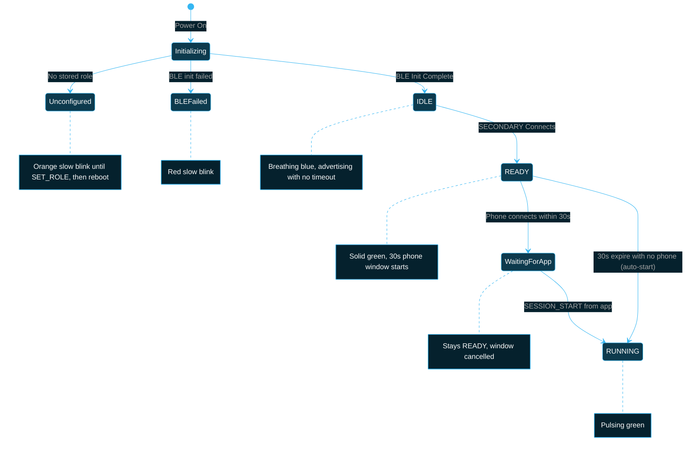
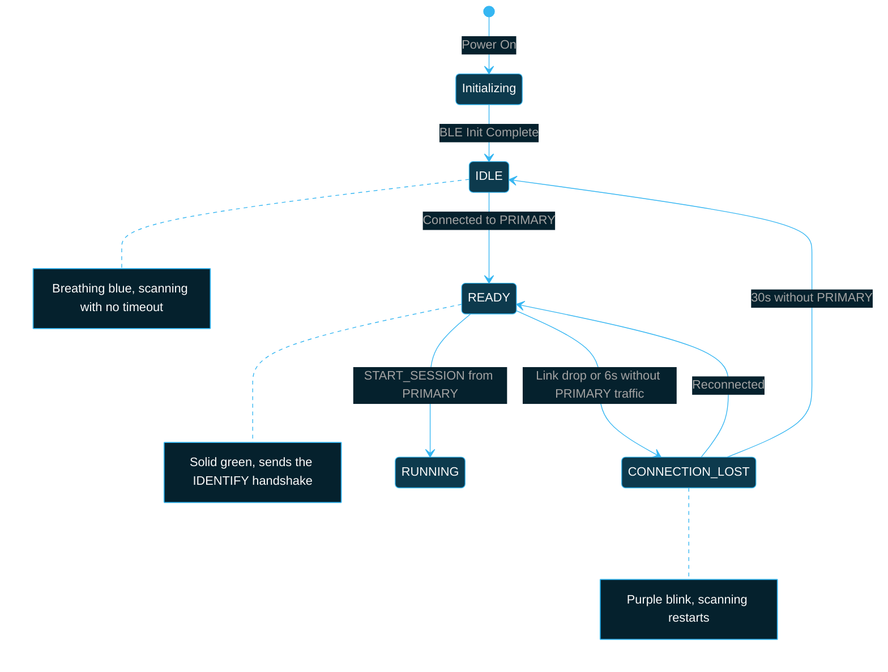

# BlueBuzzah Firmware Boot Sequence

**Comprehensive boot sequence documentation for bilateral haptic therapy system**

Version: 2.0.0
Platform: Arduino C++ on Adafruit Feather nRF52840 Express (v2) and Seeed XIAO ESP32-S3 / PentaBuzzer (v3)
Last Updated: 2025-01-11

---

## Table of Contents

- [Overview](#overview)
- [Boot Sequence Requirements](#boot-sequence-requirements)
- [PRIMARY Device Boot Sequence](#primary-device-boot-sequence)
- [SECONDARY Device Boot Sequence](#secondary-device-boot-sequence)
- [LED Indicator Reference](#led-indicator-reference)
- [Connection Requirements](#connection-requirements)
- [Timeout Behavior](#timeout-behavior)
- [Error Handling](#error-handling)
- [Timing Analysis](#timing-analysis)
- [Troubleshooting](#troubleshooting)
- [Implementation Details](#implementation-details)

---

## Overview

The BlueBuzzah boot sequence (`setup()` in `src/main.cpp`) initializes the LED, role, hardware and BLE stack, then leaves the device in IDLE while the PRIMARY advertises and the SECONDARY scans for it. There is no boot timeout: advertising and scanning continue until the pair connects. On the PRIMARY, a **30-second window** starts when the SECONDARY connects; if no phone connects within it, therapy auto-starts. Clear LED feedback provides visual indication of boot progress and of any init failure.

### Boot Sequence Goals

1. **Establish bilateral synchronization** between PRIMARY and SECONDARY devices
2. **Optional phone connection** for app control (not required for therapy)
3. **Visual feedback** via LED at every stage
4. **Never give up on the peer** - keep advertising/scanning until it appears
5. **Automatic fallback** to default therapy if no phone connects within 30 seconds of pairing

### Key Design Principles

- **Time-bounded auto-start**: 30-second phone window (`STARTUP_WINDOW_MS`), started when the SECONDARY connects
- **Phone optional**: the gloves run therapy on their own
- **User-friendly**: Clear LED indicators at each stage
- **Sync-gated start**: with the SECONDARY connected, therapy start waits for clock sync, falling back to a degraded start after ~10 seconds
- **Graceful degradation**: Default therapy if phone not connected

---

## Boot Sequence Requirements

### Minimum Requirements

**For PRIMARY Device:**
- Advertises until the SECONDARY connects (no timeout)
- Phone connection is optional

**For SECONDARY Device:**
- Scans until it finds and connects to the PRIMARY (no timeout)

**For System:**
- Auto-start requires the SECONDARY to be connected when the 30-second window expires
- A phone `SESSION_START` works with or without the SECONDARY. While the SECONDARY is connected it is refused with `Sync not ready` until clock sync is valid, or until 10 seconds (`SYNC_START_FALLBACK_MS`) after the SECONDARY connected
- Clock sync needs 5 valid PING/PONG samples (~350ms) after connecting, or 3 on a warm start

### Success Criteria

| Scenario | SECONDARY | Phone | Result |
|----------|-----------|-------|--------|
| Full Success | ✓ | ✓ (within 30 s of pairing) | App control; no auto-start |
| Partial Success | ✓ | ✗ | Automatic default therapy starts 30 s after pairing |
| No SECONDARY | ✗ | ? | PRIMARY stays IDLE (breathing blue) and keeps advertising; a phone can still start a PRIMARY-only session |
| No PRIMARY | ✗ | - | SECONDARY stays IDLE (breathing blue) and keeps scanning |

---

## Hardware Initialization Phase (BlueBuzzah v3 Only, Both Roles, Before BLE)

On BlueBuzzah v3 boards, before either role's BLE sequence begins,
`initializeHardware()` runs a **motor presence probe**: each DRV2605 channel
performs LRA auto-calibration, which can only converge with a motor
physically attached. Expect each populated motor to buzz ~0.5s at every boot
(~2-5s total) — this doubles as a power-on self-test. On nRF52 (v2) gloves
the probe never runs at boot; it is available on demand via the
`MOTOR_PRESENT` serial command.

- Detected motors feed the therapy engine's active-finger map: patterns are
  generated over present fingers only, and those indices reach SECONDARY
  inside macrocycle events, so both gloves skip a motor missing on PRIMARY.
- **Fewer than 4 motors detected** = assembly fault: logged over serial and
  indicated by a red double-blink LED for 5 seconds before boot continues.
- If the supply dips during the probe (USB-only power, no battery), the
  results are discarded as unreliable, a warning is logged, and no fault is
  indicated.
- The probe can be re-run at any time with the `MOTOR_PRESENT` serial command.

---

## PRIMARY Device Boot Sequence

The PRIMARY device acts as the central coordinator, advertising its presence and waiting for connections from both SECONDARY and phone. A new connection is classified as the SECONDARY when it sends `IDENTIFY:SECONDARY` within 1 second (`IDENTIFY_TIMEOUT_MS`); otherwise it is treated as a phone.

### State Diagram



### Detailed Steps

#### 1. Initialization Phase

**Duration**: 1-2 seconds, plus up to 3 seconds waiting for a USB serial host (skipped once a host opens the port) and, on v3, the motor presence probe

```cpp
// src/main.cpp - setup() (trimmed)

if (led.begin())
{
    led.setPattern(Colors::BLUE, LEDPattern::BLINK_CONNECT);
}

profiles.begin();
if (!profiles.hasStoredRole())
{
    waitForRoleConfiguration();   // orange slow blink; reboots after SET_ROLE
}
deviceRole = determineRole();

hardwareReady = initializeHardware();
if (hardwareReady)
{
    led.setPattern(Colors::CYAN, LEDPattern::BLINK_CONNECT);
}
else
{
    led.setPattern(Colors::RED, LEDPattern::BLINK_SLOW);
}

bleReady = initializeBLE();   // PRIMARY starts advertising inside ble.begin()
if (bleReady)
{
    // Start in IDLE state with breathing blue LED
    led.setPattern(Colors::BLUE, LEDPattern::BREATHE_SLOW);
}
else
{
    led.setPattern(Colors::RED, LEDPattern::BLINK_SLOW);
}
```

**LED Indicator**: blue connect-blink, then cyan connect-blink, then breathing blue (IDLE, 2s cycle)
**Purpose**: Initialize BLE stack and begin advertising

---

#### 2. Connection Wait Phase

**Duration**: unbounded (advertising runs until the SECONDARY connects)

```cpp
// src/main.cpp - onBLEConnect() (trimmed)

if ((deviceRole == DeviceRole::PRIMARY && type == ConnectionType::SECONDARY) ||
    (deviceRole == DeviceRole::SECONDARY && type == ConnectionType::PRIMARY))
{
    stateMachine.transition(StateTrigger::CONNECTED);   // IDLE -> READY (solid green)
}

if (deviceRole == DeviceRole::PRIMARY)
{
    if (type == ConnectionType::SECONDARY)
    {
        if (!autoStartTriggered)
        {
            // SECONDARY connected - start 30-second boot window for phone
            bootWindowStart = millis();
            bootWindowActive = true;
        }

        syncProtocol.resetClockSync();
        syncProtocol.tryWarmStart();   // warm start if the sync cache is < 15 s old
    }
    else if (type == ConnectionType::PHONE && bootWindowActive)
    {
        // Phone connected within boot window - cancel auto-start
        bootWindowActive = false;
    }
}
```

**LED Indicators**:
- **During wait**: breathing blue (IDLE) continues
- **SECONDARY connects**: solid green (READY)
- **Waiting for phone**: solid green (READY, phone has no distinct LED)

**Purpose**: Accept connections from SECONDARY and phone; start the 30-second phone window once the SECONDARY is connected

---

#### 3. Timeout Evaluation

**At 30 seconds after the SECONDARY connected**: `loop()` checks the window

```cpp
// src/main.cpp - loop()

if (deviceRole == DeviceRole::PRIMARY && bootWindowActive && !autoStartTriggered)
{
    uint32_t startSnapshot = bootWindowStart;
    uint32_t elapsed = millis() - startSnapshot;

    if (elapsed >= STARTUP_WINDOW_MS)
    {
        if (ble.isSecondaryConnected() && !ble.isPhoneConnected())
        {
            bootWindowActive = false;
            autoStartTriggered = true;
            autoStartTherapy();
        }
        else
        {
            // SECONDARY disconnected during window, cancel
            bootWindowActive = false;
        }
    }
}
```

**Outcomes**:
- **Phone connected within the window**: window cancelled; PRIMARY stays READY and waits for app commands
- **SECONDARY connected, no phone**: therapy auto-starts (`[BOOT] 30s window expired ... - auto-starting therapy`)
- **SECONDARY disconnected during the window**: window cancelled; it restarts when the SECONDARY reconnects (until auto-start has fired once)

---

#### 4. Ready State

**Final LED**: Solid green

The LED follows the state machine from here on (`onStateChange()` in `src/main.cpp`):

```cpp
case TherapyState::READY:
    led.setPattern(Colors::GREEN, LEDPattern::SOLID);
    break;
```

**Purpose**: Signal that device is ready to begin therapy

---

### PRIMARY Timeline Example

Times are illustrative. A battery boot with no USB serial host spends the first 3 seconds in the serial wait.

```
Time  | State                | LED                    | Connections
------|----------------------|------------------------|------------------
0.0s  | Initializing         | Blue Connect-Blink     | None
3.5s  | Hardware Init OK     | Cyan Connect-Blink     | None
4.0s  | IDLE (advertising)   | Breathing Blue         | None
6.0s  | READY                | Solid Green            | SECONDARY (30s window starts)
15.0s | Phone Connected      | Solid Green            | SECONDARY + Phone (window cancelled)
```

**Alternative Scenario** (No Phone):
```
Time  | State                | LED                    | Connections
------|----------------------|------------------------|------------------
0.0s  | Initializing         | Blue Connect-Blink     | None
3.5s  | Hardware Init OK     | Cyan Connect-Blink     | None
4.0s  | IDLE (advertising)   | Breathing Blue         | None
6.0s  | READY                | Solid Green            | SECONDARY (30s window starts)
36.0s | RUNNING (auto-start) | Pulsing Green          | SECONDARY
```

---

## SECONDARY Device Boot Sequence

The SECONDARY device actively scans for and connects to the PRIMARY device, matching its advert (Nordic UART service + BlueBuzzah manufacturer data) or, as a fallback, its "BlueBuzzah" name.

### State Diagram



### Detailed Steps

#### 1. Initialization Phase

**Duration**: 1-2 seconds (same `setup()` path and LED sequence as the PRIMARY)

`initializeBLE()` starts scanning for the SECONDARY role:

```cpp
// src/main.cpp - initializeBLE()

if (deviceRole == DeviceRole::SECONDARY)
{
    if (!ble.startScanning(BLE_NAME))
    {
        Serial.println(F("[ERROR] Failed to start scanning"));
        return false;
    }
    Serial.println(F("[BLE] Scanning started"));
}
```

**LED Indicator**: breathing blue (IDLE, 2s cycle)
**Purpose**: Initialize BLE stack for scanning

---

#### 2. Scanning Phase

**Duration**: unbounded (until PRIMARY found)

The scanner runs with no timeout (`start(0)`); its scan callback connects as soon as it sees a matching PRIMARY advert. See [BLE Scanning Parameters](#ble-scanning-parameters-secondary).

**LED Indicator**: breathing blue (IDLE) while scanning
**Purpose**: Find and connect to PRIMARY device

---

#### 3. Connection Success

**Duration**: < 1 second

**LED**: on connecting to PRIMARY the state goes directly to READY — solid green.

```cpp
// src/main.cpp - onBLEConnect()

if (deviceRole == DeviceRole::SECONDARY && type == ConnectionType::PRIMARY)
{
    Serial.println(F("[SECONDARY] Sending IDENTIFY:SECONDARY to PRIMARY"));
    ble.sendToPrimary("IDENTIFY:SECONDARY");
    // Start keepalive timeout tracking
    lastKeepaliveReceived = millis();
}
// ...then stateMachine.transition(StateTrigger::CONNECTED): IDLE -> READY
```

**Purpose**: Identify itself to the PRIMARY and confirm connection establishment to user

---

#### 4. No Boot Timeout

If the PRIMARY is never found, the SECONDARY stays in IDLE (breathing blue) and keeps scanning; there is no failure state.

Once connected, 6 seconds without a PING or macrocycle from the PRIMARY (`KEEPALIVE_TIMEOUT_MS`) runs `handleKeepaliveTimeout()`: motors stop, the state goes to CONNECTION_LOST (purple blink) and scanning restarts.

---

### SECONDARY Timeline Example

**Successful Boot**:
```
Time  | State                | LED                    | Status
------|----------------------|------------------------|------------------
0.0s  | Initializing         | Blue Connect-Blink     | BLE init
3.5s  | Hardware Init OK     | Cyan Connect-Blink     | Hardware ready
4.0s  | IDLE (scanning)      | Breathing Blue         | Looking for PRIMARY
5.5s  | READY                | Solid Green            | Connected, awaiting commands
```

**PRIMARY not found**:
```
Time  | State                | LED                    | Status
------|----------------------|------------------------|------------------
0.0s  | Initializing         | Blue Connect-Blink     | BLE init
3.5s  | Hardware Init OK     | Cyan Connect-Blink     | Hardware ready
4.0s  | IDLE (scanning)      | Breathing Blue         | Looking for PRIMARY
...   | IDLE (scanning)      | Breathing Blue         | Still searching (no timeout)
```

---

## LED Indicator Reference

### Complete LED Color and Pattern Guide

Colors/patterns below are the shipping firmware behavior (`src/main.cpp` boot
sequence and `onStateChange`). See `docs/API_REFERENCE.md#led-controller` for the
full pattern-timing table.

| Boot phase | Color | Pattern | Timing | Meaning |
|-------|-------|---------|-----------|---------|
| **LED initialized** | Blue | Connect blink | 250 ms on/off | early boot, LED up |
| **No role configured** | Orange | Slow blink | 1 s on/off | `SET_ROLE` not yet run |
| **Missing/Failed Motor(s)** | Red | Double blink | 2 blinks/pause, shown 5 s | v3 boot probe found fewer than 4 motors |
| **Hardware init success** | Cyan | Connect blink | 250 ms on/off | motors/mux/battery OK |
| **Hardware init failed** | Red | Slow blink | 1 s on/off | a hardware subsystem failed (replaced by blue breathe if BLE then starts) |
| **BLE ready (enters IDLE)** | Blue | Breathe | 2 s cycle | BLE up, waiting to pair/connect |
| **BLE init failed** | Red | Slow blink | 1 s on/off | BLE stack failed to start |
| **Ready** | Green | Solid | - | glove pair connected, ready for therapy |

> Note: on pairing the state goes directly to **READY (solid green)**; there is no
> separate connect flash, and phone presence is not shown with a distinct LED.

> A low battery (below `BATTERY_LOW_VOLTAGE`) turns blue breathe and solid green
> orange, from the glove's first battery check on its first idle loop; a critical
> battery is red urgent blink. Orange slow blink always means no role.

### LED Pattern Details

Each entry is `led.setPattern(color, pattern)` in `src/main.cpp`. Pattern timings
are defined in `include/config.h` (see `docs/API_REFERENCE.md#led-controller`).

- **Blue connect-blink** (`Colors::BLUE, BLINK_CONNECT`, 250 ms) — LED just
  initialized, early boot. Both roles.
- **Cyan connect-blink** (`Colors::CYAN, BLINK_CONNECT`, 250 ms) — hardware init
  (motors, mux, battery) succeeded. Both roles.
- **Blue breathe** (`Colors::BLUE, BREATHE_SLOW`, 2 s) — BLE up; device is in IDLE
  waiting to pair / connect. Both roles.
- **Solid green** (`Colors::GREEN, SOLID`) — glove pair connected; state is READY.
  On session start this changes to green `PULSE_SLOW` (or off, if "LED off during
  therapy" is enabled).
- **Red slow blink** (`Colors::RED, BLINK_SLOW`, 1 s) — a boot step failed
  (hardware or BLE init). Boot continues either way; after a hardware failure the
  LED switches to blue breathe once BLE starts, so only a BLE failure stays red.
- **Red double-blink** (`Colors::RED, DOUBLE_BLINK`, 5 s) — v3 boot motor probe found
  fewer than 4 motors, then boot continues.
- **Orange slow blink** (`Colors::ORANGE, BLINK_SLOW`, 1 s) — no role configured
  yet (run `SET_ROLE`).

### Boot LED Timeline

```
Boot (both roles), success:
[blue connect-blink]   LED init
      -> [orange slow blink]    no role set (until SET_ROLE, then reboot)
      -> [red double-blink 5s]  v3 only, if the motor probe found <4 motors
      -> [cyan connect-blink]   hardware init OK
      -> [blue breathe]         BLE ready, IDLE (waiting to pair)
      -> [SOLID GREEN]          glove pair connected, READY

Boot, failure:
      -> [red slow blink]       hardware init failed (until BLE starts) or BLE init failed (until restart)
```

## Connection Requirements

### BLE Advertisement Parameters (PRIMARY)

```cpp
// src/ble_manager_nrf52.cpp (nRF52 backend shown; the NimBLE backend uses the same intervals)

void BLEManager::setupAdvertising() {
    Bluefruit.Advertising.addFlags(BLE_GAP_ADV_FLAGS_LE_ONLY_GENERAL_DISC_MODE);
    Bluefruit.Advertising.addTxPower();
    Bluefruit.Advertising.addService(_uartService);
    static const uint8_t mfgData[] = BLE_MFG_DATA_INIT;
    Bluefruit.Advertising.addManufacturerData(mfgData, sizeof(mfgData));
    Bluefruit.ScanResponse.addName();

    Bluefruit.Advertising.restartOnDisconnect(true);
    Bluefruit.Advertising.setInterval(BLE_ADV_FAST_MIN_UNITS, BLE_ADV_FAST_MAX_UNITS);  // 20ms - 152.5ms
    Bluefruit.Advertising.setFastTimeout(30);    // Fast mode for 30 seconds
    Bluefruit.Advertising.start(0);              // 0 = Don't stop advertising
}

void BLEManager::updateAdvertisingInterval() {
    if (isSecondaryConnected()) {
        Bluefruit.Advertising.setInterval(BLE_ADV_SLOW_UNITS, BLE_ADV_SLOW_UNITS);  // 500ms
    } else {
        Bluefruit.Advertising.setInterval(BLE_ADV_FAST_MIN_UNITS, BLE_ADV_FAST_MAX_UNITS);
    }
    // restarts advertising if running so the new interval applies
}
```

**Rationale**:
- Fast 20-152.5ms advertising while the SECONDARY slot is free, so the SECONDARY (re)connects quickly
- Slow 500ms advertising once the SECONDARY is connected: only the phone slot is left, and fast adverts would take airtime from the sync link
- Advertising restarts whenever a peripheral link drops (nRF52: `_onPeriphDisconnect` restarts it if stopped, since Bluefruit's `restartOnDisconnect` only fires once no links remain; NimBLE: `advertiseOnDisconnect`)
- Advertises without a timeout (`start(0)`), so the SECONDARY can connect whenever it powers on, and on every reconnect
- Name "BlueBuzzah" (scan response) identifies the device; the SECONDARY can match earlier on the service UUID + manufacturer data in the main advert

---

### BLE Scanning Parameters (SECONDARY)

```cpp
// src/ble_manager_nrf52.cpp (nRF52 backend shown; the NimBLE backend uses the same timing)

bool BLEManager::startScanning(const char* targetName) {
    Bluefruit.Scanner.setRxCallback(_onScanCallback);
    Bluefruit.Scanner.filterRssi(-90);
    if (getConnectionCount() == 0) {
        Bluefruit.Scanner.setInterval(160, 160);  // 100ms interval, 100ms window
    } else {
        Bluefruit.Scanner.setInterval(320, 60);   // 200ms interval, 37.5ms window (19% duty)
    }
    Bluefruit.Scanner.useActiveScan(true);   // Request scan response for name
    return Bluefruit.Scanner.start(0);       // 0 = Don't stop
}
```

**Rationale**:
- Continuous scanning (100ms window every 100ms) while disconnected keeps reconnects fast
- The 19% duty cycle applies only when a false keepalive timeout restarts scanning with the link still up, so the scan doesn't crowd out sync traffic
- A PRIMARY matches on the Nordic UART service plus the BlueBuzzah manufacturer data in its main advert; the "BlueBuzzah" name (scan response, via active scanning) is the fallback
- Scans without a timeout (`start(0)`) until the PRIMARY is found

---

### Connection Validation

The SECONDARY (the BLE central) checks that the PRIMARY exposes the UART service before it reports the connection, and drops the link if it doesn't:

```cpp
// src/ble_manager_nrf52.cpp - SECONDARY central connect callback (trimmed)

if (g_bleManager->_clientUart.discover(connHandle)) {
    Serial.println(F("[BLE] UART service discovered, enabling notifications"));
    g_bleManager->_clientUart.enableTXD();
} else {
    Serial.println(F("[BLE] ERROR: UART service not found on PRIMARY"));
    Bluefruit.disconnect(connHandle);
    return;
}
```

Connection parameters are never grounds for rejecting a link. Both roles query and log the negotiated interval, warning when it exceeds `BLE_INTERVAL_WARNING_THRESHOLD_MS` (12ms):

```cpp
// src/ble_manager_nrf52.cpp - queryConnectionInterval() (trimmed)

float intervalMs = intervalUnits * 1.25f;

if (intervalMs > BLE_INTERVAL_WARNING_THRESHOLD_MS) {
    Serial.printf("[BLE] WARN: %s interval %.1fms exceeds target (%.1f-%.1fms)\n",
                  typeName, intervalMs,
                  static_cast<double>(BLE_INTERVAL_MIN_MS),
                  static_cast<double>(BLE_INTERVAL_MAX_MS));
} else {
    Serial.printf("[BLE] %s connection interval: %.1fms\n", typeName, intervalMs);
}
```

---

### Initial Time Synchronization (IEEE 1588 PTP-style)

After PRIMARY-SECONDARY connection, clock synchronization is established using a PING/PONG protocol inspired by IEEE 1588 PTP (Precision Time Protocol):

```
PING/PONG 4-Timestamp Synchronization:

PRIMARY                              SECONDARY
   |                                     |
   |--- T1: Send PING:seq|T1 --------->  |
   |                                  T2: Receive PING
   |                                  T3: Send PONG
   |  <-- PONG:seq|tx_micros|T2|T3 ------|
T4: Receive PONG                         |
   |                                     |

Clock offset = ((T2 - T1) + (T3 - T4)) / 2
RTT = (T4 - T1) - (T3 - T2)
```

**Configuration (from config.h):**
```cpp
#define SYNC_ACQUIRE_INTERVAL_MS 70  // PING/PONG every 70ms until sync is valid (cold or warm start)
#define SYNC_ACTIVE_INTERVAL_MS 250  // PING/PONG every 250ms during therapy
#define KEEPALIVE_INTERVAL_MS 1000   // PING/PONG every 1 second when idle
#define SYNC_MIN_VALID_SAMPLES 5     // Minimum samples before sync valid
#define SYNC_RTT_QUALITY_THRESHOLD_US 60000  // Reject samples with RTT > 60ms
#define SYNC_OFFSET_EMA_ALPHA_NUM 1  // EMA smoothing α = 1/10 = 0.1
#define SYNC_OFFSET_EMA_ALPHA_DEN 10
```

**Synchronization Quality:**
- Clock synchronization is continuously maintained via PING/PONG (every 70ms until sync is valid, so 5 samples take ~350ms; then 250ms during therapy, 1 second idle)
- EMA (Exponential Moving Average) smooths offset measurements
- Outlier rejection filters samples with high RTT (>60ms)
- Drift rate tracking compensates for crystal oscillator differences
- Sub-millisecond precision achieved after 5+ valid samples

**Warm-Start Recovery:**
After brief disconnects (<15 seconds), sync state is cached and recovery is faster:
```cpp
#define SYNC_WARM_START_VALIDITY_MS 15000  // Cache valid for 15 seconds
#define SYNC_WARM_START_MIN_SAMPLES 3      // Only 3 confirmatory samples needed (~210ms at the acquire cadence)
```

This ensures sub-millisecond bilateral synchronization during therapy.

---

## Timeout Behavior

### 30-Second Boot Window

The 30-second window is **PRIMARY-only** and begins when the SECONDARY connects, not at power-on. It exists to give a phone time to connect before therapy auto-starts. It runs once per boot: after auto-start has fired, later SECONDARY reconnects don't restart it.

```cpp
// include/config.h
#define STARTUP_WINDOW_MS 30000      // 30 seconds boot timeout
```

Advertising (PRIMARY) and scanning (SECONDARY) have no timeout of their own.

---

### Timeout Scenarios

#### PRIMARY Timeout Scenarios

| Scenario | Connections | Timeout Action | LED | Result |
|----------|-------------|----------------|-----|--------|
| No devices | None | None (window never starts) | Breathing Blue | IDLE, still advertising |
| SECONDARY only | SECONDARY | Auto-start therapy | Pulsing Green | RUNNING |
| SECONDARY + Phone | Both | Window cancelled when the phone connected | Solid Green | READY, waits for app commands |
| SECONDARY drops during window | None | Window cancelled | Purple Blink | CONNECTION_LOST; window restarts on reconnect |

#### Auto-Start Therapy (No Phone)

When the window expires with the SECONDARY connected and no phone, `autoStartTherapy()` starts a session:

1. **Default Profile**: Uses the current (saved) therapy profile; if none is loaded, the built-in `noisy_vcr` profile
2. **Duration**: The profile's session duration (120 minutes for the built-in vCR profiles)
3. **Pattern**: The profile's pattern type, timing, jitter and mirroring
4. **Battery gate**: If either glove's battery is low (below `BATTERY_LOW_VOLTAGE`), it doesn't start (`[AUTO] Battery too low - not starting`) and auto-start doesn't run again this boot
5. **Sync gate**: If clock sync isn't valid yet it retries every second; after 10 retries it starts anyway (`[AUTO] Sync not valid after 10s - starting therapy (timing may be degraded)`)
6. **No User Intervention**: Therapy begins automatically when the 30-second window expires without a phone connection

This "auto-start" behavior allows the system to function as a standalone therapy device without requiring a phone app. Users can simply power on both devices and therapy will begin about 30 seconds after the gloves pair.

**To override auto-start**: Connect phone app within 30 seconds of the gloves pairing.

---

#### SECONDARY Timeout Scenarios

| Scenario | Connection | Timeout Action | LED | Result |
|----------|------------|----------------|-----|--------|
| PRIMARY found | Connected | N/A | Solid Green | READY |
| PRIMARY not found | None | None (keeps scanning) | Breathing Blue | IDLE |

---

### Timeout Extension

**The boot window is NOT extended** while the SECONDARY stays connected, even if a phone is expected. If the SECONDARY disconnects, the window is cancelled and starts over when it reconnects (until auto-start has fired once).

**Rationale**:
- Predictable user experience
- Prevents indefinite waiting
- Allows automatic default therapy if phone not available

---

## Error Handling

### Connection Failure Modes

#### 1. No SECONDARY Connection (PRIMARY)

**Symptom**: PRIMARY stays breathing blue (IDLE); there is no boot failure state

**Causes**:
- SECONDARY not powered on
- SECONDARY out of range
- BLE interference
- Hardware failure

**LED**: Breathing blue

**Recovery**: Power on the SECONDARY or bring it in range; the PRIMARY keeps advertising and accepts it whenever it connects

---

#### 2. No PRIMARY Found (SECONDARY)

**Symptom**: SECONDARY stays breathing blue (IDLE) and keeps scanning

**Causes**:
- PRIMARY not powered on
- PRIMARY out of range
- BLE interference
- Hardware failure

**LED**: Breathing blue

**Recovery**: Power on the PRIMARY or bring it in range; the SECONDARY connects as soon as it sees the advert

---

#### 3. Connection Drops During Boot

**Symptom**: Connection established but drops before boot completes

**Causes**:
- BLE interference
- Devices moved out of range
- Low battery
- Hardware issue

**Detection**:
```cpp
// src/main.cpp - onBLEDisconnect() (trimmed)

if ((deviceRole == DeviceRole::PRIMARY && type == ConnectionType::SECONDARY) ||
    (deviceRole == DeviceRole::SECONDARY && type == ConnectionType::PRIMARY))
{
    stateMachine.transition(StateTrigger::DISCONNECTED);   // READY -> CONNECTION_LOST

    if (deviceRole == DeviceRole::PRIMARY && bootWindowActive)
    {
        bootWindowActive = false;
        Serial.println(F("[BOOT] SECONDARY disconnected - boot window cancelled"));
    }
}
```

**LED**: Purple fast blink (CONNECTION_LOST) for up to 30 seconds (`CONNECTION_LOST_TIMEOUT_MS`), then breathing blue (IDLE)

**Recovery**: Automatic. The PRIMARY keeps advertising and the SECONDARY rescans; on reconnect the state returns to READY and, if auto-start hasn't run yet, the 30-second window starts again

---

#### 4. High Connection Interval

**Symptom**: Connection established but the negotiated interval is above the 7.5-10ms target

**Causes**:
- BLE negotiation failure
- Incompatible BLE settings

**Detection**: logged only, never rejected (see [Connection Validation](#connection-validation)):
```
[BLE] WARN: SECONDARY interval 15.0ms exceeds target (7.5-10.0ms)
```

**Recovery**: Retry connection or power cycle

---

### Error Logging

Boot errors are printed to serial as they happen; there is no separate error log. Typical lines:

```
[ERROR] Haptic controller initialization failed
[ERROR] Battery monitor initialization failed
[WARNING] Some hardware initialization failed
[ERROR] Missing/failed motor(s): 3/5 detected (minimum 4) - check JST connections
[ERROR] BLE begin() failed
[FAILURE] BLE initialization failed
[ERROR] Failed to start scanning
```

---

## Timing Analysis

### Boot Sequence Fixed Waits

| Step | Time | Source |
|------|------|--------|
| USB serial wait | Up to 3s (ends as soon as a serial host opens the port) | `setup()` |
| Post-role delay | 500ms | `setup()` |
| Motor presence probe (v3 only) | ~0.5s per motor (~2-5s) | `initializeHardware()` |
| Missing-motor indication (v3, < 4 motors) | 5s | `initializeHardware()` |
| SECONDARY identification | Up to 1s (`IDENTIFY_TIMEOUT_MS`) | BLE manager |
| Initial clock sync | ~350ms cold (5 samples at 70ms), ~210ms warm (3 samples) | `config.h` |
| Phone window before auto-start | 30s after the SECONDARY connects | `STARTUP_WINDOW_MS` |
| Auto-start sync wait | Up to 10 retries, 1s apart | `autoStartTherapy()` |

---

### Typical Boot Timeline (Success)

Illustrative, for a battery boot with no USB serial host:

```
Event                          | Time    | Duration | Cumulative
-------------------------------|---------|----------|------------
Power On                       | 0.0s    | -        | 0.0s
USB Serial Wait (no host)      | 0.0s    | 3.0s     | 3.0s
Post-Role Delay                | 3.0s    | 0.5s     | 3.5s
Hardware + BLE Init            | 3.5s    | ~0.5s    | ~4.0s
Advertising/Scanning           | ~4.0s   | varies   | -
Connection + IDENTIFY          | -       | < 1s     | -
Initial Sync                   | -       | ~0.35s   | -
```

On v3 the motor presence probe adds ~2-5s to hardware init.

---

### BLE Connection Latency

**Configuration (from config.h):**
```cpp
#define BLE_INTERVAL_MIN_MS 7.5f     // Minimum connection interval (BLE spec minimum)
#define BLE_INTERVAL_MAX_MS 10       // Maximum connection interval
#define BLE_TIMEOUT_MS 6000          // Supervision timeout (6 seconds)
#define BLE_INTERVAL_WARNING_THRESHOLD_MS 12.0f  // Warn if > 12ms
#define BLE_PHONE_INTERVAL_MIN_UNITS 24  // 30ms phone link interval (1.25ms units)
#define BLE_PHONE_INTERVAL_MAX_UNITS 40  // 50ms
```

The 7.5-10ms range applies to the glove link. The phone link is requested at 30-50ms with no peripheral latency, so command traffic doesn't take radio time from the sync link.

**Effective Latency**:
- Minimum: 7.5ms (one connection interval)
- Maximum: 20ms (two connection intervals at negotiated max)
- Average: ~10ms
- Warning threshold: 12ms (firmware logs warning if exceeded)

**Sub-millisecond Synchronization**: Achieved through:
1. 7.5-10ms glove-link BLE connection interval
2. IEEE 1588 PTP-style clock offset calculation
3. EMA-smoothed offset tracking with drift compensation
4. Periodic PING/PONG keepalive (every 70ms until clock sync is valid, 250ms during therapy, 1 second idle)

---

## Troubleshooting

### Problem: Devices Stuck on Breathing Blue LED

**Symptoms**:
- LED continues breathing blue (IDLE) indefinitely
- No connection established
- Both devices powered on

**Possible Causes**:
1. Devices out of range (> 1-2 meters)
2. BLE interference (Wi-Fi, other devices)
3. One device not actually powered on
4. Both devices configured with the same role
5. Hardware failure

**Solutions**:

1. **Verify Both Devices Powered On**:
   - Check that both LEDs are breathing blue (orange on a low battery)
   - Verify battery voltage (> 3.8V)
   - Check USB connections if using USB power

2. **Reduce Distance**:
   - Place devices within 0.5 meters
   - Remove obstructions between devices
   - Avoid metal surfaces

3. **Check Settings Files**:
   - Use serial monitor to verify device role is correct (`[ROLE] Device configured as: ...`)
   - The role is stored in `/settings.bin` (InternalFS on nRF52, LittleFS on ESP32-S3); a device without a stored role blinks orange instead

4. **Reduce BLE Interference**:
   - Move away from Wi-Fi routers
   - Turn off nearby Bluetooth devices
   - Avoid 2.4GHz congested areas

5. **Power Cycle Both Devices**:
   - Turn off both devices
   - Wait 5 seconds
   - Power on both devices

---

### Problem: Device Shows Slow Red Blink After Boot

**Symptoms**:
- LED shows slow red blink after boot instead of breathing blue
- Device never pairs

**Possible Causes**:
1. BLE stack failed to start (`[FAILURE] BLE initialization failed`)
2. SECONDARY could not start scanning (`[ERROR] Failed to start scanning`)

A hardware init failure also shows a slow red blink, but only until BLE starts; check serial for `[ERROR]` lines even when the LED looks normal.

**Solutions**:

1. **Verify Device Roles**:
   - Check serial monitor for device role output
   - PRIMARY should show `[ROLE] Device configured as: PRIMARY`
   - SECONDARY should show `[ROLE] Device configured as: SECONDARY`

2. **Reflash Firmware**:
   ```bash
   pio run -e <env> -t upload
   ```

3. **Test Hardware**:
   - Check serial monitor for I2C errors
   - Verify BLE initialization succeeds

---

### Problem: Boot Succeeds But Therapy Fails

**Symptoms**:
- Boot completes successfully (green LED)
- Therapy starts but motors don't activate
- Or therapy immediately errors

**Possible Causes**:
1. Haptic hardware not initialized
2. I2C communication failure
3. Bilateral synchronization lost
4. Initial sync failed
5. Running on USB power only: motors run from the battery (`[POWER] USB power detected - motors still require a charged battery`)

**Solutions**:

1. **Test Haptic Hardware**:
   - Enter calibration mode (`CALIBRATE_START`, then `CALIBRATE_BUZZ`)
   - Test each finger individually

2. **Verify I2C Communication**:
   - Check serial monitor for I2C addresses
   - Should see 0x70 (multiplexer), 0x5A (DRV2605 per channel)

3. **Check Sync Protocol**:
   - Verify time offset was established
   - Check for SYNC errors in serial output

---

### Problem: Intermittent Boot Failures

**Symptoms**:
- Boot sometimes succeeds, sometimes fails
- No consistent pattern
- Hardware seems functional

**Possible Causes**:
1. Environmental BLE interference varies
2. Battery voltage borderline low
3. Timing-dependent race condition
4. Memory fragmentation

**Solutions**:

1. **Monitor Battery Voltage**:
   - Check serial output for battery status
   - Should be > 3.5V for reliable operation

2. **Enable Debug Logging**:
   - Add Serial.print statements to track boot progress

---

## Implementation Details

### Boot Sequence in main.cpp

The boot sequence is orchestrated in `main.cpp`:

```cpp
// src/main.cpp (trimmed)

void setup()
{
    Serial.begin(115200);

    // Wait for serial with timeout
    uint32_t serialWaitStart = millis();
    while (!Serial && (millis() - serialWaitStart < 3000))
    {
        delay(10);
    }

    power.begin();      // Penta: peripheral 3V3 rail (no-op on nRF)
    led.begin();        // blue connect-blink

    // 1. Role (blocks with orange blink until SET_ROLE if none is stored)
    profiles.begin();
    if (!profiles.hasStoredRole())
    {
        waitForRoleConfiguration();   // never returns - reboots after SET_ROLE
    }
    deviceRole = determineRole();
    delay(500);

    // 2. Hardware, then BLE - boot continues even if either fails
    hardwareReady = initializeHardware();   // cyan blink, or red slow blink
    bleReady = initializeBLE();             // breathing blue, or red slow blink

    // 3. Therapy engine, state machine (LED follows state from here on), menu
    initializeTherapy();
    stateMachine.begin(TherapyState::IDLE);
    stateMachine.onStateChange(onStateChange);
    menu.begin(&therapy, &battery, &haptic, &stateMachine, &profiles, &ble);
    deferredQueue.setExecutor(executeDeferredWork);
}
```

---

### LED Controller Class

`LEDController` lives in `include/hardware.h` (implemented in `src/hardware.cpp`)
and exposes a generic color+pattern API. State→LED decisions are made by the
caller in `src/main.cpp`, not inside the controller.

```cpp
// include/hardware.h

class LEDController {
public:
    bool begin();
    void update();                                             // call every loop() to animate
    void setPattern(const RGBColor& color, LEDPattern pattern);
    void setColor(uint8_t r, uint8_t g, uint8_t b);           // SOLID
    void setColor(const RGBColor& color);                      // SOLID
    void off();
    void setBrightness(uint8_t brightness);
    RGBColor getColor() const;
    LEDPattern getPattern() const;

private:
    Adafruit_NeoPixel _pixel;
    // ...
};
```

Example (from the boot sequence): `led.setPattern(Colors::BLUE, LEDPattern::BREATHE_SLOW);`

---

## Best Practices

### For Reliable Boot

1. **Power on both devices** (order doesn't matter; they pair whenever both are up)
2. **Keep devices close** (< 1 meter) during boot
3. **Ensure good battery charge** (> 3.5V)
4. **Avoid BLE interference** (Wi-Fi routers, other Bluetooth devices)
5. **Use clean power source** (good battery or stable USB)
6. **Monitor LED feedback** for diagnostic information

### For Troubleshooting

1. **Check LED patterns** first - they tell the story
2. **Monitor serial console** for detailed logs
3. **Test one component at a time** (BLE, haptic, etc.)
4. **Use calibration mode** to verify hardware
5. **Check settings files** before assuming hardware failure

### For Development

1. **Use mock implementations** for testing without hardware
2. **Enable debug logging** for detailed diagnostics
3. **Monitor timing** with millis() measurements
4. **Test timeout scenarios** explicitly
5. **Validate all LED patterns** visually

---

## Summary

The BlueBuzzah boot sequence is a **safety-critical** operation that establishes bilateral synchronization between PRIMARY and SECONDARY devices. Key points:

- **No boot timeout** - devices advertise/scan until the pair connects
- **30-second phone window** after pairing, then auto-start
- **Clear LED feedback** at every stage
- **Sync-gated start** - therapy waits for clock sync, with a degraded-mode fallback after ~10 seconds
- **Graceful degradation** - default therapy if phone not connected
- **Comprehensive error handling** with recovery guidance

Auto-start therapy begins only when:
1. The SECONDARY is connected when the 30-second window expires
2. No phone connected during the window
3. Neither glove's battery is low
4. Bilateral time synchronization is established, or 10 one-second retries have passed
5. Auto-start has not already run since boot

---

## Additional Resources

- [API Reference](API_REFERENCE.md) - Complete API documentation
- [Architecture Guide](ARCHITECTURE.md) - System design and patterns

---

**Platform**: Arduino C++ with PlatformIO
**Last Updated**: 2025-01-11
**Document Version**: 2.0.0
