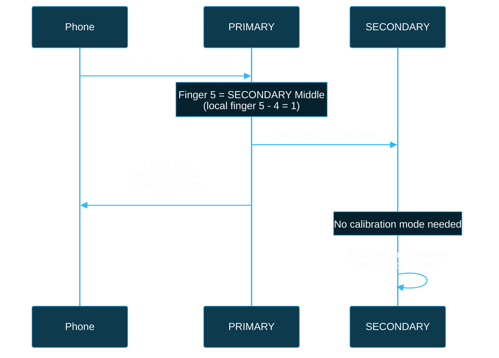

# BlueBuzzah Calibration Guide
**Version:** 2.0.0
**Date:** 2025-01-23
**Platform:** Arduino C++ / PlatformIO
**Module**: MenuController calibration commands (src/menu_controller.cpp)

---

## Table of Contents

1. [Overview](#overview)
2. [Calibration Architecture](#calibration-architecture)
3. [Finger Mapping](#finger-mapping)
4. [Calibration Workflow](#calibration-workflow)
5. [PRIMARY→SECONDARY Relay Protocol](#primarysecondary-relay-protocol)
6. [Intensity Mapping](#intensity-mapping)
7. [Clinical Tuning Guidelines](#clinical-tuning-guidelines)
8. [Troubleshooting](#troubleshooting)
9. [Assembly QA (BlueBuzzah v3)](#assembly-qa-bluebuzzah-v3)

---

## Terminology Note

This document uses the following device role terminology:
- **PRIMARY**: Initiates calibration, controls phone connection
- **SECONDARY**: Receives relayed commands via PRIMARY

Both devices run identical firmware and advertise as "BlueBuzzah". Role is stored in `/settings.bin` (set over serial with `SET_ROLE:PRIMARY` / `SET_ROLE:SECONDARY`). The calibration commands are handled only by the PRIMARY: the phone (or a USB serial terminal) talks to the PRIMARY, which relays SECONDARY buzzes.

> **Motor counts:** the examples in this guide use the 4-finger BlueBuzzah
> (8 motors per pair, finger indices 0–7). The 5-finger BlueBuzzah v3 adds a
> thumb: 10 motors per pair, local indices 0–4 and remote 5–9. Firmware
> validation derives from `MAX_ACTUATORS` (`0..2*MAX_ACTUATORS-1`), so adjust
> the index ranges and totals below accordingly. The phone app must use the
> matching index scheme for the connected board.

---

## Overview

### Purpose

Calibration mode allows individual finger motor testing for:
- **Hardware Verification**: Confirm all 8 motors functional
- **Intensity Tuning**: Find optimal vibration strength per finger
- **User Comfort**: Adjust for individual sensation thresholds
- **Diagnostic Testing**: Identify motor failures or loose connections

### Features

- Test all 8 motors individually (0-7)
- Adjustable intensity (0-100%)
- Configurable duration (50-2000ms)
- **PRIMARY→SECONDARY relay**: Phone can test SECONDARY motors via PRIMARY
- Real-time feedback via BLE responses

---

## Calibration Architecture

### CalibrationMode Integration

**File**: `src/menu_controller.cpp`

Calibration functionality is integrated into the MenuController class in the Arduino C++ implementation.

**State Variables** (`include/menu_controller.h`):

```cpp
class MenuController {
private:
    bool _isCalibrating;              // Calibration state flag
    uint32_t _calibrationStartTime;

    // Active one-shot calibration buzz. Touched ONLY from loop() context
    // (via updateCalibrationBuzz()) so these stay plain fields.
    int8_t _calibBuzzFinger;      // -1 = none
    uint32_t _calibBuzzOffTime;   // millis() deadline to deactivate

    // Pending calibration-buzz handoff, consumed from loop() context
    volatile int8_t _calibBuzzPendingFinger;
    volatile uint8_t _calibBuzzPendingIntensity;
    volatile uint16_t _calibBuzzPendingDuration;
    volatile bool _calibBuzzCancelPending;
    volatile bool _calibBuzzRequestPending;  // publish flag: set last
};
```

### State Management

**Enter Calibration** (menu_controller.cpp):

```cpp
void MenuController::handleCalibrateStart() {
    if (_therapy && _therapy->isRunning()) {
        sendError("Cannot calibrate during active session");
        return;
    }

    _isCalibrating = true;
    _calibrationStartTime = millis();

    beginResponse();
    addResponseLine("MODE", "CALIBRATION");
    sendResponse();
}
```

**Exit Calibration** (menu_controller.cpp):

```cpp
void MenuController::handleCalibrateStop() {
    _isCalibrating = false;

    // Cancel any pending/in-flight one-shot so it cannot reactivate a motor
    cancelCalibrationBuzz();

    // Stop any relayed buzz still running on the SECONDARY glove
    if (_sendToSecondaryCallback && _ble && _ble->isSecondaryConnected()) {
        _sendToSecondaryCallback("CALIB_STOP");
    }

    // A stop must take effect immediately, not one loop iteration later
    if (_haptic) {
        _haptic->emergencyStop();
    }

    beginResponse();
    addResponseLine("MODE", "NORMAL");
    sendResponse();
}
```

Every reply starts with a `CMD:<COMMAND>` line and ends with EOT (`\x04`), for example `CMD:CALIBRATE_START\nMODE:CALIBRATION\n\x04`. The examples below omit the `CMD` line, as the [BLE Protocol](https://github.com/BlueBuzzah/BlueBuzzah-Firmware/wiki/BLE-Protocol) does.

---

## Finger Mapping

### Physical Layout

```text
PRIMARY GLOVE:                  SECONDARY GLOVE:
┌─────────────────────┐        ┌─────────────────────┐
│  0: Index           │        │  4: Index           │
│  1: Middle          │        │  5: Middle          │
│  2: Ring            │        │  6: Ring            │
│  3: Pinky           │        │  7: Pinky           │
└─────────────────────┘        └─────────────────────┘
```

### Index-to-Finger Mapping

| Index | Glove | Finger | Motor Channel | Control Path |
|-------|-------|--------|---------------|--------------|
| 0 | PRIMARY | Index | 0 | Direct (PRIMARY local) |
| 1 | PRIMARY | Middle | 1 | Direct (PRIMARY local) |
| 2 | PRIMARY | Ring | 2 | Direct (PRIMARY local) |
| 3 | PRIMARY | Pinky | 3 | Direct (PRIMARY local) |
| 4 | SECONDARY | Index | 0 | Relay (PRIMARY → SECONDARY) |
| 5 | SECONDARY | Middle | 1 | Relay (PRIMARY → SECONDARY) |
| 6 | SECONDARY | Ring | 2 | Relay (PRIMARY → SECONDARY) |
| 7 | SECONDARY | Pinky | 3 | Relay (PRIMARY → SECONDARY) |

**Motor Channel Calculation**:
```cpp
// PRIMARY (fingers 0 .. MAX_ACTUATORS-1)
uint8_t motorChannel = finger;                  // 0→0, 1→1, 2→2, 3→3

// SECONDARY (fingers MAX_ACTUATORS .. 2*MAX_ACTUATORS-1)
uint8_t motorChannel = finger - MAX_ACTUATORS;  // 4→0, 5→1, 6→2, 7→3 (v2)
```

---

## Calibration Workflow

### BLE Command Sequence

**Complete Calibration Session**:

```text
1. Phone → PRIMARY: CALIBRATE_START\x04
2. PRIMARY → Phone: MODE:CALIBRATION\n\x04

3. Phone → PRIMARY: CALIBRATE_BUZZ:0:50:500\x04
4. PRIMARY → Phone: FINGER:0\nINTENSITY:50\nDURATION:500\n\x04  (sent immediately)
5. PRIMARY: <buzzes local index finger at 50% for 500ms>

6. Phone → PRIMARY: CALIBRATE_BUZZ:4:75:500\x04
7. PRIMARY → SECONDARY: CALIB_BUZZ:0:75:500
8. PRIMARY → Phone: FINGER:4\nINTENSITY:75\nDURATION:500\n\x04  (sent immediately)
9. SECONDARY: <buzzes local index finger at 75% for 500ms>

... (repeat for all 8 fingers)

10. Phone → PRIMARY: CALIBRATE_STOP\x04
11. PRIMARY → SECONDARY: CALIB_STOP
12. PRIMARY → Phone: MODE:NORMAL\n\x04
```

The response does not wait for the buzz to finish. Wait at least the buzz duration before sending the next `CALIBRATE_BUZZ`; a new buzz on the same glove replaces one still running.

### Main Buzz Method

**Entry Point** (menu_controller.cpp):

```cpp
void MenuController::handleCalibrateBuzz(const char params[][PARAM_BUFFER_SIZE], uint8_t paramCount) {
    if (!_isCalibrating) {
        sendError("Not in calibration mode");
        return;
    }

    if (paramCount < 3) {
        sendError("Finger, intensity, and duration required");
        return;
    }

    int finger = atoi(params[0]);
    int intensity = atoi(params[1]);
    int duration = atoi(params[2]);

    // Validate ranges. Indices 0..MAX_ACTUATORS-1 are local; the rest map to
    // the SECONDARY glove (4-finger boards: 0-7, 5-finger boards: 0-9).
    constexpr int maxFingerIndex = 2 * MAX_ACTUATORS - 1;
    if (finger < 0 || finger > maxFingerIndex) {
        char msg[40];
        snprintf(msg, sizeof(msg), "Invalid finger index (0-%d)", maxFingerIndex);
        sendError(msg);
        return;
    }
    if (intensity < 0 || intensity > 100) {
        sendError("Intensity out of range (0-100)");
        return;
    }
    if (duration < 50 || duration > 2000) {
        sendError("Duration out of range (50-2000ms)");
        return;
    }

    if (finger < MAX_ACTUATORS) {
        if (!calibrationBuzz(static_cast<uint8_t>(finger),
                             static_cast<uint8_t>(intensity),
                             static_cast<uint16_t>(duration))) {
            sendError("Motor disabled");
            return;
        }
    } else {
        // Relay to the SECONDARY glove (its local index = finger - MAX_ACTUATORS)
        if (!_sendToSecondaryCallback || !_ble || !_ble->isSecondaryConnected()) {
            sendError("Secondary glove not connected");
            return;
        }
        char relay[48];
        snprintf(relay, sizeof(relay), "CALIB_BUZZ:%d:%d:%d",
                 finger - MAX_ACTUATORS, intensity, duration);
        _sendToSecondaryCallback(relay);
    }

    beginResponse();
    addResponseLine("FINGER", (int32_t)finger);
    addResponseLine("INTENSITY", (int32_t)intensity);
    addResponseLine("DURATION", (int32_t)duration);
    sendResponse();
}
```

**Routing Logic** (PRIMARY; menu commands are not dispatched on a SECONDARY):

| Finger | Action |
|--------|--------|
| 0-3 (`< MAX_ACTUATORS`) | `calibrationBuzz()` - local motor; `ERROR:Motor disabled` if that DRV2605 failed to initialize |
| 4-7 (`>= MAX_ACTUATORS`) | Relay `CALIB_BUZZ:<finger - MAX_ACTUATORS>:<intensity>:<duration>` to SECONDARY; `ERROR:Secondary glove not connected` if no SECONDARY |

---

### Local Motor Control

**Implementation** (menu_controller.cpp):

`calibrationBuzz()` only records the request. The main loop calls `updateCalibrationBuzz()` on every iteration, which turns the motor on and turns it off once the duration has passed, so nothing blocks while the motor runs.

```cpp
bool MenuController::calibrationBuzz(uint8_t finger, uint8_t intensity, uint16_t durationMs) {
    if (!_haptic || finger >= MAX_ACTUATORS || !_haptic->isEnabled(finger)) {
        return false;
    }

    // Only record the pending request. The haptic hardware is driven
    // exclusively from loop() via updateCalibrationBuzz().
    {
        PLATFORM_CRITICAL_ENTER();
        _calibBuzzPendingFinger = static_cast<int8_t>(finger);
        _calibBuzzPendingIntensity = intensity;
        _calibBuzzPendingDuration = durationMs;
        _calibBuzzCancelPending = false;
        _calibBuzzRequestPending = true;  // publish flag: set last
        PLATFORM_CRITICAL_EXIT();
    }
    return true;
}

// Called from loop() (abridged)
void MenuController::updateCalibrationBuzz() {
    // ... take the pending request/cancel under a critical section

    if (requestPending) {
        if (_calibBuzzFinger >= 0 && _haptic) {
            _haptic->deactivate(static_cast<uint8_t>(_calibBuzzFinger));
        }
        if (_haptic) {
            _haptic->activate(pendingFinger, pendingIntensity);
        }
        _calibBuzzFinger = pendingFinger;
        _calibBuzzOffTime = millis() + pendingDuration;
    }

    if (_calibBuzzFinger >= 0 &&
        static_cast<int32_t>(millis() - _calibBuzzOffTime) >= 0) {
        if (_haptic) {
            _haptic->deactivate(static_cast<uint8_t>(_calibBuzzFinger));
        }
        _calibBuzzFinger = -1;
    }
}
```

**DRV2605 Configuration**:
- **Mode**: Real-Time Playback (0x05), set once at boot by `configureDRV2605()`
- **Amplitude**: 0-127 (7-bit value), from intensity via `amplitudeToRTP()`
- **Waveform**: None; RTP drives the LRA directly at the configured 250 Hz
- **Control**: Direct `setRealtimeValue()` register write (`HapticController::activate()` / `deactivate()`)

---

## PRIMARY→SECONDARY Relay Protocol

### Remote Motor Control

**PRIMARY Relay** (`handleCalibrateBuzz()`, above): for a finger `>= MAX_ACTUATORS` the PRIMARY sends the internal message `CALIB_BUZZ:<localFinger>:<intensity>:<duration>` to the SECONDARY, where `localFinger = finger - MAX_ACTUATORS`, and replies to the phone straight away. `CALIBRATE_STOP` sends `CALIB_STOP`.

**Message Flow**:



### SECONDARY Handler

**SECONDARY Receives Remote Request** (`onBLEMessage()` in main.cpp):

```cpp
// Handle CALIB_BUZZ from PRIMARY (SECONDARY only)
if (deviceRole == DeviceRole::SECONDARY && strncmp(message, "CALIB_BUZZ:", 11) == 0)
{
    int finger, intensity, duration;
    if (sscanf(message + 11, "%d:%d:%d", &finger, &intensity, &duration) == 3 &&
        finger >= 0 && finger < MAX_ACTUATORS &&
        intensity >= 0 && intensity <= 100 &&
        duration >= 50 && duration <= 2000)
    {
        menu.calibrationBuzz(static_cast<uint8_t>(finger),
                             static_cast<uint8_t>(intensity),
                             static_cast<uint16_t>(duration));
    }
    return;
}

// Handle CALIB_STOP from PRIMARY (SECONDARY only): cancel any relayed
// one-shot buzz; hardware deactivation happens in loop()
if (deviceRole == DeviceRole::SECONDARY && strcmp(message, "CALIB_STOP") == 0)
{
    menu.cancelCalibrationBuzz();
    return;
}
```

**Key Feature**: The SECONDARY has no calibration mode of its own. It calls `calibrationBuzz()` directly, so the phone never has to put the SECONDARY into calibration.

**Why?** Phone workflow is simpler - no need to send separate CALIBRATE_START to SECONDARY.

The SECONDARY sends no reply. A relayed buzz with invalid values, or for a SECONDARY motor whose DRV2605 failed to initialize, is ignored silently.

---

## Intensity Mapping

### User Perception to DRV2605 Value

**Conversion Formula**:

```cpp
// HapticController::amplitudeToRTP() - intensity (0-100%) → DRV2605 RTP value (0-127)
if (amplitude > MAX_AMPLITUDE) {
    amplitude = MAX_AMPLITUDE;
}
return (uint8_t)((amplitude * DRV2605_MAX_RTP) / MAX_AMPLITUDE);  // integer division
```

**Lookup Table**:

| User % | DRV Value | Sensation | Clinical Use |
|--------|-----------|-----------|--------------|
| 0% | 0 | None | Motor off |
| 10% | 12 | Barely perceptible | Detection threshold testing |
| 25% | 31 | Light tap | Minimum therapeutic |
| 50% | 63 | Moderate buzz | Typical therapy level |
| 75% | 95 | Strong vibration | Higher therapeutic |
| 100% | 127 | Maximum output | Intensity verification |

### Clinical Intensity Ranges

**Recommended Therapy Intensities**:

```
Comfort Level          | Intensity Range | DRV Range
-----------------------|-----------------|------------
Sub-threshold          | 0-15%           | 0-19
Detection threshold    | 15-25%          | 19-31
Therapeutic minimum    | 25-50%          | 31-63
Optimal therapeutic    | 50-75%          | 63-95
Maximum therapeutic    | 75-90%          | 95-114
Above comfort          | 90-100%         | 114-127
```

**Typical User Preferences**:
- **Young adults**: 60-80% (comfortable vibration)
- **Older adults**: 40-60% (reduced sensation sensitivity)
- **Parkinson's patients**: 50-70% (based on tremor severity)

### Amplitude Scaling Factors

**Voltage Impact**:
```cpp
// Peak voltage limits maximum intensity. Fixed at 2.50 V in
// HapticController::configureDRV2605() (not a profile setting):
drv.writeRegister8(0x17, 118);  // OD_CLAMP: 2.50V / 0.02122 ≈ 118

// Lower voltage → weaker sensation at same RTP value
```

**Frequency Impact**:
```cpp
// LRAs are resonant devices. Driving frequency is fixed at 250 Hz in
// HapticController::configureDRV2605() (not a profile setting):
drv.writeRegister8(0x20, 40);  // OL_LRA_PERIOD: 1 / (250 * 0.00009849) ≈ 40

// On-resonance (250 Hz): Maximum efficiency
// Off-resonance (±50 Hz): ~50% reduced intensity
// Far off-resonance (±100 Hz): ~80% reduced intensity
```

**Recommendation**: Calibration and therapy use the same 250 Hz driver configuration, so intensities found here carry over to therapy directly.

---

## Clinical Tuning Guidelines

### Initial Calibration Procedure

**Step 1: Detection Threshold** (5-10 minutes per glove)

```
For each finger (0-7):
    1. Start at 0% intensity
    2. Increase by 5% increments
    3. Ask patient: "Can you feel this?"
    4. Record first intensity where detected
    5. Repeat 3 times, average result
```

**Expected Thresholds**:
- Healthy adults: 10-20%
- Reduced sensation (aging/diabetes): 25-40%
- Hypersensitive: 5-15%

**Step 2: Comfort Maximum** (5-10 minutes per glove)

```
For each finger (0-7):
    1. Start at detection threshold + 20%
    2. Increase by 10% increments
    3. Ask patient: "Is this comfortable?"
    4. Record last comfortable intensity
    5. This is the patient's maximum
```

**Expected Maximums**:
- Healthy adults: 70-90%
- Reduced sensation: 80-100%
- Hypersensitive: 40-60%

**Step 3: Therapeutic Intensity** (finalization)

```
For each finger (0-7):
    Therapeutic intensity = Detection threshold + 50% of comfort range

    Example:
        Detection: 15%
        Comfort max: 75%
        Range: 75 - 15 = 60%
        Therapeutic: 15 + (60 * 0.50) = 45%
```

**Record in Patient Profile**:
```
// Via BLE commands (only the Custom profile, ID 4, is editable):
PROFILE_LOAD:4\x04                     // Glove saves and reboots
PROFILE_CUSTOM:AMPMIN:45:AMPMAX:45\x04  // Fixed intensity (no variation)
// Or allow ±5% variation:
// PROFILE_CUSTOM:AMPMIN:40:AMPMAX:50\x04
```

Therapy amplitude is bounded to 20-100% (`PARAM_MIN_AMPLITUDE_PCT` in `config.h`), so a threshold found below 20% cannot be used as a profile amplitude. `AMPMIN` must not exceed the current `AMPMAX` (and vice versa); keys apply left to right. The values are saved to `/custom.bin` and survive loading other profiles.

### Inter-Finger Balancing

**Problem**: Not all fingers have equal sensation sensitivity.

**Solution**: Individual per-finger intensity tuning (future enhancement).

**Current Workaround**:
```
1. Calibrate all 8 fingers
2. Find finger with HIGHEST detection threshold (least sensitive)
3. Set AMPMIN/AMPMAX based on that finger
4. All fingers will be above detection for that patient
5. Some fingers may be stronger, but therapy still effective
```

**Example**:
```
Detection Thresholds:
    Finger 0 (PRIMARY Index):  15%
    Finger 1 (PRIMARY Middle):  20%  ← Highest
    Finger 2 (PRIMARY Ring): 12%
    Finger 3 (PRIMARY Pinky):   18%
    Finger 4 (SECONDARY Index):  14%
    Finger 5 (SECONDARY Middle):  16%
    Finger 6 (SECONDARY Ring): 11%
    Finger 7 (SECONDARY Pinky):   19%

Set therapeutic intensity based on Finger 1 (20%):
    AMPMIN = 20 + 30 = 50%
    AMPMAX = 50%

Result: All fingers above detection, Finger 1 has optimal intensity
```

### Session-to-Session Variability

**Expected Variations**:
- Day-to-day: ±5-10% intensity
- Morning vs Evening: Up to ±15% (circadian effects)
- Medication state: ±20% (Parkinson's patients)

**Recommendation**: Re-calibrate every 4-6 weeks or when patient reports discomfort.

---

## Troubleshooting

### Motor Not Responding

**Symptom**: CALIBRATE_BUZZ succeeds but no vibration felt

**Diagnostic Steps**:

1. **Check voltage setting**:
   ```cpp
   // Fixed in HapticController::configureDRV2605(), not configurable at runtime
   drv.writeRegister8(0x17, 118);  // OD_CLAMP: 2.50V peak
   ```
   **Fix**: None needed at runtime; a weak buzz on every channel points at the battery (see Inconsistent Intensity)

2. **Check frequency**:
   ```cpp
   // Fixed in HapticController::configureDRV2605(), not configurable at runtime
   drv.writeRegister8(0x20, 40);  // OL_LRA_PERIOD: 250 Hz
   ```
   **Fix**: Verify LRA specification (typically 200-300 Hz)

3. **Check intensity**:
   ```
   // Test at maximum intensity first via BLE command (after CALIBRATE_START):
   CALIBRATE_BUZZ:0:100:1000
   ```
   **Fix**: If still no sensation, hardware issue

4. **Check I2C connection**:
   ```
   // Serial console at boot should show:
   [INFO] TCA9548A multiplexer initialized at 0x70
   [INFO] DRV2605 finger 0 initialized
   // A failed driver shows:
   [ERROR] DRV2605 finger 0 initialization failed
   ```
   **Fix**: If a finger failed, check wiring to multiplexer (CALIBRATE_BUZZ on it returns `ERROR:Motor disabled`)

   **Note**: The firmware uses different I2C timing for different channels:
   ```cpp
   // From config.h:
   #define I2C_INIT_DELAY_MS 5       // Delay after channel select (fingers 0-3)
   #define I2C_INIT_DELAY_CH4_MS 10  // Extended delay for channel 4 (longer I2C path)
   #define I2C_RETRY_COUNT 3         // Max retries for DRV2605 initialization
   #define I2C_RETRY_DELAY_MS 50     // Delay between retries
   ```
   Channel 4 (the thumb on BlueBuzzah v3) gets the longer initialization delay because of its longer I2C trace on the PCB

5. **Check motor wiring**:
   - Measure motor terminals with multimeter
   - Should see ~10Ω resistance for LRA
   - If open circuit, motor cable disconnected

---

### SECONDARY Motor Testing Fails

**Symptom**: PRIMARY motors work, SECONDARY motors return error

**Diagnostic Steps**:

1. **Check SECONDARY connection**:
   ```
   // Send INFO command via BLE
   INFO
   // Response should include:
   // BATS:3.68  ← SECONDARY is connected
   ```
   **Fix**: If `BATS:0.00` or `CALIBRATE_BUZZ` returns `ERROR:Secondary glove not connected`, reconnect SECONDARY glove

2. **Check SECONDARY motor initialization**:
   ```
   // SECONDARY serial console at boot:
   [ERROR] DRV2605 finger 1 initialization failed
   ```
   **Fix**: A relayed buzz to a disabled SECONDARY motor is ignored silently (the PRIMARY still replies with FINGER/INTENSITY/DURATION), so check the SECONDARY's boot log for failed drivers

3. **Manual SECONDARY testing**:
   ```
   // Connect terminal to SECONDARY glove directly (115200 baud).
   // CALIBRATE_* commands are PRIMARY-only, so use:
   // Send: MOTOR_TEST:1          (drives local channel 1 for 2s)
   // or:   CALIB_BUZZ:1:80:500   (the same message the PRIMARY relays)
   // If works: BLE relay issue
   // If fails: SECONDARY hardware issue
   ```

---

### Inconsistent Intensity

**Symptom**: Same intensity value feels different across sessions

**Possible Causes**:

1. **Battery voltage drop**:
   ```
   // Check battery via BLE command
   BATTERY
   // If <3.6V, sensation will be weaker
   ```
   **Fix**: Charge gloves to >3.7V before calibration

2. **Skin contact**:
   - Ensure motors pressed against skin
   - Check glove fit (should be snug)
   - Clean motor surfaces (oil/sweat reduces sensation)

3. **Temperature effects**:
   - LRAs perform differently when warm
   - First test may feel weaker (motor cold)
   **Fix**: Run 5-second warm-up buzz at 50% before calibration

---

### Helper Methods

The firmware has no "test all fingers" command; the phone loops over `CALIBRATE_BUZZ`.

**Usage via BLE**:
```cpp
// Phone can automate full calibration (2 * MOTORS fingers, MOTORS from INFO):
// sendCommand("CALIBRATE_START");
// for (int finger = 0; finger < 2 * motors; finger++) {
//     sendCommand("CALIBRATE_BUZZ:" + String(finger) + ":50:200");
//     waitForResponse();
//     delay(200 + 100);  // Response comes back before the buzz ends
// }
// sendCommand("CALIBRATE_STOP");
```

**Finger Names** (main.cpp, indexed by local finger):

```cpp
// Finger names for display, indexed by finger id (thumb only used at 5 actuators)
const char *FINGER_NAMES[] = {"Index", "Middle", "Ring", "Pinky", "Thumb"};
```

For a `CALIBRATE_BUZZ` index, the glove is PRIMARY when `finger < MAX_ACTUATORS` and SECONDARY otherwise; the name is `FINGER_NAMES[finger % MAX_ACTUATORS]` (index 5 on v2 → SECONDARY Middle).

---

## Future Enhancements

### Per-Finger Intensity Profiles

**Current Limitation**: Single intensity for all fingers

**Proposed Enhancement**:
```cpp
// In TherapyProfile struct
struct TherapyProfile {
    // ... existing fields ...
    uint8_t amplitudeFingerMap[8];  // Per-finger intensity (0-100%)
};

// Initialize per-finger map
uint8_t fingerMap[8] = {
    45,  // PRIMARY Index
    55,  // PRIMARY Middle (less sensitive, needs higher)
    40,  // PRIMARY Ring
    50,  // PRIMARY Pinky
    42,  // SECONDARY Index
    52,  // SECONDARY Middle
    38,  // SECONDARY Ring
    48   // SECONDARY Pinky
};

// In therapy engine
void TherapyEngine::fingersOn(uint8_t* fingers, uint8_t count) {
    for (uint8_t i = 0; i < count; i++) {
        uint8_t finger = fingers[i];
        uint8_t amplitude = params_.amplitudeFingerMap[finger];
        hardware_.setMotorAmplitude(finger % 4, amplitude);
    }
}
```

### Automated Calibration Algorithm

**Proposed**: Adaptive staircase method

```cpp
uint8_t autoCalibrateFinger(uint8_t fingerIndex) {
    /**
     * Automated detection threshold using adaptive staircase.
     *
     * Algorithm:
     *     1. Start at 50% (mid-point)
     *     2. Patient presses button when sensation detected
     *     3. Adjust intensity:
     *         - Detected: Decrease by 10%
     *         - Not detected: Increase by 10%
     *     4. Repeat until convergence (±5%)
     *     5. Return threshold
     */
    uint8_t intensity = 50;
    uint8_t step = 10;
    uint8_t detectedCount = 0;
    uint8_t notDetectedCount = 0;

    while (step > 5) {
        buzzFinger(fingerIndex, intensity, 500);
        bool detected = waitForButtonPress(3000);  // 3 second timeout

        if (detected) {
            intensity -= step;
            detectedCount++;
        } else {
            intensity += step;
            notDetectedCount++;
        }

        // Reduce step size after reversals
        if (detectedCount > 1 && notDetectedCount > 1) {
            step = step / 2;
        }
    }

    return intensity;
}
```

### Calibration Session Logging

**Proposed**: Record calibration data for analysis (stored in LittleFS)

```cpp
// Calibration log structure
struct CalibrationLog {
    uint32_t timestamp;           // Unix timestamp
    char patientId[16];           // Patient identifier
    uint8_t sessionNumber;        // Session count
    uint8_t thresholds[8];        // Detection thresholds per finger
    uint8_t comfortMax[8];        // Comfort maximum per finger
    uint8_t therapeutic[8];       // Final therapeutic intensity per finger
};

// Save to LittleFS
void saveCalibrationLog(const CalibrationLog& log) {
    File file = LittleFS.open("/calibration.log", "a");
    if (file) {
        file.write((uint8_t*)&log, sizeof(log));
        file.close();
    }
}
```

---

## See Also

- **[THERAPY_ENGINE.md](THERAPY_ENGINE.md)** - Motor control and therapy pattern generation
- **[BLE_PROTOCOL.md](BLE_PROTOCOL.md)** - Calibration commands (CALIBRATE_START, CALIBRATE_BUZZ, CALIBRATE_STOP)
- **[ARCHITECTURE.md](ARCHITECTURE.md)** - Hardware reference and DRV2605 register map
- **[API_REFERENCE.md](API_REFERENCE.md)** - Hardware module API (HapticController::activate, deactivate)

---

**Document Maintenance:**
Update this document when:
- Modifying calibration algorithms
- Changing intensity mapping formulas
- Adding new calibration features
- Updating clinical protocols
- Adding per-finger intensity support

**Last Updated:** 2025-01-23
**Clinical Protocol Version:** 1.0
**Reviewed By:** Clinical Engineering Team

## Assembly QA (BlueBuzzah v3)

Serial commands (115200 baud) for validating motor wiring on a freshly
assembled glove. Stop any running session first (they do it automatically).

| Command | Effect |
| --- | --- |
| `MOTOR_DIAG` | Buzzes every channel alone (600 ms, full amplitude) and checks a per-chip reset canary afterward. `*** CHIP RESET` means the supply dipped mid-drive — check the battery (missing, discharged, or miswired). |
| `MOTOR_TEST:<n>` | Drives one channel (`0`–`4`) for 2 s. Use to map a specific connector. |
| `MOTOR_PRESENT` | Open-load probe: runs LRA auto-calibration per channel (each present motor buzzes ~0.5 s) and prints `MOTOR PRESENT` / `NO MOTOR` per port. Also refreshes the therapy engine's active-finger map. Runs automatically at every boot; needs battery power (`SUPPLY DIP` output means the results were discarded). |

Wiring facts:

- Motor JST ports are silk-labeled **1–5 in reverse** of firmware channels:
  firmware finger N ↔ silk port `5−N` (`MOTOR_SILK_PORT()` in `board_config.h`).
  Schematic designators: J2=MOT_0 … J6=MOT_4; J1 is the battery.
- Motors run from **VBat**. A glove on USB without a charged battery cannot
  drive any motor — expect `CHIP RESET` canaries on every populated channel.
- The DRV2605's built-in load diagnostics (MODE=6) report false failures with
  this firmware's open-loop LRA configuration; the operator feeling each buzz
  is the actuator test. A channel that never buzzes with a good battery is an
  open circuit (unplugged JST or broken LRA lead). `MOTOR_PRESENT` detects
  the same condition electrically via LRA auto-calibration (MODE=7), which
  cannot converge on an open port.
- At boot, the presence probe feeds pattern generation: with 4 of 5 motors
  attached, both gloves run 4-buzz macrocycles that skip the empty port.
  Fewer than 4 motors = red double-blink LED for 5 s at boot.
