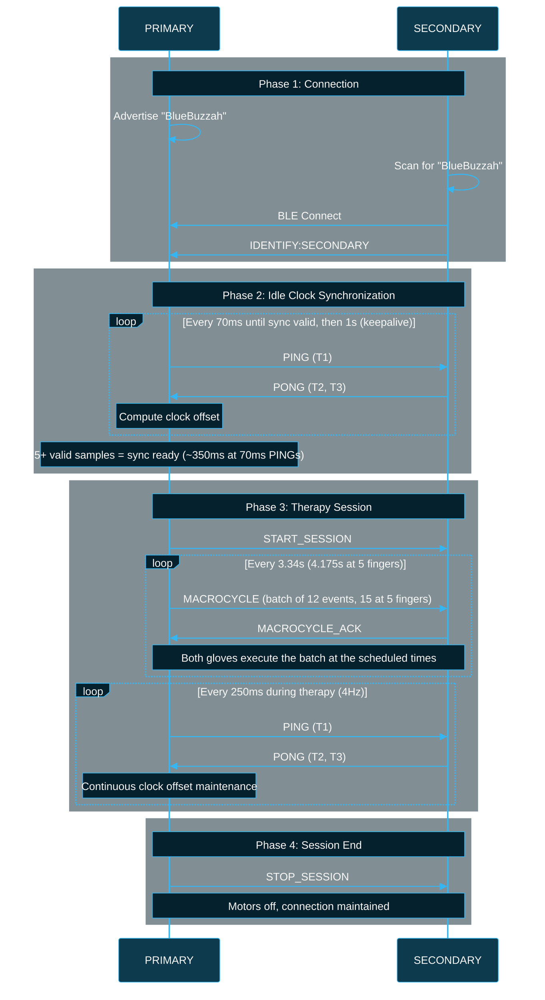
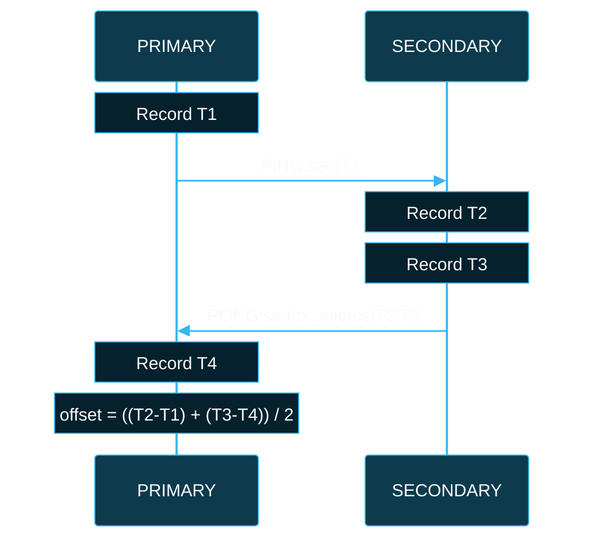
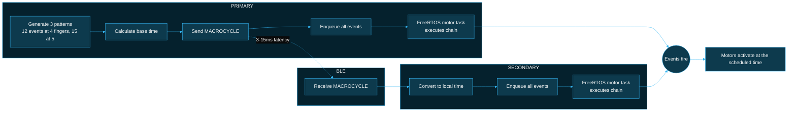
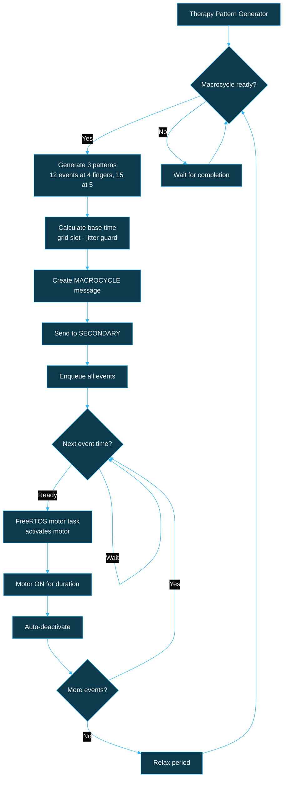
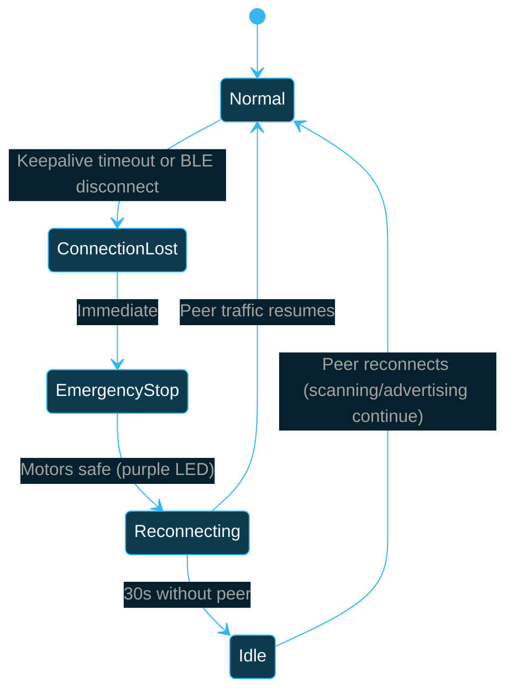

# BlueBuzzah Synchronization Protocol

**Version:** 2.6.0
**Last Updated:** 2026-06-10

---

## Overview

BlueBuzzah uses a bilateral synchronization protocol to coordinate haptic feedback between two gloves (PRIMARY and SECONDARY) over Bluetooth Low Energy. The protocol uses IEEE 1588 PTP-inspired clock synchronization with absolute time scheduling and microsecond-precision timestamps.

| Metric | Target | Achieved |
|--------|--------|----------|
| Bilateral sync accuracy | <50ms | pending re-validation (see SYNC_VALIDATION.md) |
| Clock offset precision | <5ms | pending re-validation (see SYNC_VALIDATION.md) |
| BLE latency compensation | Yes | PTP 4-timestamp |

> **Note on previous figures:** The "<1ms" and "<500µs" values cited in earlier revisions were measured against the FreeRTOS tick clock, which has ~976µs quantization because DWT was never enabled. Those numbers reflect tick-quantized timestamps, not true sub-millisecond resolution. The system is being re-baselined on the 1MHz hardware timebase introduced in this revision; see SYNC_VALIDATION.md for acceptance gates.

### Core Principles

- **PRIMARY commands, SECONDARY follows** — All therapy decisions originate from PRIMARY
- **Absolute time scheduling** — Commands include future activation timestamps
- **Continuous synchronization** — Clock offset maintained throughout session
- **Fail-safe design** — SECONDARY halts if PRIMARY connection lost

---

## Session Lifecycle



### Timing Requirements

| Phase | Maximum Duration |
|-------|------------------|
| Initial clock sync | ~350ms (5 samples @ 70ms acquire interval) |
| Session start | After sync is valid; refused with `Sync not ready` until then, then starts anyway 10s after the SECONDARY connected (`SYNC_START_FALLBACK_MS`); no macrocycle plays until sync is valid |
| Keepalive timeout | 6 seconds (6 missed) |

---

## Clock Synchronization

### PTP 4-Timestamp Exchange

The protocol uses IEEE 1588-inspired clock synchronization to measure the offset between PRIMARY and SECONDARY clocks, independent of network asymmetry.



### Offset Calculation

```text
offset = ((T2 - T1) + (T3 - T4)) / 2
```

| Timestamp | Device | Event |
|-----------|--------|-------|
| T1 | PRIMARY | PING sent |
| T2 | SECONDARY | PING received |
| T3 | SECONDARY | PONG sent |
| T4 | PRIMARY | PONG received |

A positive offset means SECONDARY's clock is ahead of PRIMARY.

### RTT Measurement

Round-Trip Time (RTT) is calculated using the IEEE 1588 PTP formula:

```text
RTT = (T4 - T1) - (T3 - T2)
```

This formula isolates network latency from SECONDARY processing time:
- `(T4 - T1)` = total round trip including processing
- `(T3 - T2)` = SECONDARY processing time
- Result = pure network latency (BLE transmission delays only)

Excluding processing time provides:
- More accurate network latency estimates (5-20ms typical)
- Better quality filtering (rejects poor BLE conditions, not slow processing)
- Improved lead time precision (adapts to actual network conditions)

### Transmit Timestamping

T1 (PING sent) and T3 (PONG sent) are stamped at **BLE-stack handoff** (SoftDevice on v2, NimBLE on v3) rather than at message creation. Both PING and PONG are enqueued as deferred-stamp TX entries; `processTxQueue` serializes them with the handoff time at the moment the BLE stack accepts the packet for transmission and reports it through the `onTxStamped` callback.

**Why this matters:** Between message construction and the BLE radio actually picking up a packet, the main loop may run other work (sensor reads, state-machine ticks, motor-queue processing). Stamping at creation captures that variable queuing delay as apparent propagation time, introducing an asymmetric bias into PTP offset samples. Stamping at handoff removes that latency from the measurement.

`onTxStamped` records `pingT1` and `pingSeq` for PING packets so the offset calculation can correlate the correct T1 with the matching PONG response.

**PONG sequence matching:** The PONG handler validates that the received sequence number matches the in-flight `pingSeq`. A sequence-mismatched (stale) PONG is excluded from the offset calculation without clearing the in-flight T1, so a stale reply can't poison an offset sample. It still refreshes the PRIMARY's keepalive timer: any PONG proves the SECONDARY is alive.

### Filtering and Maintenance

- **Initial sync:** Acquire-rate PINGs (70ms) accumulate samples, median offset selected
- **Minimum valid:** At least 5 good samples required (~350ms after connect: PINGs run every 70ms, `SYNC_ACQUIRE_INTERVAL_MS`, until sync is valid)
- **Continuous maintenance:** Ongoing sync at 4Hz during therapy / 1Hz idle keeps the offset current; the offset EMA follows crystal drift between the gloves
- **Smoothing:** Exponential moving average prevents sudden jumps

#### Maintenance Sample Quality Gates

Three gates are applied in order before a maintenance sample updates the EMA:

1. **RTT hard ceiling (60ms):** Any exchange with RTT > 60ms is discarded. This rejects samples polluted by BLE retransmissions where the network path is too lossy to yield a reliable offset.

2. **Lucky-packet gate (decaying minimum RTT):** A tracked per-session minimum RTT (`minRTT`) is maintained and decays upward by `SYNC_MIN_RTT_DECAY_US` (200µs) per sample to allow gradual adaptation. Only exchanges with `RTT <= minRTT + SYNC_LUCKY_RTT_MARGIN_US` (10ms) are accepted. This gate selects low-jitter "lucky" packets whose round-trip approximates the true one-way propagation time, providing better offset estimates.

3. **Innovation gate with hard re-anchor on persistence:** If a candidate offset deviates from the current EMA by more than `SYNC_INNOVATION_GATE_US` (5ms) it is initially rejected. After `SYNC_INNOVATION_REJECT_LIMIT` (5) such rejections with no accepted sample in between, the next deviating sample is treated as a true step change (e.g., from a long disconnect or oscillator retrim) and **hard re-anchors** the offset to the new value rather than blending it in via EMA. This prevents the EMA from chasing transient noise while still tracking genuine clock jumps.

### Outlier Rejection

The clock sync algorithm uses MAD (Median Absolute Deviation) to filter outliers before computing the final offset:

1. Compute preliminary median from all offset samples
2. Filter samples deviating from the preliminary median by more than max(3 × MAD, 5ms)
3. Compute final median from filtered samples only
4. If fewer than 5 samples survive filtering, use the preliminary median instead (sync still becomes valid)

This improves robustness against BLE retransmissions and RF interference that cause anomalous RTT measurements.

### Warm-Start Sync (Quick Reconnection)

Brief BLE disconnections (interference, range limits) can recover quickly using cached sync state:

| Scenario | Samples Required | Recovery Time |
|----------|------------------|---------------|
| Cold start (first connect) | 5 | ~350ms |
| Warm start (reconnect <15s after the last cached sample) | 3 confirmatory | ~210ms (macrocycles carry the cached offset once the first confirmatory sample agrees) |
| Long disconnect (cache older than 15s) | 5 | ~350ms |

**Warm-start process:**
1. On valid sync, cache the current offset with a timestamp (updated by every accepted sample)
2. On disconnect, the cache is preserved
3. On reconnect within 15 seconds of the cache timestamp:
   - Seed the offset with the cached value
   - Enter warm-start mode
   - Require 3 confirmatory samples within 5ms of the cached offset
4. If a single sample diverges >5ms, abort to cold start (safety fallback)

This shortens re-sync after brief BLE interference events from ~350ms (cold start) to ~210ms.

---

## Synchronized Execution

### MACROCYCLE Command Flow



### Lead Time Calculation

The activation time is set in the future to ensure SECONDARY receives and processes the command before the scheduled time:

```text
activate_time = current_time + lead_time
lead_time = average_RTT + safety_margin + processing_overhead + generation_overhead
```

`average_RTT` is twice the smoothed one-way latency from PING/PONG (`calculateAdaptiveLeadTime()`). With no RTT samples yet the lead time is the 70ms minimum; the first sample already counts.

Every macrocycle, including the first of a session, is sent at its prepare point, 300ms (`SYNC_MAX_LEAD_TIME_US + MACROCYCLE_PREPARE_MARGIN_US`) before its first onset. The adaptive lead time is the least a macrocycle must still have when it goes out; with less, PRIMARY skips it.

| Parameter | Value | Purpose |
|-----------|-------|---------|
| Minimum lead time | 70ms | Covers RTT (~40ms) + variance (~5ms) + processing (10ms) + generation (5ms) + margin (10ms) |
| Maximum lead time | 150ms | Conservative upper bound for worst-case BLE conditions |
| Safety margin | 6× smoothed one-way latency deviation | 3σ at RTT scale; handles jitter |
| Processing overhead | 10ms | BLE callback + deserialization + queue forwarding (SECONDARY) |
| Generation overhead | 5ms | Macrocycle generation + serialization (PRIMARY) |

### Time Conversion

SECONDARY converts PRIMARY timestamps to local time:

```text
local_time = primary_time + clock_offset
```

---

## Therapy Event Cycle



### Macrocycle Structure

One therapy macrocycle consists of 3 patterns (12 buzz events at 4 fingers, 15 at 5) followed by a relax period. Values below are for the default timing; v3 values in parentheses:

| Component | Duration |
|-----------|----------|
| Motor ON time | 100ms (configurable) |
| Motor OFF time | 67ms (configurable) |
| Fingers per pattern | 4 (5); profile `FINGERS`, capped at index to pinky plus the thumb when the PRIMARY's boot motor check found it |
| Patterns per macrocycle | 3 |
| Events per macrocycle | 12 (15): 3 patterns × fingers |
| Pattern duration | ~668ms (~835ms) |
| Inter-macrocycle relax | ~1336ms (~1670ms): 2× pattern duration |
| **Total macrocycle (grid period)** | **3.34 seconds (4.175 seconds)**: 5 × fingers × (TIME_ON + TIME_OFF), fixed. Each onset sits within ±A of its slot, with A capped at (TIME_OFF − 6ms) / 2. |

### Macrocycle Batching Architecture

PRIMARY sends all of a macrocycle's events in a single MACROCYCLE message. This batching approach provides:

- **~4× reduction in BLE traffic** (~200 bytes vs ~720 bytes)
- **No per-buzz BLE traffic** — every motor event is sent before the first buzz (PING/PONG continues at 4Hz)
- **Single clock offset application** — less computation, fewer rounding errors
- **Cleaner architecture** — macrocycle as atomic unit

SECONDARY's `ActivationQueue` schedules all events with their local activation times, then processes them as time elapses. PRIMARY does not wait for `MC_ACK`: it enqueues its own events right after sending. Every `MC_ACK` refreshes its SECONDARY keepalive timer and reports what the SECONDARY did with the macrocycle (scheduled, rejected or refused) and how much margin it had. If the SECONDARY rejected the last macrocycle sent (or refused it, outside a bench `TEST`), or the macrocycle can't be queued for the SECONDARY, PRIMARY skips it locally too, so one hand never plays alone. While PRIMARY has no usable clock offset (sync not valid and no confirmed warm-start offset), it sends no macrocycle and plays none itself, printing `[MACROCYCLE] No clock sync - skipping seq=N on both gloves`. After 5 macrocycles in a row that were rejected or skipped this way (`MACROCYCLE_REJECT_LIMIT`), PRIMARY prints `[ERROR] 5 macrocycles in a row skipped - stopping therapy` and ends the session with reason `ERROR` (a bench `TEST` just stops).

---

## Error Handling

### Connection Loss Recovery



### Timeout Behavior

| Event | Timeout | Action |
|-------|---------|--------|
| No PING/PONG (keepalive) | 6s (`KEEPALIVE_TIMEOUT_MS`) | Emergency stop; SECONDARY → connection-lost |
| Boot window elapses with SECONDARY connected but no phone (PRIMARY) | 30s (`STARTUP_WINDOW_MS`) | Auto-start therapy |

> **Note:** There is no dedicated "no SECONDARY found", "no READY", or "no MACROCYCLE" timeout in the current firmware — a stalled or lost link is caught by the 6s keepalive, which triggers the emergency stop. The 30s `STARTUP_WINDOW_MS` is the PRIMARY auto-start window (it begins therapy when no phone has connected), not a startup-abort timeout. Detailed connection/boot timing lives in [BOOT_SEQUENCE.md](BOOT_SEQUENCE.md).

---

## Message Reference

### Message Format

All `SyncCommand` messages use the format (the plain-string internal messages noted in the Handshake and Status tables are the exceptions):

```text
COMMAND:field1|field2|field3|...
```

- Field delimiter: `|` (pipe)
- Message terminator: `0x04` (EOT)
- Timestamps: Microseconds since boot

### Handshake Messages

| Message | Direction | Fields | Example |
|---------|-----------|--------|---------|
| `IDENTIFY:SECONDARY` | S → P | (plain string, not pipe-delimited) | `IDENTIFY:SECONDARY` |
| `GLOVE_ERROR` | S → P | (plain string; sent right after `IDENTIFY:SECONDARY` and again with every battery check, only when the SECONDARY has a boot hardware fault and is in `ERROR`; the PRIMARY ignores it from any other link) | `GLOVE_ERROR` |
| `MOTOR_STATUS` | S → P | v3 only. The SECONDARY's boot motor check: one token per finger in finger order (index, middle, ring, pinky, thumb), comma-separated (`OK`, `OPEN`, `NODRIVER`, `UNKNOWN`). Sent right after `IDENTIFY:SECONDARY` (after `GLOVE_ERROR` when that is sent), again with every battery check, and after a serial `MOTOR_PRESENT` while linked. The PRIMARY accepts it only from the SECONDARY's link, drops a malformed list or one with the wrong token count, clears its copy on every SECONDARY connect and disconnect, and reports it to the app as `INFO` `MOTS`. A warning only: it never refuses or ends a session, and doesn't change session patterns | `MOTOR_STATUS:OK,OK,OPEN,OPEN,OPEN` |
| `START_SESSION` | P → S | seq, timestamp | `START_SESSION:1\|50000` |
| `PAUSE_SESSION` | P → S | seq, timestamp | `PAUSE_SESSION:0\|61000000` |
| `RESUME_SESSION` | P → S | seq, timestamp | `RESUME_SESSION:0\|65000000` |
| `STOP_SESSION` | P → S | seq, timestamp | `STOP_SESSION:99\|120000000` |

The PRIMARY sends `STOP_SESSION` whenever its session ends while the SECONDARY is linked: phone stop, completion, `TEST` stop, a serial motor diagnostic, battery, fault or keepalive timeout. Both gloves drop every already-scheduled macrocycle event and stop their motors at once. A reboot or power-off sends nothing: the SECONDARY sees the link drop instead.

### Synchronization Messages

| Message | Direction | Fields | Example |
|---------|-----------|--------|---------|
| `PING` | P → S | seq, T1 | `PING:42\|1000000` |
| `PONG` (legacy) | S → P | seq, tx_micros, T2, T3 (T2High, T2Low, T3High, T3Low once either exceeds 32 bits) | `PONG:42\|1000550\|1000500\|1000600` |
| `PONG` (anchor, 6 data fields) | S → P | seq, tx_micros, T2High, T2Low, T3High, T3Low, AnchorHigh, AnchorLow — *see anchor section* | `PONG:42\|1000550\|0\|1000500\|0\|1000600\|0\|999800` |

PONG has two wire forms; see [Connection-Anchor Timestamping](#connection-anchor-timestamping) for the 6-data-field format and detection rules. When anchor timestamping is disabled (the v3 default), only the legacy 4-field form is used.

> **The PONG `timestamp` field is the message construction time, not `0`.** The `SyncCommand` constructor stamps `getMicros()` and `createPongWithTimestamps` / `createPongWithAnchor` never override it, so the field carries the PONG's build time (between T2 and T3). The PTP math reads T2/T3 from the positional data fields and ignores this field. Earlier doc revisions that showed `PONG:…|0|…` were inaccurate.

**Unified Keepalive + Clock Sync:**

The protocol uses a single unified mechanism for both keepalive and clock synchronization:

| State | Mechanism | Interval | Purpose |
|-------|-----------|----------|---------|
| Acquiring (sync not yet valid, or warm start) | PING/PONG | 70ms | Fast initial clock sync + keepalive |
| Idle / no session | PING/PONG | 1 second | Clock sync + keepalive (unified) |
| Therapy active | PING/PONG | 250ms (4Hz) | Higher-cadence sync during therapy |

- **PING** provides: Clock sync timestamp (T1) + proof PRIMARY is alive
- **PONG** provides: Clock sync response (T2, T3) + proof SECONDARY is alive
- **Continuous sync:** Clock offset is maintained throughout all states
- **No separate keepalive:** PING/PONG serves both purposes efficiently

This unified approach provides continuous clock synchronization throughout all session states. The increased 4Hz cadence during therapy reduces the maximum interval between offset updates from 1s to 250ms, so the offset EMA follows crystal drift more closely.

### Therapy Messages

| Message | Direction | Fields | Example |
|---------|-----------|--------|---------|
| `MACROCYCLE` | P → S | seq, baseTime, count, events... | See below |
| `MACROCYCLE_ACK` | S → P | seq, tx_micros, status, margin_ms | `MC_ACK:42\|5050120\|0\|287` |
| `DEACTIVATE` (reserved) | — | seq, tx_micros | `DEACTIVATE:43\|5050120` |

> **`serialize()` always emits the `seq|timestamp` pair**, and the timestamp is the message construction time (`getMicros()`), **never `0`**. The 2-arg `SyncCommand` constructor calls `setTimestampNow()`, so `createMacrocycleAck(seq, status, marginMs)` produces `MC_ACK:42|<micros>|<status>|<margin_ms>`. PRIMARY ignores the timestamp field for `MC_ACK`.
>
> **`status`** says what the SECONDARY did with the macrocycle: `0` scheduled, `1` rejected (nothing playable: local base time more than 5 s from its clock, every event late or invalid, or a frame that failed to parse but still had a readable `seq`), `2` refused (SECONDARY in `CRITICAL_BATTERY` or `ERROR`). **`margin_ms`** is the signed time in ms from the moment the SECONDARY stages the complete macrocycle to the macrocycle's first valid event, negative when that event was already late and dropped; it is `0` when status isn't `0`.
>
> PRIMARY ignores an `MC_ACK` that doesn't come from the SECONDARY connection. Every other `MC_ACK` refreshes its SECONDARY keepalive timer. If status is `1` and `seq` is the last macrocycle sent, PRIMARY drops that macrocycle's queued activations too and prints `[MACROCYCLE] SECONDARY rejected seq=N - skipping it on both gloves`. If the ACK arrives after the first event's time, PRIMARY drops the rest of the macrocycle and prints `[WARN] SECONDARY rejected seq=N after it started - dropping the rest of it`. If the next macrocycle has already gone out, nothing is cleared and it prints `[WARN] SECONDARY rejected seq=N too late to skip - it played on this glove only`. Status `2` is handled the same way with `refused` in the log line, except during a bench `TEST`, which keeps playing on the PRIMARY. Each status `1` counts toward `MACROCYCLE_REJECT_LIMIT`; any status `0` resets the count. If status is `0` and the margin is under 20 ms (`MACROCYCLE_ACK_LOW_MARGIN_MS`), it prints `[WARN] MC_ACK seq=N margin=Mms`. In debug mode it logs every ACK as `[MACROCYCLE] ACK seq=N status=S margin=Mms`. There is no retransmission. The BLE task only stores the latest ACK; `loop()` acts on it and prints.
>
> **`DEACTIVATE` is reserved/unused.** The `SyncCommandType::DEACTIVATE` value and `createDeactivate()` factory exist, but no `DEACTIVATE` message is sent over BLE: SECONDARY turns motors off locally via its paired activate/deactivate `ActivationQueue`. The factory does not override the construction timestamp, so if it were ever serialized it would be `DEACTIVATE:43|<micros>`. The same applies to the `BUZZ` type, which was superseded by `MACROCYCLE` batching.

**MACROCYCLE format (V5):**

```text
MC:seq|baseHigh|baseLow|offHigh|offLow|dur|count|d,f,a[,fo]|d,f,a[,fo]|...
```

| Field | Description |
|-------|-------------|
| seq | Sequence number for ACK matching |
| baseHigh | High 32 bits of baseTime (µs) |
| baseLow | Low 32 bits of baseTime (µs) |
| offHigh | High 32 bits of clockOffset (signed) |
| offLow | Low 32 bits of clockOffset |
| dur | Common ON duration for all events (ms) |
| count | Number of events (3 patterns × fingers: 12 on v2, 15 on v3 by default; at most `MACROCYCLE_MAX_EVENTS`) |
| d | Delta time from baseTime (ms) |
| f | SECONDARY finger index (0 to motors − 1: 0-3 on v2, 0-4 on v3) |
| a | Amplitude percentage (0-100) |
| fo | Frequency offset (optional, omitted when 0): `(freq - 200) / 5` for 200-455 Hz range |

**Example MACROCYCLE:**

```text
MC:1|0|5050000|0|12345|100|12|0,0,100,10|167,1,100,10|334,2,100,10|...
```

Each event carries `fo=10`, decoded as `200 + 10×5 = 250 Hz`, and the SECONDARY plays each event at its `fo`. An event without an `fo` field decodes as `fo=0` (200 Hz).

**Note:** The V5 format preserves full microsecond precision for baseTime by splitting the 64-bit value into two 32-bit parts, avoiding the up to 999µs precision loss in the previous millisecond-based format.

SECONDARY applies clock offset once to baseTime, then schedules all events via an activation queue. This reduces BLE traffic from 12 messages to 1 per macrocycle (~200 bytes vs ~720 bytes).

### Parameter Messages

None are sent. Therapy parameters reach the SECONDARY inside each `MC` (duration, amplitude, frequency per event).

### Status Messages

| Message | Direction | Fields | Example |
|---------|-----------|--------|---------|
| `GET_BATTERY` | P → S | (none) | `GET_BATTERY` |
| `BATRESPONSE` | S → P | voltage (reply to `GET_BATTERY`: the SECONDARY's last motor-idle reading, `0.00` if none yet); voltage and level (pushed after every motor-idle SECONDARY battery check; level 0 normal, 1 low, 2 critical) | `BATRESPONSE:3.68`, `BATRESPONSE:3.68\|0` |
| `LED_OFF_SYNC` | P → S | 0 or 1 (mirrors `THERAPY_LED_OFF`) | `LED_OFF_SYNC:1` |
| `DEBUG_SYNC` | P → S | 0 or 1 (mirrors `DEBUG`) | `DEBUG_SYNC:1` |
| `CALIB_BUZZ` | P → S | finger, intensity, duration (relayed `CALIBRATE_BUZZ`) | `CALIB_BUZZ:1:80:500` |
| `CALIB_STOP` | P → S | (none) | `CALIB_STOP` |
| `DEBUG_FLASH` | P → S | seq, timestamp, flash time on the SECONDARY's clock (the PRIMARY adds its clock offset; sent at each macrocycle start, debug mode only) | `DEBUG_FLASH:7\|5000000\|5070000` |

These are plain colon-delimited strings, except `DEBUG_FLASH`, which is a `SyncCommand` frame.

---

## Safety Validations

The protocol includes several safety mechanisms to prevent incorrect synchronization:

| Validation | Threshold | Action |
|------------|-----------|--------|
| baseTime freshness | ±5 seconds | SECONDARY plays nothing from a macrocycle whose local base time is further than this from now and sends `MC_ACK` status `1`. PRIMARY skips that macrocycle too, and ends the session after 5 skipped in a row |
| Late event | More than 5ms past its time (`MACROCYCLE_LATE_EVENT_TOLERANCE_US`) | SECONDARY drops that event when the frame arrives and plays the rest, printing one `[MACROCYCLE] Dropped N late events` line. If every event is late, the previous macrocycle's queue is left alone. `MC_ACK` still has status `0`, with a negative margin when the first event was among the late ones. If nothing is left to play, the ACK has status `1` and PRIMARY drops the rest of that macrocycle too. Either glove's motor task also drops an activation that is this late when its turn comes (`loop()` prints `[MOTOR_TASK] Dropped N late activations`), e.g. after a `loop()` stall |
| New macrocycle | Any | Replaces queued activations on both gloves. Pending turn-offs still run, so a motor that is on is never left on |
| Critical battery | SECONDARY in `CRITICAL_BATTERY` | SECONDARY acknowledges each macrocycle with `MC_ACK` status `2` but plays nothing until the PRIMARY ends the session. PRIMARY skips each refused macrocycle too, except in a bench `TEST` |
| Hardware fault | SECONDARY in `ERROR` (sent `GLOVE_ERROR`) | SECONDARY acknowledges each macrocycle with `MC_ACK` status `2` but plays nothing. The PRIMARY refuses starts while linked to it (`Secondary glove error`, flag cleared on every SECONDARY connect) and ends a running session (not a bench `TEST`) with reason `ERROR` |
| RTT quality | 60ms | Reject samples affected by retransmissions |

These validations ensure that BLE interference or momentary disconnects don't cause the sync system to make large erroneous corrections.

---

## Tuning Guidance

### RTT Quality Threshold

The `SYNC_RTT_QUALITY_THRESHOLD_US` (60ms) balances sample acceptance vs quality:
- **Too low (20ms):** Rejects most samples, slow sync convergence
- **Too high (200ms):** Accepts retransmission-affected samples, poor accuracy
- **Recommended:** 60ms rejects ~10-20% of samples

### Connection Interval Trade-offs

| Interval | Latency | Battery | Use Case |
|----------|---------|---------|----------|
| 7.5ms | Lowest | Highest drain | Active therapy |
| 15ms | Medium | Medium drain | Idle monitoring |
| 30ms | Higher | Lower drain | Background connection |

Current setting: 7.5-10ms on the glove link for maximum sync accuracy during therapy; the phone link requests 30-50ms.

### Outlier Threshold

The outlier rejection uses MAD (Median Absolute Deviation) with minimum 5ms:
- **Automatic:** Adapts to network conditions (3× MAD)
- **Minimum floor:** Never rejects samples within 5ms of median
- **Aggressive mode:** Reduce floor to 3ms if network is very stable

---

## Connection-Anchor Timestamping

> **Status:** On by default on v2, off on v3 (`SYNC_ANCHOR_TIMESTAMPING_ENABLED` in `config.h`). **v2 (nRF52) only**: radio notifications are a SoftDevice feature, and on v3 `radio_anchor` is an inert stub, so sync stays on PTP. PRIMARY parses every PONG form regardless of the flag, so mismatched builds fall back to PTP rather than breaking.

### Motivation

PTP offset estimation assumes the PING and the PONG take equally long. Between the gloves they don't. The PONG (central to peripheral) waits for the next connection event, so it takes about one connection interval. The PING takes anything from under a millisecond up to one interval, depending on where in the interval it was handed to the radio. Bench measurement on v2 at a 10ms interval put the PTP offset wrong by half the difference, `(RTT - 2 x interval) / 2`: about -4ms at a 12ms RTT and near zero at 20ms (`docs/TIMING_BASELINE.md`, 2026-11-12). The shortest round trips are the most lopsided, so RTT filtering alone can't fix it.

Both gloves see the same connection events, though. Each one records an "anchor" timestamp of every event, and the difference between the two gloves' anchors of the same event is a direct clock comparison that doesn't depend on either leg's delay.

### Radio Notification Anchors

A radio-notification ISR (SWI1, priority 2) fires approximately 800µs before each connection event. The ISR records the local `getMicros()` value into a 16-slot ring buffer (`SYNC_ANCHOR_RING_SIZE`). Because the SoftDevice schedules connection events at the same wall-clock instant on both ends of a link, the difference between PRIMARY's anchor and SECONDARY's anchor is a direct measure of clock offset without any assumption about path symmetry.

### 6-Data-Field PONG Wire Format

When anchor timestamping is enabled, SECONDARY attaches its most recent rx anchor to the PONG reply using the extended wire format created by `createPongWithAnchor`.

> **Wire framing note:** The standard `PONG:seq|timestamp|...` framing header (sequence number and the construction-time `timestamp` field — non-zero, ignored by the PTP math) precedes these data fields. The table below describes the six data fields that follow that framing header.

| Data field index | Name | Description |
|-----------------|------|-------------|
| 0 | T2High | High 32 bits of T2 (PING rx timestamp) |
| 1 | T2Low | Low 32 bits of T2 |
| 2 | T3High | High 32 bits of T3 (PONG tx timestamp) |
| 3 | T3Low | Low 32 bits of T3 |
| 4 | AnchorHigh | High 32 bits of SECONDARY rx anchor |
| 5 | AnchorLow | Low 32 bits of SECONDARY rx anchor |

PRIMARY detects the anchor format by the presence of data field index 4 (`hasData("4")`), which only the anchor form populates. The legacy 64-bit form stops at data field index 3; the legacy short form stops at data field index 1. The legacy forms are silently handled as plain PTP exchanges.

### Anchor Pairing Rules

**SECONDARY (rx anchor):** The rx anchor attached to each PONG is unambiguous — it is the most recent anchor that arrived within `SYNC_ANCHOR_RX_WINDOW_US` (15ms) before the PONG rx callback. Because connection events are regular, there is normally exactly one candidate.

**PRIMARY (tx anchor):** After T1 is stamped at SoftDevice handoff, PRIMARY searches its anchor ring for the first anchor that arrives within `SYNC_ANCHOR_TX_WINDOW_US` (25ms) of T1. The 25ms window is approximately 2× the maximum BLE connection interval, which is long enough to always capture the next connection event after the PING is handed off.

That first anchor is not always the right one. The anchor fires about 800µs before its event, so a PING handed off inside that lead is carried by an event whose anchor has already passed, and gets paired with the next event: the offset comes out exactly one connection interval off. A PING that misses its event is off the other way. On the bench 7-44% of exchanges per run were paired a whole number of intervals off, in bursts lasting seconds, because the PING's position in the interval drifts slowly. [Pairing Correction](#pairing-correction) puts them back.

### Offset Calculation

```text
anchorOffset = secondaryAnchor - primaryAnchor - SYNC_ANCHOR_BIAS_US
```

`SYNC_ANCHOR_BIAS_US` is a calibrated constant (50µs, measured on v2 with the logic analyzer) that corrects for any systematic asymmetry between the peripheral (PRIMARY) and central (SECONDARY) radio-event timing. Positive values correct for peripheral RX-window widening where PRIMARY's anchor fires slightly early relative to SECONDARY's.

The anchor offset replaces the PTP offset for that sample once its pairing has been corrected and checked (next section). PTP is still calculated on every exchange, but only to build the reference used for that correction.

### Pairing Correction

Every exchange feeds a **coarse reference**, whether or not it has an anchor:

```text
coarse sample = ptpOffset + interval - RTT / 2      (only if RTT <= 2 x interval + 1ms)
reference     = median of the last 7 coarse samples (needs at least 3)
```

The correction term is the PTP error above, with the reply leg taken as one interval. An exchange whose reply was retransmitted can still pass the RTT limit (a 21ms exchange with a short PING and a two-interval reply reads 10ms low), which is why the reference is a median and never a single sample. On the bench it sat 0.07-0.18ms from the true offset.

Each anchor offset is then **snapped**: shifted by a whole number of connection intervals to the value nearest the reference (`SimpleSyncProtocol::snapAnchorOffset()`).

| Case | Result |
|------|--------|
| Snapped offset within `SYNC_ANCHOR_SNAP_TOLERANCE_US` (750µs) of the reference | Used as the sample |
| Further away: not a whole-interval mispair (an advertising or phone-link event) | Anchor rejected, the reference is used as the sample |
| No anchor in the PONG, or none found on PRIMARY | The reference is used as the sample |
| No reference yet, clock sync not valid yet | Exchange skipped, up to `SYNC_ANCHOR_ACQUIRE_SKIP_LIMIT` (10) |
| No reference yet, past that limit or sync already valid | Raw PTP offset |

So once the reference exists, no sample is the raw PTP offset. The skip covers the first few exchanges after a connect: their raw PTP offsets would otherwise set the initial median milliseconds off, and the first macrocycles of a session would start out while the EMA caught up. The limit lets a link too slow to produce a reference still sync on PTP.

Nothing here compares an anchor with the offset currently held. An earlier pre-filter did (`SYNC_ANCHOR_PREFILTER_US`), and when the initial median settled on mispaired anchors it rejected every correct one from then on, leaving the gloves one interval apart for the session. The reference is rebuilt from the last seven exchanges, so it can't hold a wrong value.

The sample then goes through the same RTT, lucky-packet and innovation gates as a PTP sample.

### Caveats

- **Both-gloves-same-flag requirement:** A SECONDARY built with the anchor flag emits 6-data-field PONGs; one built without it emits plain PONGs. PRIMARY parses either form, but only computes anchor offsets when it is built with the flag and receives a 6-field PONG. Otherwise the exchange is a plain PTP sample. This is safe (it falls back to PTP), but both gloves need the flag if anchor-based accuracy is the goal.
- **Start order:** The SoftDevice only accepts the radio-notification configuration while the radio is idle. `BLEManager::begin()` therefore calls `radioAnchorBegin()` before the role setup, because a PRIMARY starts advertising there. Called any later, it fails with `NRF_ERROR_INVALID_STATE` on a PRIMARY and sync silently stays on PTP. The boot log says which happened: `[SYNC] Radio-anchor timestamping active` or `[SYNC] WARNING: radio-anchor init failed - PTP-only sync`.
- **Dual link:** When PRIMARY is connected to a phone and to SECONDARY, its anchor ring holds events from both links, and from advertising. An anchor from the wrong link is not a whole number of glove-link intervals off, so the snap tolerance rejects it and the reference is used for that sample. With a phone connected on the bench, about 13-15% of anchors were rejected this way, against 2-4% without, and skew was unchanged. Start-up with a phone already connected has not been measured.
- **Reply leg assumption:** The coarse reference relies on the PONG taking one connection interval. That is how a central-to-peripheral reply behaves on the v2 SoftDevice link, and it held in every bench run, but it is a property of this link, not of BLE.

---

## Known Limitations

### SECONDARY Stateless Design

The SECONDARY glove operates statelessly—it receives macrocycles with clock offset but doesn't send timing feedback. This simplifies the protocol but means:
- PRIMARY cannot detect SECONDARY clock drift directly
- Sync quality relies entirely on PING/PONG exchanges
- If PING/PONG fails, sync degrades silently

### Timestamp Precision

The firmware uses a dedicated 1MHz hardware timebase (`hires_clock` module) rather than the FreeRTOS tick clock. On v3 this is `esp_timer` (always available; the HFXO watchdog and tick-clock fallback below are nRF-only). On v2:

- **Hardware timebase:** NRF_TIMER4 is configured as a 1MHz free-running counter clocked from the on-board 32MHz HFXO crystal. This gives 1µs resolution independent of the FreeRTOS tick rate (previously ~976µs quantization because DWT was never enabled).
- **HFXO watchdog:** `loop()` calls `hiresClockEnsureHfclk()` once per second. It checks whether the HFCLK is still running and, if not, **re-asserts** the HFCLK request (`sd_clock_hfclk_request()`) so TIMER4 stays on the crystal. It logs only on failure — `[CLOCK] HFCLK re-request failed` — and is otherwise silent; the counter keeps advancing throughout.
- **Fallback path:** If `hiresClockBegin()` fails at boot (e.g., SoftDevice pre-empts TIMER4 allocation), `setup()` logs the degradation once (`[CLOCK] WARNING: hardware timebase unavailable - falling back to tick clock (~1ms resolution)`). `getMicros()` then switches sources **silently** based on `hiresClockIsRunning()`. All sync time math (`syncNowMs()` = `getMicros() / 1000`) uses a single unified clock domain in either case.
- **Overflow safety:** `getMicros()` returns a `uint64_t`. It extends the 32-bit source (which wraps every ~71.6 minutes) with an overflow counter, updated inside a critical section so concurrent callers can't double-count a wrap. At 1MHz the 64-bit result wraps at ~584,000 years.

### Interrupt Safety

Sync state variables are accessed from both main loop and BLE callbacks. Key considerations:
- Connection state marked `volatile` for cache coherency
- Sequence ID generator is NOT thread-safe (main loop only)
- Large structures (Macrocycle) should only be modified from main loop

### ARM printf Limitations

- 64-bit printf (%llu, %lld) not supported by the nRF52 Arduino toolchain (Cortex-M4); both boards use the same split format
- Macrocycle serialization splits 64-bit values into high/low 32-bit parts
- This adds ~10 bytes overhead per macrocycle but ensures portability

---

## Protocol Parameters

| Parameter | Value | Description |
|-----------|-------|-------------|
| RTT quality threshold (`SYNC_RTT_QUALITY_THRESHOLD_US`) | 60ms | Hard ceiling — discard samples with higher RTT |
| Minimum valid samples (`SYNC_MIN_VALID_SAMPLES`) | 5 | Required for valid sync (~350ms from connect) |
| Outlier threshold (`SYNC_OUTLIER_THRESHOLD_US`) | 5ms | Floor of the max(3 × MAD, 5ms) offset outlier threshold |
| PING/PONG interval (acquiring, `SYNC_ACQUIRE_INTERVAL_MS`) | 70ms | Until clock sync is valid (cold or warm start) |
| PING/PONG interval (idle) | 1s | Keepalive + clock sync when no therapy session active |
| PING/PONG interval during therapy (`SYNC_ACTIVE_INTERVAL_MS`) | 250ms (4Hz) | Higher cadence while therapy is running |
| Keepalive timeout (SECONDARY, `KEEPALIVE_TIMEOUT_MS`) | 6s | 6 missed PINGs = connection lost |
| Keepalive timeout (PRIMARY, `PRIMARY_KEEPALIVE_TIMEOUT_MS`) | 6s | During therapy: sends `STOP_SESSION` and shuts down its motors |
| Lead time range | 70-150ms | Adaptive minimum lead: a macrocycle with less left when it goes out is skipped |
| Initial lead time | 70ms | The adaptive minimum until the first RTT sample exists |
| Send lead (`SYNC_MAX_LEAD_TIME_US + MACROCYCLE_PREPARE_MARGIN_US`) | 300ms | Every macrocycle, the first included, goes out at its prepare point this far before its first onset |
| Processing overhead (`SYNC_PROCESSING_OVERHEAD_US`) | 10ms | SECONDARY processing time allowance |
| Generation overhead (`SYNC_GENERATION_OVERHEAD_US`) | 5ms | PRIMARY macrocycle generation + serialization |
| Warm-start validity (`SYNC_WARM_START_VALIDITY_MS`) | 15s | Cache valid for this long after its last update |
| BLE connection interval (glove link) | 7.5-10ms | Low-latency communication (6-8 BLE units); phone link requests 30-50ms |
| Lucky-packet RTT margin (`SYNC_LUCKY_RTT_MARGIN_US`) | 10ms | Accept only RTT ≤ minRTT + 10ms |
| Minimum RTT decay (`SYNC_MIN_RTT_DECAY_US`) | 200µs/sample | Per-sample upward creep of tracked minRTT |
| Innovation gate (`SYNC_INNOVATION_GATE_US`) | 5ms | Reject offset jumps larger than this threshold |
| Innovation reject limit (`SYNC_INNOVATION_REJECT_LIMIT`) | 5 samples | Persistent deviation triggers hard re-anchor |
| Anchor ring size (`SYNC_ANCHOR_RING_SIZE`) | 16 slots | Radio-notification timestamps retained |
| Anchor RX window (`SYNC_ANCHOR_RX_WINDOW_US`) | 15ms | Max age of rx anchor vs rx callback |
| Anchor TX window (`SYNC_ANCHOR_TX_WINDOW_US`) | 25ms | Max lookahead from PING handoff to tx anchor |
| Anchor bias (`SYNC_ANCHOR_BIAS_US`) | 50µs | Central-vs-peripheral constant, measured on v2 with the logic analyzer |
| Coarse samples (`SYNC_ANCHOR_COARSE_SAMPLES`) | 7 | Corrected PTP offsets whose median is the pairing reference |
| Coarse minimum (`SYNC_ANCHOR_COARSE_MIN_SAMPLES`) | 3 | Coarse samples needed before the reference is used |
| Coarse RTT margin (`SYNC_ANCHOR_COARSE_RTT_MARGIN_US`) | 1ms | A coarse sample needs RTT within two intervals plus this |
| Snap tolerance (`SYNC_ANCHOR_SNAP_TOLERANCE_US`) | 750µs | Snapped anchor must land this close to the reference |
| Acquire skip limit (`SYNC_ANCHOR_ACQUIRE_SKIP_LIMIT`) | 10 | Exchanges skipped while waiting for the reference during initial sync |

---

## See Also

- **[BLE-Protocol (wiki)](https://github.com/BlueBuzzah/BlueBuzzah-Firmware/wiki/BLE-Protocol)** — Phone app command protocol
- **[THERAPY_ENGINE.md](THERAPY_ENGINE.md)** — Pattern generation
- **[ARCHITECTURE.md](ARCHITECTURE.md)** — System design overview
