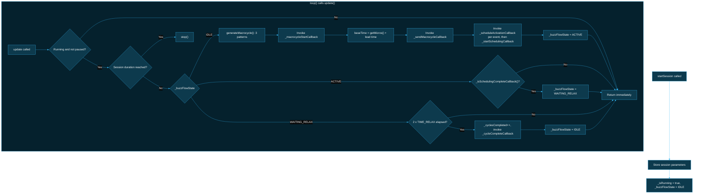

# BlueBuzzah Therapy Engine
**Version:** 2.0.0
**Date:** 2026-01-19
**Therapy Protocol:** Vibrotactile Coordinated Reset (vCR)
**Platform:** Arduino C++ / PlatformIO

---

## Table of Contents

1. [Therapy Overview](#therapy-overview)
2. [VCR Engine Architecture](#vcr-engine-architecture)
3. [Pattern Generation](#pattern-generation)
4. [Haptic Control](#haptic-control)
5. [Session Execution](#session-execution)
6. [Therapy Profiles](#therapy-profiles)
7. [DRV2605 Motor Control](#drv2605-motor-control)
8. [Performance Optimization](#performance-optimization)

---

## Terminology Note

This document uses the following device role terminology:
- **PRIMARY**: Generates patterns, controls therapy timing
- **SECONDARY**: Receives synchronization commands

Both devices run identical firmware and advertise as "BlueBuzzah". Role is stored in `/settings.bin` (written by `ProfileManager::saveSettings()`, set over serial with `SET_ROLE:PRIMARY` / `SET_ROLE:SECONDARY`); a device with no stored role defaults to PRIMARY. Code examples use `DeviceRole::PRIMARY` or `DeviceRole::SECONDARY` for device role parameters.

> **Motor counts:** BlueBuzzah v2 (Feather nRF52840) has 4 motors per glove; BlueBuzzah v3 (PentaBuzzer, XIAO ESP32-S3) has 5 (adds the thumb). Everything below scales with `MAX_ACTUATORS` from `board_config.h`. Examples use 4 fingers unless noted.

---

## Therapy Overview

### Vibrotactile Coordinated Reset (vCR)

**Clinical Foundation**: [PMC8055937](https://pmc.ncbi.nlm.nih.gov/articles/PMC8055937/)

**Mechanism**: Desynchronization of pathological neural oscillations in Parkinson's disease through bilateral vibrotactile stimulation.

**Key Parameters**:
- **Pattern**: Random permutations (RNDP) of all finger activations (4 on v2, 5 on v3)
- **Timing**: 100ms ON, 67ms OFF per finger (configurable)
- **Bilaterality**: Synchronized PRIMARY/SECONDARY glove stimulation
- **Jitter**: Temporal randomization to prevent habituation (0-50%)
- **Mirror Mode**: Symmetric vs independent PRIMARY/SECONDARY patterns
- **Session Duration**: 1-240 minutes (default: 120 minutes)

**Therapeutic Goal**: Reduce motor symptoms through coordinated reset stimulation

---

## VCR Engine Architecture

### Module Structure

**Files**:
- `src/therapy_engine.cpp` - Core therapy execution
- `include/therapy_engine.h` - Class declarations

**Key Class**: `TherapyEngine`

### Class Interface

TherapyEngine uses a **callback-driven architecture**. Hardware operations are decoupled from the engine—it generates patterns and timing, then invokes callbacks to perform actual motor activations.

```cpp
// include/therapy_engine.h (abridged)

// Callback types (plain function pointers)
typedef void (*ActivateCallback)(uint8_t finger, uint8_t amplitude);
typedef void (*DeactivateCallback)(uint8_t finger);
typedef void (*CycleCompleteCallback)(uint32_t cycleCount);
typedef void (*MacrocycleStartCallback)(uint32_t macrocycleCount);
typedef void (*SendMacrocycleCallback)(const Macrocycle& macrocycle);
typedef void (*ScheduleActivationCallback)(uint64_t activateTimeUs, uint8_t finger,
                                           uint8_t amplitude, uint16_t durationMs, uint16_t frequencyHz);
typedef void (*StartSchedulingCallback)();
typedef bool (*IsSchedulingCompleteCallback)();
typedef uint32_t (*GetLeadTimeCallback)();

class TherapyEngine {
public:
    TherapyEngine();  // Default constructor - no hardware dependencies

    // CALLBACKS - Set these before starting a session
    void setActivateCallback(ActivateCallback callback);
    void setDeactivateCallback(DeactivateCallback callback);
    void setCycleCompleteCallback(CycleCompleteCallback callback);
    void setMacrocycleStartCallback(MacrocycleStartCallback callback);
    void setSendMacrocycleCallback(SendMacrocycleCallback callback);
    void setSchedulingCallbacks(ScheduleActivationCallback scheduleCallback,
                                StartSchedulingCallback startCallback,
                                IsSchedulingCompleteCallback isCompleteCallback);
    void setGetLeadTimeCallback(GetLeadTimeCallback callback);

    // Restrict patterns to the motors found present at boot (v3 presence probe)
    void setActiveFingers(const uint8_t* fingers, uint8_t count);
    void setFrequencyRandomization(bool enabled, uint16_t minHz = 210, uint16_t maxHz = 260);

    // Session control
    void startSession(uint32_t durationSec, PatternType patternType, float timeOnMs,
                      float timeOffMs, float jitterPercent, uint8_t numFingers,
                      bool mirrorPattern, uint8_t amplitudeMin, uint8_t amplitudeMax,
                      bool isTestMode);
    void pause();
    void resume();
    void stop();

    // CRITICAL: Must call in loop() - drives the state machine
    void update();

    // State queries
    bool isRunning() const;
    bool isPaused() const;
    bool isTestMode() const;
    uint32_t getCyclesCompleted() const;
    uint32_t getTotalActivations() const;
    uint32_t getElapsedSeconds() const;
    uint32_t getRemainingSeconds() const;

private:
    BuzzFlowState _buzzFlowState;   // IDLE -> ACTIVE -> WAITING_RELAX
    Macrocycle _currentMacrocycle;  // Events for the macrocycle being executed
    uint64_t _macrocycleBaseTime;   // Absolute time (µs) of event 0
    // ... session parameters, finger map, callback storage

    Macrocycle generateMacrocycle();  // 3 patterns x numFingers events
    void executeMacrocycleStep();     // Flow-control state machine
};
```

> **IMPORTANT:** The `update()` method MUST be called frequently in `loop()`. TherapyEngine does not use blocking delays—it uses a state machine that advances each time `update()` is called.

### Execution Flow (Callback-Driven)

TherapyEngine uses a **non-blocking state machine** driven by repeated calls to `update()`. No blocking delays are used—timing is managed through state transitions and callback invocations.



**Key Points:**
- `update()` MUST be called on every `loop()` iteration
- No `delay()` calls inside TherapyEngine—session and relax timing use `millis()` comparisons
- All hardware operations are performed via callbacks, not direct calls
- FreeRTOS motor task handles precise timing of activations

---

## Pattern Generation

### Permutation Strategy (RNDP)

**Algorithm** (`src/therapy_engine.cpp`): each pattern is a Fisher-Yates shuffle of the finger slots, generated at runtime (there is no pre-computed permutation table).

```cpp
constexpr void shuffleArray(std::span<uint8_t> arr) {
    // Fisher-Yates shuffle
    for (size_t i = arr.size() - 1; i > 0; i--) {
        size_t const j = static_cast<size_t>(random(0, static_cast<long>(i + 1)));
        std::swap(arr[i], arr[j]);
    }
}

Pattern generateRandomPermutation(uint8_t numFingers, float timeOnMs, float timeOffMs,
                                  float jitterPercent, bool mirrorPattern) {
    Pattern pattern = Pattern(numFingers);
    // ...
    // Generate PRIMARY device sequence (random permutation)
    for (uint8_t i = 0; i < numFingers; i++) {
        pattern.primarySequence[i] = i;
    }
    shuffleArray(pattern.primarySequence);

    // Generate SECONDARY device sequence based on mirror setting
    if (mirrorPattern) {
        // Mirrored: same finger on both devices (for noisy vCR)
        for (uint8_t i = 0; i < numFingers; i++) {
            pattern.secondarySequence[i] = pattern.primarySequence[i];
        }
    } else {
        // Non-mirrored: independent random sequence
        for (uint8_t i = 0; i < numFingers; i++) {
            pattern.secondarySequence[i] = i;
        }
        shuffleArray(pattern.secondarySequence);
    }
    // ... jitter applied to timeOffMs (see Timing Breakdown)
    return pattern;
}
```

**Pattern Space** (4 fingers; 5 fingers in parentheses):
- PRIMARY permutations: 4! = 24 patterns (5! = 120)
- SECONDARY permutations: 4! = 24 patterns (independent when non-mirrored)
- Total combinations (mirrored): 24 patterns (PRIMARY determines SECONDARY)
- Total combinations (non-mirrored): 24 × 24 = 576 unique patterns (120 × 120 = 14,400)

**Other pattern types** (`PatternType`, selected by the profile's `patternType` string):

| `patternType` | Generator | Behavior |
|---------------|-----------|----------|
| `rndp` | `generateRandomPermutation()` | Random permutation per pattern (above) |
| `sequential` | `generateSequentialPattern()` | PRIMARY fingers in order `0..n-1`; SECONDARY same order when mirrored, reverse order when not |
| `mirrored` | `generateMirroredPattern()` | Random permutation, always identical on both gloves (ignores `mirrorPattern`) |

**Bilateral Mirroring** (`src/therapy_engine.cpp`):

Mirroring is controlled by the `mirrorPattern` parameter based on vCR type:

| vCR Type | `mirrorPattern` | Behavior | Rationale |
|----------|-----------------|----------|-----------|
| Noisy vCR | `true` | Same finger on both hands | Avoids bilateral masking interference |
| Regular vCR | `false` | Independent sequences per hand | Increases spatial randomization for synaptic decoupling |

```cpp
// include/therapy_engine.h
struct [[nodiscard]] Pattern {
    std::vector<uint8_t> primarySequence;
    std::vector<uint8_t> secondarySequence;
    std::vector<float> timeOffMs;   // TIME_OFF + jitter for each finger
    uint8_t numFingers;
    float burstDurationMs;          // TIME_ON
    float interBurstIntervalMs;     // TIME_RELAX = numFingers * (TIME_ON + TIME_OFF)
    // ...
};
```

Both hands use finger indices `0..MAX_ACTUATORS-1`, with the hardware wiring ensuring each channel maps to the same anatomical finger on both gloves (channel 0 = index on both, etc.).

**Active-finger remapping**: pattern sequences are slot indices `0..numFingers-1`. `remapPatternFingers()` maps them onto the physical fingers set by `setActiveFingers()`. On v3 the boot motor-presence probe calls `setActiveFingers()` with the ports that have a motor, so a missing motor is skipped on both gloves rather than getting a silent slot. `startSession()` caps `numFingers` at the active-finger count.

### Bilateral Pattern Delivery

**Why Needed?** Both gloves must play the same macrocycle for bilateral symmetry.

The SECONDARY never generates patterns or random values. The PRIMARY generates every pattern, jitter offset and amplitude, then sends the complete macrocycle to the SECONDARY as one `MACROCYCLE` message. Each event carries the SECONDARY's finger index, so the SECONDARY plays exactly what the PRIMARY chose and no shared random seed is needed.

```cpp
// src/therapy_engine.cpp - generateMacrocycle()
MacrocycleEvent evt(
    cumulativeTimeMs,
    secondaryFinger,   // For SECONDARY (BLE transmission)
    primaryFinger,     // For PRIMARY (local scheduling)
    amplitude,
    (uint8_t)pattern.burstDurationMs,
    _currentFrequency[primaryFinger]  // Use PRIMARY finger for frequency lookup
);
```

`MacrocycleEvent::primaryFinger` is local to the PRIMARY and is not serialized. See [SYNCHRONIZATION_PROTOCOL.md](SYNCHRONIZATION_PROTOCOL.md) for the message format and clock-offset handling.

### Finger Mapping

**Physical Layout**:
```
PRIMARY GLOVE:               SECONDARY GLOVE:
0: Index                     0: Index
1: Middle                    1: Middle
2: Ring                      2: Ring
3: Pinky                     3: Pinky
4: Thumb (v3 only)           4: Thumb (v3 only)
```

**Pattern Example** (non-mirrored):
```cpp
// One pattern (4 fingers)
pattern.primarySequence   = {2, 0, 3, 1};
pattern.secondarySequence = {1, 3, 0, 2};

// Execution sequence:
// Buzz 1: PRIMARY Ring   (2) + SECONDARY Middle (1)
// Buzz 2: PRIMARY Index  (0) + SECONDARY Pinky  (3)
// Buzz 3: PRIMARY Pinky  (3) + SECONDARY Index  (0)
// Buzz 4: PRIMARY Middle (1) + SECONDARY Ring   (2)
```

---

## Haptic Control

### HapticController Class

**Files**:
- `src/hardware.cpp` - Hardware implementation
- `include/hardware.h` - Class declarations

**Interface** (`include/hardware.h`, abridged):

```cpp
class HapticController {
public:
    bool begin();

    // Motor control (amplitude is 0-100%)
    Result activate(uint8_t finger, uint8_t amplitude);
    Result deactivate(uint8_t finger);
    void stopAll();          // Deactivate fingers tracked as active
    void emergencyStop();    // Write RTP 0 to every enabled driver
    Result setFrequency(uint8_t finger, uint16_t frequencyHz);

    // Motor-task fast path (I2C channel pre-selection)
    bool selectChannelPersistent(uint8_t finger);
    Result setFrequencyDirect(uint8_t finger, uint16_t frequencyHz);
    Result activatePreSelected(uint8_t finger, uint8_t amplitude);
    void closeAllChannels();

    // Health / QA
    uint8_t verifyAndHeal();          // Reconfigure a DRV2605 that reset (VBat brownout)
    uint8_t probeMotorPresence();     // Open-load probe (v3)
    bool isEnabled(uint8_t finger) const;

private:
    TCA9548A _tca;
    Adafruit_DRV2605 _drv[MAX_ACTUATORS];

    bool selectChannel(uint8_t finger);
    void closeChannels();
    void configureDRV2605(Adafruit_DRV2605& drv);
    uint8_t amplitudeToRTP(uint8_t amplitude) const;
};
```

LED and battery are separate classes in the same files (`LEDController`, `BatteryMonitor`).

**I2C Hardware Setup** (`src/hardware.cpp`):

```cpp
bool HapticController::begin() {
    // Create I2C mutex for thread-safe access
    _i2cMutex = xSemaphoreCreateMutex();

    // Initialize I2C at 400kHz
#if defined(BOARD_PENTABUZZER_ESP32S3)
    Wire.begin(SDA_PIN_OVERRIDE, SCL_PIN_OVERRIDE);
#else
    Wire.begin();
#endif
    Wire.setClock(I2C_FREQUENCY);

    // Initialize TCA9548A multiplexer
    _tca.begin(Wire);
    _tca.closeAll();

    // Initialize each finger's DRV2605 (with retries; configures LRA + RTP mode)
    uint8_t successCount = 0;
    for (uint8_t finger = 0; finger < MAX_ACTUATORS; finger++) {
        if (initializeFinger(finger)) {
            successCount++;
        }
    }

    _initialized = (successCount > 0);
    return _initialized;
}
```

### Motor Control Methods

**Activate / Deactivate** (`src/hardware.cpp`):

```cpp
Result HapticController::activate(uint8_t finger, uint8_t amplitude) {
    // ... validate finger, check enabled, clamp amplitude to 100
    I2CMutexLock lock(_i2cMutex);
    if (!lock.acquired()) {
        return Result::ERROR_BUSY;
    }
    if (!selectChannel(finger)) {
        return Result::ERROR_HARDWARE;
    }
    _drv[finger].setRealtimeValue(amplitudeToRTP(amplitude));
    closeChannels();
    _fingerActive[finger] = (amplitude > 0);
    return Result::OK;
}
```

`deactivate()` is the same with an RTP value of 0. Amplitude is not randomized here: the engine picks each event's amplitude when it builds the macrocycle (see [Amplitude](#real-time-playback-rtp-mode)).

**Scheduling Activations** (`src/therapy_engine.cpp`):

The engine schedules activations via callbacks rather than executing them directly with blocking delays. In the `IDLE` state of `executeMacrocycleStep()`:

```cpp
// Calculate lead time FIRST (callback takes 50-200µs)
// Falls back to 50ms if no callback registered
uint32_t leadTimeUs = _getLeadTimeCallback ? _getLeadTimeCallback() : 50000;

uint64_t nowUs = getMicros();
_macrocycleBaseTime = nowUs + leadTimeUs;
_currentMacrocycle.baseTime = _macrocycleBaseTime;

// Send macrocycle to SECONDARY
if (_sendMacrocycleCallback) {
    _sendMacrocycleCallback(_currentMacrocycle);
}

// Schedule all PRIMARY activations locally via ActivationQueue
if (_scheduleActivationCallback) {
    for (uint8_t i = 0; i < _currentMacrocycle.eventCount; i++) {
        const MacrocycleEvent& evt = _currentMacrocycle.events[i];
        uint64_t activateTime = _macrocycleBaseTime + (evt.deltaTimeMs * 1000ULL);
        _scheduleActivationCallback(activateTime, evt.primaryFinger, evt.amplitude,
                                    evt.durationMs, evt.getFrequencyHz());
        _totalActivations++;
    }
    if (_startSchedulingCallback) {
        _startSchedulingCallback();
    }
}
```

Jitter is not added here: it is already baked into each event's `deltaTimeMs` (see [Timing Breakdown](#timing-breakdown-per-macrocycle)).

> **Note:** No `delay()` calls are used. Timing is managed by the FreeRTOS motor task which executes events at their scheduled microsecond timestamps.

**Emergency Stop** (`src/hardware.cpp`):

```cpp
void HapticController::emergencyStop() {
    // Proceed even if the mutex can't be taken (emergency takes priority)
    I2CMutexLock lock(_i2cMutex, pdMS_TO_TICKS(200));

    for (uint8_t finger = 0; finger < MAX_ACTUATORS; finger++) {
        if (_fingerEnabled[finger]) {
            if (selectChannel(finger)) {
                _drv[finger].setRealtimeValue(0);
            }
        }
    }
    closeChannels();
    // ... clear active flags
}
```

### Random Frequency Reconfiguration

**Feature**: Optionally randomize actuator frequency each pattern (Custom vCR in the original firmware)

When enabled with `setFrequencyRandomization(true, minHz, maxHz)`, `generateMacrocycle()` picks a new frequency per finger for each pattern, in 5 Hz steps from `minHz` up to but not including `maxHz` (like v1's `randrange`), and stores it in each event:

```cpp
if (_frequencyRandomization) {
    uint16_t range = _frequencyMax - _frequencyMin;
    uint16_t steps = range / 5;
    for (uint8_t finger = 0; finger < MAX_ACTUATORS; finger++) {
        _currentFrequency[finger] = _frequencyMin + static_cast<uint16_t>(random(0, steps) * 5);
    }
}
```

Every session start (phone `SESSION_START`, auto-start, `TEST`) applies the current profile's `frequencyRandomization`, `frequencyMin` and `frequencyMax`. Only `custom_vcr` has it on (210-260 Hz, so 210-255 Hz); the others play 250 Hz. Both gloves read each event's frequency from the macrocycle, and the motor task writes it to the LRA period register, OL_LRA_PERIOD (0x20, 98.49 µs units), during pre-selection after the previous burst, off the activation's critical path. The write is skipped when the frequency hasn't changed, so fixed-frequency profiles add no I2C traffic.

---

## Session Execution

### Callback-Driven Architecture

TherapyEngine uses a **callback-driven architecture** where the engine generates patterns and timing decisions, then invokes registered callbacks for actual hardware operations. This decouples the therapy logic from hardware dependencies.

**Callback Registration** (`initializeTherapy()` in `main.cpp`):

```cpp
bool initializeTherapy()
{
    // Set local motor callbacks (both roles need these for standalone tests)
    therapy.setActivateCallback(onActivate);
    therapy.setDeactivateCallback(onDeactivate);
    therapy.setCycleCompleteCallback(onCycleComplete);

    // Set BLE sync callback (PRIMARY only - sends commands to SECONDARY)
    if (deviceRole == DeviceRole::PRIMARY)
    {
        therapy.setSendMacrocycleCallback(onSendMacrocycle);
        // Set macrocycle start callback for PING/PONG latency measurement
        therapy.setMacrocycleStartCallback(onMacrocycleStart);
        // Set scheduling callbacks for FreeRTOS motor task
        therapy.setSchedulingCallbacks(onScheduleActivation, onStartScheduling, onIsSchedulingComplete);
        // Set adaptive lead time callback for RTT-based scheduling
        therapy.setGetLeadTimeCallback(onGetLeadTime);
    }
    return true;
}
```

What the PRIMARY callbacks do:

| Callback | Implementation (`main.cpp`) |
|----------|-----------------------------|
| `onSendMacrocycle` | Clears the activation queue, sets `clockOffset = syncProtocol.getCorrectedOffset()`, serializes with `SyncCommand::serializeMacrocycle()`, and sends to the SECONDARY. If the send fails it sets `g_skipLocalMacrocycle` so the PRIMARY skips the macrocycle too rather than buzzing one hand. Returns early when no SECONDARY is connected. |
| `onScheduleActivation` | `activationQueue.enqueue(activateTimeUs, finger, amplitude, durationMs, frequencyHz)` unless `g_skipLocalMacrocycle` is set |
| `onStartScheduling` | `activationQueue.scheduleNext()` (wakes the motor task) |
| `onIsSchedulingComplete` | `activationQueue.isComplete()` |
| `onGetLeadTime` | `syncProtocol.calculateAdaptiveLeadTime()` (clamped to 70-150 ms, `SYNC_MIN_LEAD_TIME_US` / `SYNC_MAX_LEAD_TIME_US`) |
| `onMacrocycleStart` | Queues a `HAPTIC_HEAL` (`verifyAndHeal()`) on the deferred queue; in debug mode also triggers the synchronized debug LED flash |
| `onCycleComplete` | Logs `[THERAPY] Cycle N complete` |

### Session Lifecycle

**Starting a Session:**

Sessions are started by the phone's `SESSION_START` (`MenuController::handleSessionStart()`), by `autoStartTherapy()` when no phone connects during the boot window, and by the serial `TEST` command (`startTherapyTest()`, fixed `TEST_DURATION_SEC` of 120 s). All three read the current profile:

```cpp
// src/menu_controller.cpp - handleSessionStart()
const TherapyProfile* profile = _profiles->getCurrentProfile();
durationSec = profile->sessionDurationMin * 60;
timeOnMs = profile->timeOnMs;
timeOffMs = profile->timeOffMs;
jitterPercent = profile->jitterPercent;
numFingers = profile->numFingers;
mirror = profile->mirrorPattern;
amplitudeMin = profile->amplitudeMin;
amplitudeMax = profile->amplitudeMax;
// patternType: "rndp" | "sequential" | "mirrored" -> PatternType

if (_stateMachine && !_stateMachine->transition(StateTrigger::START_SESSION)) {
    sendError("Cannot start in current state");  // therapy never runs against the FSM
    return;
}
_therapy->startSession(durationSec, patternType, timeOnMs, timeOffMs, jitterPercent, numFingers, mirror,
                        amplitudeMin, amplitudeMax, false);
```

`SESSION_START` is refused while a session runs, while either glove is in `ERROR` (`ERROR:Primary glove error` / `ERROR:Secondary glove error`), without a SECONDARY (`ERROR:Secondary not connected`), when either glove's battery is low (`ERROR:Battery too low`), and (with a SECONDARY connected) until clock sync is ready (`ERROR:Sync not ready`); once the SECONDARY has been connected for `SYNC_START_FALLBACK_MS` (10 s) the start is let through even without converged sync. If the state machine won't enter `RUNNING`, it replies `ERROR:Cannot start in current state` and therapy doesn't start.

**Main Loop Integration:**

```cpp
void loop() {
    // ...
    // Update therapy engine (both roles - PRIMARY generates patterns for sync,
    // SECONDARY needs this for standalone hardware tests)
    therapy.update();

    // A macrocycle queued by therapy.update() goes out now rather than after
    // the next iteration's deferred work, menu commands and LED updates -
    // that wait came straight out of its lead time
    ble.processPeerTx();
    // ...
}
```

**The `update()` Method:**

```cpp
void TherapyEngine::update() {
    if (!_isRunning) {
        return;
    }

    // Check for pause
    if (_isPaused) {
        return;
    }

    // Check for stop request
    if (_shouldStop) {
        _isRunning = false;
        return;
    }

    // Check session timeout (paused time doesn't count toward the length)
    if (_sessionDurationSec > 0) {
        if (getElapsedSeconds() >= _sessionDurationSec) {
            Serial.println(F("[THERAPY] Session duration reached"));
            stop(SessionEndReason::COMPLETED);
            return;
        }
    }

    // Execute macrocycle batching (MACROCYCLE-only architecture)
    executeMacrocycleStep();
}
```

`executeMacrocycleStep()` is the `IDLE` → `ACTIVE` → `WAITING_RELAX` → `IDLE` state machine shown in the [Execution Flow](#execution-flow-callback-driven) diagram.

### FreeRTOS Motor Task

Motor activations are executed by a dedicated FreeRTOS task for sub-millisecond precision (`motorTask()` in `main.cpp`, abridged):

```cpp
// FreeRTOS motor task (Priority 4)
static void motorTask(void* pvParameters) {
    for (;;) {
        MotorEvent event;
        if (!activationQueue.peekNextEvent(event)) {
            // No events - block until notified of new event
            ulTaskNotifyTake(pdTRUE, portMAX_DELAY);
            continue;
        }

        uint64_t now = getMicros();
        int64_t delayUs = static_cast<int64_t>(event.timeUs - now);

        if (delayUs <= 0) {
            // Event time already passed - execute immediately
            if (activationQueue.dequeueNextEvent(event)) {
                executeMotorEvent(event);
            }
            continue;
        }

        if (delayUs > 2000) {
            // (Pre-select the upcoming activation's I2C channel if not done yet)
            // Sleep until 1ms before event, then busy-wait
            TickType_t ticks = pdMS_TO_TICKS((delayUs - 1000) / 1000);
            if (ticks > 0) {
                // Wake early if new event is enqueued (may be earlier than current)
                ulTaskNotifyTake(pdTRUE, ticks);
                continue;  // Re-check queue in case new event is earlier
            }
        }

        // Event is close (<2ms) - busy-wait for precision
        while (getMicros() < event.timeUs) {
            taskYIELD();
        }

        if (activationQueue.dequeueNextEvent(event)) {
            executeMotorEvent(event);
        }
    }
}
```

**Key Features:**
- Non-blocking: BLE callbacks process during sleep
- Sub-millisecond precision through hybrid sleep + busy-wait
- I2C pre-selection reduces activation latency (~100μs vs ~500μs)
- The queue holds paired ACTIVATE/DEACTIVATE events, so the motor task also turns each motor off after its `durationMs`

### Timing Breakdown Per Macrocycle

**Configuration** (Noisy vCR, 4 fingers):
- TIME_ON = 100ms
- TIME_OFF = 67ms
- JITTER = 23.5% = ±19.6ms
- TIME_RELAX = numFingers * (TIME_ON + TIME_OFF) = 668ms

**Jitter** is applied to each finger's TIME_OFF when the pattern is generated:

```cpp
// Jitter amount: (TIME_ON + TIME_OFF) * jitter% / 100 / 2
// clampedJitterAmount() also limits it so TIME_OFF never drops below
// MIN_INTER_BURST_GAP_MS (5 ms)
const float jitterAmount = clampedJitterAmount(cycleDurationMs, timeOffMs, jitterPercent);

float jitter = static_cast<float>(random(-1000, 1001)) / 1000.0f * jitterAmount;
offTime += jitter;
```

**One Macrocycle**:

```
Buzz Sequence 1:
  Finger 1: 100ms ON + 67ms OFF ±19.6ms jitter = 147-186ms
  Finger 2: 100ms ON + 67ms OFF ±19.6ms jitter = 147-186ms
  Finger 3: 100ms ON + 67ms OFF ±19.6ms jitter = 147-186ms
  Finger 4: 100ms ON + 67ms OFF ±19.6ms jitter = 147-186ms
  Total: 588-744ms (avg 668ms)

Buzz Sequence 2: 588-744ms
Buzz Sequence 3: 588-744ms (ends when the last motor turns off;
                 its final TIME_OFF is not waited out)

Relax: 2 × TIME_RELAX = 1336ms, timed from the last deactivation
Lead time before the first event: 70-150ms (adaptive)

Total per macrocycle: ~3.34-3.42 seconds on average
```

With 5 fingers (v3) each sequence is 5 buzzes, TIME_RELAX is 835ms, and a macrocycle has 15 events (`MACROCYCLE_MAX_EVENTS = 3 * MAX_ACTUATORS`).

**Per Session** (120 minutes, 4 fingers):

```
Macrocycles per session: (120 * 60) / ~3.38 = ~2,130 macrocycles
Total buzzes per glove: ~2,130 * 3 * 4 = ~25,600 finger activations
Relax periods: ~47 minutes of the 120 (2,130 * 1.336 s)
```

---

## Therapy Profiles

### Profile Structure

**Files**:
- `src/profile_manager.cpp` - Profile loading/saving
- `include/profile_manager.h` - Profile definitions
- Persistent storage through `fs_backend` (InternalFS on nRF52840, LittleFS on ESP32-S3): `/settings.bin` (role, active profile, its parameters, LED/debug flags) and `/custom.bin` (Custom profile edits)

**TherapyProfile Structure** (`include/profile_manager.h`):

```cpp
struct TherapyProfile {
    char name[PROFILE_NAME_MAX];
    char description[PROFILE_DESC_MAX];

    // Actuator settings
    ActuatorType actuatorType;
    uint16_t frequencyHz;

    // Timing parameters
    float timeOnMs;
    float timeOffMs;
    float jitterPercent;

    // Amplitude settings
    uint8_t amplitudeMin;
    uint8_t amplitudeMax;

    // Session settings
    uint16_t sessionDurationMin;  // Duration in minutes
    char patternType[PATTERN_TYPE_MAX];
    bool mirrorPattern;
    uint8_t numFingers;

    // Metadata
    bool isDefault;

    // Frequency randomization (Custom vCR feature)
    bool frequencyRandomization;
    uint16_t frequencyMin;  // Min frequency for randomization (Hz)
    uint16_t frequencyMax;  // Max frequency for randomization (Hz)
};
```

`actuatorType` and `frequencyHz` are stored and reported by `PROFILE_GET` but do not reach the DRV2605: the drivers are always configured as LRA, at 250 Hz unless the profile randomizes frequency.

### Profile Comparison

Built-in profiles (`ProfileManager::initBuiltInProfiles()`). `PROFILE_LOAD` takes the ID. All profiles use `numFingers = MAX_ACTUATORS`. With no saved settings the device loads profile 1.

| ID | Profile | TIME_ON | TIME_OFF | JITTER | MIRROR | PATTERN | AMPLITUDE | SESSION | Use Case |
|----|---------|---------|----------|--------|--------|---------|-----------|---------|----------|
| 1 | **Regular vCR** (`regular_vcr`) | 100ms | 67ms | 0% | False | rndp | 100% | 120 min | Standard protocol, independent L/R |
| 2 | **Noisy vCR** (`noisy_vcr`) | 100ms | 67ms | 23.5% | True | rndp | 100% | 120 min | Prevents habituation |
| 3 | **Hybrid vCR** (`hybrid_vcr`) | 100ms | 67ms | 23.5% | False | rndp | 100% | 120 min | Jitter with independent L/R |
| 4 | **Custom vCR** (`custom_vcr`) | 100ms | 67ms | 23.5% | False | rndp | 70-100% | 120 min | User-editable (see below) |
| 5 | **Gentle** (`gentle`) | 80ms | 87ms | 15% | True | sequential | 30-70% | 60 min | Lower amplitude |
| 6 | **Quick Test** (`quick_test`) | 100ms | 67ms | 23.5% | True | rndp | 50-100% | 5 min | Short test session |

When `amplitudeMin != amplitudeMax`, `generateMacrocycle()` picks each event's amplitude with `random(amplitudeMin, amplitudeMax + 1)`.

**Custom profile** (ID 4, `CUSTOM_PROFILE_ID`): the only editable profile. With Custom loaded, `PROFILE_CUSTOM:KEY:VALUE[:KEY:VALUE...]` and `PARAM_SET:KEY:VALUE` change `ON`, `OFF`, `JITTER`, `AMPMIN`, `AMPMAX`, `SESSION`, `FINGERS` and `MIRROR` within the `PARAM_*` bounds in `config.h`. `PATTERN`, `TYPE` and `FREQ` are locked (`ERROR:Parameter <name> is not adjustable on the Custom profile`). Edits are saved to `/custom.bin`, which survives loading other profiles and is re-applied whenever Custom is loaded. Both commands are refused while a session runs and when another profile is active. See the [BLE Protocol](https://github.com/BlueBuzzah/BlueBuzzah-Firmware/wiki/BLE-Protocol) for the full command reference.

### Profile Switching

**Runtime Switching** (`src/menu_controller.cpp`, abridged):

```cpp
void MenuController::handleProfileLoad(const char params[][PARAM_BUFFER_SIZE], uint8_t paramCount) {
    // ...
    if (_stateMachine && isActiveState(_stateMachine->getCurrentState())) {
        sendError("Session must be stopped before loading a profile");
        return;
    }

    int profileId = atoi(params[0]);
    if (!_profiles->loadProfile(static_cast<uint8_t>(profileId))) {
        sendError("Invalid profile ID");
        return;
    }

    // Save settings to persist profile change
    _profiles->saveSettings();

    // ... stop therapy, emergencyStop(), STOP_SESSION transition

    // Send response before reboot
    beginResponse();
    addResponseLine("STATUS", "REBOOTING");
    addResponseLine("PROFILE", _profiles->getCurrentProfileName());
    sendResponse();

    // ... then restart the device
}
```

**Note**: Loading a profile saves it and reboots the glove; it is rejected during an active session. The SECONDARY needs no copy of the profile, because every macrocycle it plays carries the PRIMARY's timing and amplitudes.

---

## DRV2605 Motor Control

### Register Configuration

**DRV2605 Key Registers**:

| Register | Address | Function | Value | Notes |
|----------|---------|----------|-------|-------|
| STATUS | 0x00 | Status | Read only | Read first in `configureDRV2605()` |
| MODE | 0x01 | Operating mode | 0x05 | Real-time playback (RTP) |
| RTP_INPUT | 0x02 | RTP amplitude | 0-127 | 7-bit value |
| OD_CLAMP | 0x17 | Overdrive clamp | 118 | Peak voltage limit (2.50 V) |
| FEEDBACK_CTRL | 0x1A | N_ERM/LRA select | 0x80 bit = LRA | `useLRA()`; also the reset canary for `verifyAndHeal()` |
| CONTROL1 | 0x1B | Drive time | `(5000 / freq) & 0x1F` | Written by `setFrequency()` |
| CONTROL3 | 0x1D | Advanced control | `\| 0x21` | Open-loop enable |
| OL_LRA_PERIOD | 0x20 | LRA period | 40 | Driving frequency (250 Hz) |
| VBAT | 0x21 | Supply voltage | Read only | Battery voltage on v3 (`vbat_estimator.cpp`) |

### Driver Configuration Sequence

**Method** (`src/hardware.cpp`):

```cpp
void HapticController::configureDRV2605(Adafruit_DRV2605& drv) {
    // 0. Read register 0x00 in attempt to un-brick corrupted boards
    drv.readRegister8(DRV2605_REG_STATUS);

    // 1. Configure for LRA (Linear Resonant Actuator)
    drv.useLRA();

    // 2. Enable open-loop mode (v1 requirement for proper LRA operation)
    // Register 0x1D (CONTROL3): Set bits 5 (N_PWM_ANALOG) and 0 (LRA_OPEN_LOOP)
    uint8_t control3 = drv.readRegister8(0x1D);
    drv.writeRegister8(0x1D, control3 | 0x21);

    // 3. Set peak voltage to 2.50V (v1 default: ACTUATOR_VOLTAGE = 2.50)
    // Register 0x17 (OD_CLAMP): voltage = value * 0.02122V
    // 2.50V / 0.02122 ≈ 118
    drv.writeRegister8(0x17, 118);

    // 4. Set driving frequency to 250Hz (v1 default)
    // Register 0x20 (OL_LRA_PERIOD): period = 1 / (freq * 0.00009849)
    // 250Hz: 1 / (250 * 0.00009849) ≈ 40
    drv.writeRegister8(0x20, 40);

    // 5. Set Real-Time Playback (RTP) mode
    drv.setMode(DRV2605_MODE_REALTIME);

    // 6. Initialize RTP value to 0 (motor off)
    drv.setRealtimeValue(0);
}
```

Voltage and frequency are fixed in this function; no profile parameter changes them.

### Real-Time Playback (RTP) Mode

**Why RTP?**
- Direct amplitude control (0-127)
- No waveform library needed
- Minimal latency (~1ms)
- Precise timing control

**Amplitude Mapping**:

```cpp
// src/hardware.cpp - amplitude (0-100%) -> DRV2605 RTP value (0-127)
uint8_t HapticController::amplitudeToRTP(uint8_t amplitude) const {
    if (amplitude > MAX_AMPLITUDE) {
        amplitude = MAX_AMPLITUDE;
    }
    return (uint8_t)((amplitude * DRV2605_MAX_RTP) / MAX_AMPLITUDE);
}

// Examples:
// 0%   -> 0   (motor off)
// 50%  -> 63  (half power)
// 100% -> 127 (full power)
```

**RTP Update Sequence** (inside `activate()` / `deactivate()`):

```cpp
// 1. Select motor channel via multiplexer
selectChannel(finger);

// 2. Set amplitude
_drv[finger].setRealtimeValue(amplitudeToRTP(amplitude));

// 3. Close the mux channel (always, to prevent bus conflicts)
closeChannels();

// 4. Stop motor later with setRealtimeValue(0) the same way
```

### I2C Multiplexer Routing

**Hardware Setup**:

```
MCU I2C Bus @ 400kHz (nRF52840 default pins / ESP32-S3 SDA=GPIO5, SCL=GPIO6)
  |
  +-- TCA9548A Multiplexer (0x70)
        |-- Port 0: DRV2605 #1 (Index)   @ 0x5A
        |-- Port 1: DRV2605 #2 (Middle)  @ 0x5A
        |-- Port 2: DRV2605 #3 (Ring)    @ 0x5A
        |-- Port 3: DRV2605 #4 (Pinky)   @ 0x5A
        +-- Port 4: DRV2605 #5 (Thumb)   @ 0x5A  (v3 only)
```

**Why Multiplexer?** All DRV2605 chips have fixed address 0x5A. The multiplexer lets up to 8 chips share one bus (4 or 5 are used).

**Channel Selection** (`src/hardware.cpp`):

```cpp
bool HapticController::selectChannel(uint8_t finger) {
    if (finger >= MAX_ACTUATORS) {
        return false;
    }
    _tca.openChannel(finger);
    return true;
}

void HapticController::closeChannels() {
    _tca.closeAll();
    _preSelectedFinger = -1;  // Invalidate pre-selection
}
```

---

## Performance Optimization

### Memory Efficiency

**Allocation Strategy**:

```cpp
// Macrocycle: fixed-size event array, no heap
struct Macrocycle {
    // ...
    MacrocycleEvent events[MACROCYCLE_MAX_EVENTS];  // 3 * MAX_ACTUATORS (12 or 15)
};

// Pattern: std::vector members, allocated each time a pattern is generated
struct Pattern {
    std::vector<uint8_t> primarySequence;
    std::vector<uint8_t> secondarySequence;
    std::vector<float> timeOffMs;
    // ...
};
```

`generateMacrocycle()` builds 3 `Pattern` objects per macrocycle, so pattern generation does small heap allocations once per macrocycle (in the main loop, not in the motor task or BLE callbacks). Each serialized macrocycle fits in `MESSAGE_BUFFER_SIZE` (512 bytes).

### Timing Optimization

**Critical Path** (FreeRTOS motor task, see [FreeRTOS Motor Task](#freertos-motor-task)):

```cpp
// Motor task timing breakdown:
// 1. Event dequeue: <10μs
// 2. I2C channel select: done ahead of time (pre-selection) after a DEACTIVATE
//    or while sleeping before the first event
// 3. Fast path (pre-selected): RTP write only, ~100μs
// 4. Slow path (not pre-selected): mux select + setFrequency + activate, ~500μs
```

> **Note:** No blocking delays in TherapyEngine. All timing is managed by the FreeRTOS motor task which achieves sub-millisecond precision.

**Non-Blocking BLE Handling**:

BLE callbacks never touch I2C. They run in SoftDevice/ISR context on nRF52840 and in the NimBLE host task on ESP32-S3, and hand motor work to the main loop through `MotorEventBuffer` (incoming macrocycle events) or `DeferredQueue` (blocking work such as `HAPTIC_HEAL`). The PRIMARY's outgoing macrocycle is queued by `therapy.update()` and sent by `ble.processPeerTx()` in the same `loop()` iteration.

### I2C Bus Optimization

**Frequency Selection**:

```cpp
// config.h
#define I2C_FREQUENCY 400000  // 400kHz Fast Mode

// hardware.cpp
Wire.setClock(I2C_FREQUENCY);
```

**Batch Operations**:

```cpp
// Stop every enabled motor regardless of tracked state
void HapticController::emergencyStop() {
    for (uint8_t finger = 0; finger < MAX_ACTUATORS; finger++) {
        if (_fingerEnabled[finger]) {
            if (selectChannel(finger)) {  // 1 switch per motor
                _drv[finger].setRealtimeValue(0);
            }
        }
    }
    closeChannels();
}
```

All I2C access to the drivers takes the I2C mutex (`I2CMutexLock`), so the motor task and the main loop never interleave mux transactions.

---

## Clinical Considerations

### Therapeutic Parameters

**Optimal Settings** (based on research):
- **Frequency**: 250 Hz (matches LRA resonance)
- **Amplitude**: 100% (maximum sensation without pain)
- **ON/OFF ratio**: 100ms/67ms (3:2 ratio)
- **Jitter**: 23.5% (prevents habituation)
- **Session duration**: 120 minutes (2 hours)
- **Pattern**: Random permutations (non-predictable)

### Safety Features

1. **Battery check**: `SESSION_START` is refused with `ERROR:Battery too low` when either glove's battery is low: two battery checks in a row (taken between pulses; a below-threshold reading is re-checked 5s later) below `BATTERY_LOW_VOLTAGE` (3.8V, too low to finish a 2-hour session). The PRIMARY doesn't auto-start then, and it stops a running session when either glove is critical: two checks in a row below `BATTERY_CRITICAL_VOLTAGE` (3.3V)
2. **Keepalive timeout**: Therapy stops if the peer glove's keepalive stops for 6s (`KEEPALIVE_TIMEOUT_MS`)
3. **Emergency stop**: `emergencyStop()` immediately stops all motors
4. **Visual feedback**: LED indicators for errors
5. **Driver self-heal**: `verifyAndHeal()` reconfigures a DRV2605 that reset after a supply brownout
6. **Hardware fault**: A glove with no working motor driver, no motor task, or (v3) fewer than 4 motors enters `ERROR` at boot and stays there until reboot. Starts are refused while either glove is in `ERROR`, and the PRIMARY ends a running session (reason `ERROR`) if the SECONDARY reports `GLOVE_ERROR`

### Bilateral Synchronization

**Importance**: Both hands must stimulate simultaneously for optimal neural desynchronization.

**Achieved Synchronization**: <1ms bilateral sync (sub-millisecond precision via FreeRTOS motor task)

**Verification**:

```
// Enable debug mode over BLE or serial
DEBUG:1

// At each macrocycle start the PRIMARY schedules a synchronized white
// LED flash on both gloves (overrides THERAPY_LED_OFF).
// Observe LED timing:
// - Both gloves should flash within 20ms of each other
// - If >50ms lag, check BLE connection quality
```

For a measured result, use the GPIO method in [SYNC_VALIDATION.md](SYNC_VALIDATION.md).

---

## Troubleshooting

### Motor Not Activating

**Diagnostic Checklist**:

1. **Check I2C connection**:
   ```
   Serial output should show:
   "[INFO] TCA9548A multiplexer initialized at 0x70"
   "[INFO] DRV2605 finger 0 initialized"
   ```

2. **Check driver initialization**:
   ```
   Serial output should show:
   "[INFO] Haptic controller ready: 4/4 fingers enabled"
   ```

3. **Check battery power**:
   ```
   // On v3 the DRV2605s run from VBat: with no battery (USB only),
   // any drive browns them out and they go silent.
   // MOTOR_DIAG over serial buzzes every channel and reports "*** CHIP RESET".
   ```

4. **Check the motor itself**:
   ```
   // MOTOR_TEST:<n> drives one channel at full amplitude for 2s
   // MOTOR_PRESENT probes every port for an attached LRA
   ```

See [CALIBRATION_GUIDE.md](CALIBRATION_GUIDE.md#assembly-qa-bluebuzzah-v3) for the assembly QA commands.

### Synchronization Drift

**Symptoms**: PRIMARY and SECONDARY buzz at noticeably different times

**Causes**:
1. BLE connection interval >7.5ms
2. MACROCYCLE arriving after its scheduled time (check SECONDARY serial logs)
3. Clock sync not converged (`SESSION_START` returns `ERROR:Sync not ready` until it is)

**Fix**:
```
Enable debug mode (DEBUG:1) and monitor serial output for:
"[MACROCYCLE] Sent seq=N ..."      (PRIMARY)
"[MACROCYCLE] Received seq=N ..."  (SECONDARY, includes timeUntilExec)
timeUntilExec should stay positive
```

### Session Not Completing

**Symptoms**: Therapy runs indefinitely

**Causes**:
1. Session duration calculation error
2. `_isRunning` flag not cleared
3. `update()` not being called

**Fix**:
```cpp
// update() ends the session when therapy seconds (paused time excluded)
// reach the duration. Unsigned subtraction keeps this correct across
// millis() wraparound.
if (getElapsedSeconds() >= _sessionDurationSec) {
    stop(SessionEndReason::COMPLETED);
}
// durationSec comes from sessionDurationMin * 60 (1-240 minutes)
```

---

## Future Enhancements

### Potential Improvements

1. **Adaptive Jitter**: Adjust jitter based on therapy progress
2. **Multi-Frequency Stimulation**: Simultaneously drive different fingers at different frequencies
3. **Closed-Loop Control**: Adjust amplitude based on measured motor response
4. **Session Logging**: Record buzz patterns to LittleFS storage
5. **Resume After Disconnect**: Save session state for recovery

### Research Extensions

1. **Frequency Sweeps**: Gradual frequency changes during session
2. **Phase-Shifted Patterns**: Introduce phase delays between fingers
3. **Intensity Ramps**: Gradual amplitude increase/decrease
4. **Personalized Profiles**: Machine learning-optimized parameters

---

## See Also

- **[SYNCHRONIZATION_PROTOCOL.md](SYNCHRONIZATION_PROTOCOL.md)** - PRIMARY ↔ SECONDARY MACROCYCLE coordination
- **[CALIBRATION_GUIDE.md](CALIBRATION_GUIDE.md)** - Motor intensity calibration workflow
- **[ARCHITECTURE.md](ARCHITECTURE.md)** - Hardware reference and DRV2605 specs
- **[BLE_PROTOCOL.md](BLE_PROTOCOL.md)** - Session control and parameter adjustment commands
- **[API_REFERENCE.md](API_REFERENCE.md)** - TherapyEngine module API

---

**Document Maintenance:**
Update this document when:
- Modifying therapy algorithms or pattern generation
- Changing DRV2605 configuration parameters
- Adding new therapy profiles
- Updating timing constants
- Modifying haptic control logic

**Last Updated:** 2026-01-19
**Therapy Protocol Version:** vCR 1.0
**Platform:** Arduino C++ / PlatformIO
