# Therapy Session Flow & Device Communication

This document provides comprehensive visual diagrams of the BlueBuzzah therapy session lifecycle, firmware responsibilities, and PRIMARY ↔ SECONDARY device communication.

## Overview

The BlueBuzzah system uses a dual-glove architecture with synchronized bilateral haptic feedback:

- **PRIMARY glove**: Connects to smartphone, generates therapy patterns, coordinates SECONDARY
- **SECONDARY glove**: Receives commands from PRIMARY, executes synchronized motor activations
- **Synchronization**: IEEE 1588 PTP-style clock offset calculation achieves <2ms bilateral sync
- **Communication**: BLE UART service for phone ↔ PRIMARY, custom sync protocol for PRIMARY ↔ SECONDARY

---

## 1. Session Lifecycle State Machine

The therapy session follows an 11-state finite state machine (`src/state_machine.cpp`). The diagram shows the transitions current firmware actually fires; CONNECTING and ERROR are defined but never entered (see the table below). `BATTERY_CRITICAL` enters CRITICAL_BATTERY from any state except during a bench `TEST`; only the edge from LOW_BATTERY is drawn:

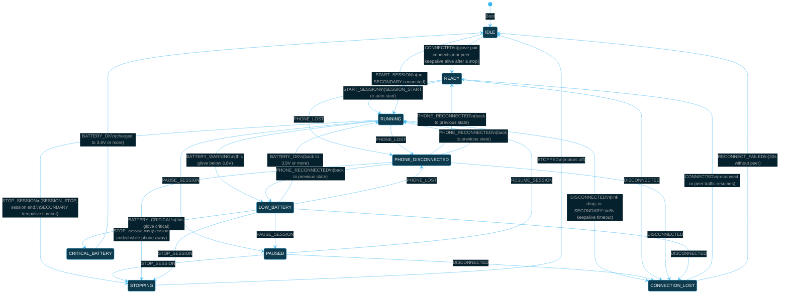

**State Descriptions:**

| State                | Description                                             |
| -------------------- | ------------------------------------------------------- |
| `IDLE`               | No session; glove pair not connected (advertising/scanning) |
| `CONNECTING`         | Defined but never entered (pairing goes IDLE → READY)  |
| `READY`              | Glove pair connected, awaiting session start            |
| `RUNNING`            | Active therapy session, motors executing patterns       |
| `PAUSED`             | Session paused, motors idle, timing preserved           |
| `STOPPING`           | Stop in progress; `STOPPED` follows immediately, so it lands in IDLE (then READY if the pair is still connected) |
| `ERROR`              | Defined but never entered (no code fires `ERROR_OCCURRED` or `EMERGENCY_STOP`) |
| `LOW_BATTERY`        | Session running on a low battery (this glove below 3.8V); behaves like RUNNING, orange slow pulse |
| `CRITICAL_BATTERY`   | This glove's battery critical; motors stopped, red urgent blink, until it charges to 3.8V |
| `CONNECTION_LOST`    | Glove link lost; therapy stopped, purple blink, waits up to 30s for the peer |
| `PHONE_DISCONNECTED` | PRIMARY only: phone lost from READY, RUNNING or LOW_BATTERY; informational, keeps the interrupted state's LED |

---

## 2. Session Initialization Sequence

Complete boot-to-ready sequence including connection establishment and clock synchronization:

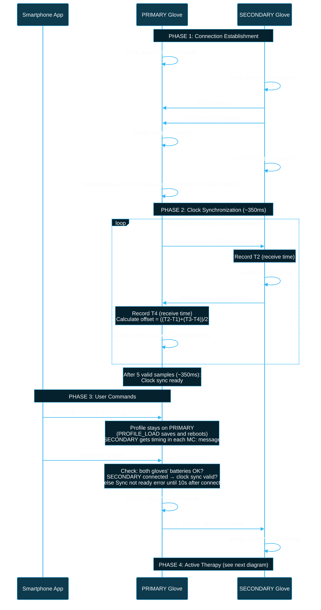

---

## 3. Active Therapy Session Flow

Pattern generation, message batching, and motor scheduling during an active session:

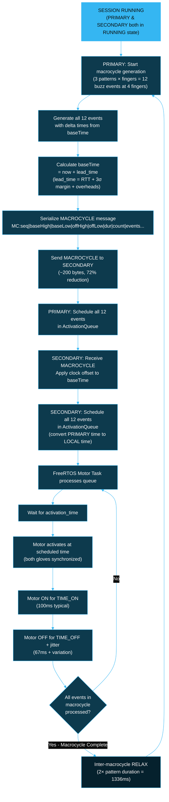

**Key Metrics:**

- Pattern duration: ~668ms (4 events × 167ms average)
- Macrocycle duration: ~3.3s (3 patterns + relaxation)
- Batching efficiency: 72% bandwidth reduction (200 bytes vs 720 bytes)

---

## 4. Clock Synchronization (PTP 4-Timestamp)

IEEE 1588 PTP-style clock offset calculation for sub-2ms bilateral synchronization:

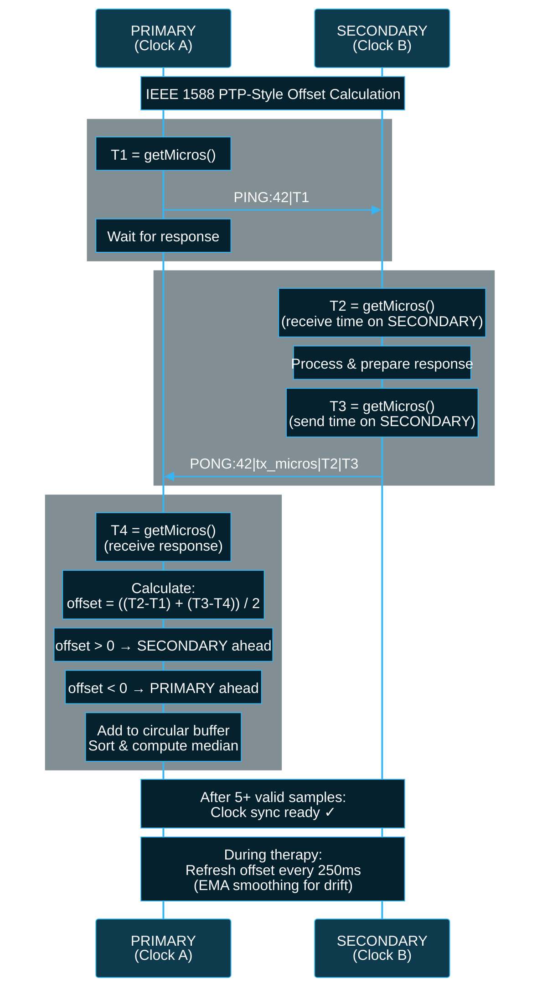

**Offset Calculation Formula:**

```
offset = ((T2 - T1) + (T3 - T4)) / 2
RTT = (T4 - T1) - (T3 - T2)
```

**Synchronization Parameters:**

- **Target accuracy**: <2ms bilateral sync
- **Confidence threshold**: RTT < 60ms
- **Minimum samples**: 5 for sync ready
- **Smoothing**: Exponential moving average (α = 0.1)
- **Update frequency**: Every PING/PONG (70ms until sync valid, 250ms during therapy, 1s idle)

### Warm-Start Sync Recovery

After brief BLE disconnects, the firmware can skip full clock synchronization using cached sync state:

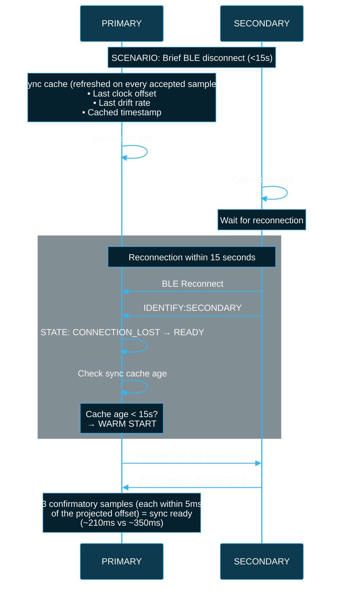

**Warm-Start Conditions:**

| Condition | Warm-Start | Cold-Start |
|-----------|:----------:|:----------:|
| Disconnect duration < 15s | ✓ | ✗ |
| Disconnect duration ≥ 15s | ✗ | ✓ |
| First connection (no cache) | ✗ | ✓ |
| Device reboot (or a sample > 5ms off the projection) | ✗ | ✓ |

**Recovery Time Comparison:**

| Start Type | Required Samples | Time to Sync Ready |
|------------|:----------------:|:------------------:|
| Cold-Start | 5+ samples | ~350ms |
| Warm-Start | 3 samples | ~210ms |

**Sync Cache Contents:**

```cpp
// include/sync_protocol.h
struct WarmStartCache {
    int64_t cachedOffset;        // Last known median offset
    float cachedDriftRate;       // Last known drift rate (us/ms)
    uint32_t cacheTimestamp;     // syncNowMs() epoch (getMicros()/1000) when cached
    bool isValid;                // Cache contains usable data
};

// From config.h:
// SYNC_WARM_START_VALIDITY_MS = 15000 (15 seconds)
// SYNC_WARM_START_MIN_SAMPLES = 3
// SYNC_WARM_START_TOLERANCE_US = 5000 (5ms)
```

**Purpose:** Warm-start gets the gloves back to a valid clock sync sooner after transient BLE issues (interference, temporary out-of-range) by avoiding full re-synchronization. The session itself is stopped on connection loss and must be started again.

---

## 5. Synchronized Motor Activation

How both gloves achieve sub-2ms synchronization despite BLE latency:

```mermaid
%%{init: {'theme': 'base', 'themeVariables': {
  'primaryColor': '#0d3a4d',
  'primaryTextColor': '#fafafa',
  'primaryBorderColor': '#35B6F2',
  'lineColor': '#35B6F2',
  'secondaryColor': '#05212D',
  'tertiaryColor': '#0a0a0a',
  'background': '#0a0a0a',
  'mainBkg': '#0d3a4d',
  'nodeBorder': '#35B6F2',
  'clusterBkg': '#05212D',
  'clusterBorder': '#35B6F2',
  'titleColor': '#fafafa',
  'edgeLabelBackground': '#0a0a0a'
}}}%%
flowchart LR
    subgraph PRIMARY["PRIMARY (0ms reference)"]
        A["1. Generate macrocycle<br/>t=500ms"]
        B["2. baseTime<br/>= 500ms + lead_time<br/>= 570ms"]
        C["3. Send MACROCYCLE<br/>(12 events)"]
        D["4. Schedule all in queue<br/>baseTime=570ms"]
    end

    subgraph BLE["Bluetooth Latency<br/>(~7.5-20ms)"]
        E["Transit (7.5-20ms)"]
    end

    subgraph SECONDARY["SECONDARY (offset=-1ms)"]
        F["5. Receive MACROCYCLE<br/>(570ms PRIMARY time,<br/>offset carried in MC:)"]
        G["6. Convert to LOCAL<br/>time = 570ms + (-1ms)<br/>= 569ms"]
        H["7. Schedule all in queue<br/>baseTime=569ms"]
        I["8. Wait for 569ms"]
    end

    subgraph EXECUTION["Motor Activation"]
        J["Both motors activate<br/>within <2ms of each other"]
    end

    A --> B --> C --> E --> F --> G --> H --> I --> J
    C --> D --> J
    D -.->|Waits for<br/>570ms| J
    I -.->|Waits for<br/>569ms| J
```

**Key Insight:** By scheduling events with absolute activation times (in PRIMARY's timebase) and applying clock offset conversion on SECONDARY, the system decouples synchronization accuracy from BLE transmission latency.

---

## 6. Message Types & Flow

All messages exchanged between devices during a therapy session:

```mermaid
%%{init: {'theme': 'base', 'themeVariables': {
  'primaryColor': '#0d3a4d',
  'primaryTextColor': '#fafafa',
  'primaryBorderColor': '#35B6F2',
  'lineColor': '#35B6F2',
  'secondaryColor': '#05212D',
  'tertiaryColor': '#0a0a0a',
  'background': '#0a0a0a',
  'mainBkg': '#0d3a4d',
  'nodeBorder': '#35B6F2',
  'clusterBkg': '#05212D',
  'clusterBorder': '#35B6F2',
  'titleColor': '#fafafa',
  'edgeLabelBackground': '#0a0a0a'
}}}%%
graph TD
    A["PRIMARY ← Phone Commands"]

    B["Handshake Messages"]
    C["Synchronization Messages"]
    D["Therapy Messages"]
    E["Status Messages"]

    B --> B0["IDENTIFY:SECONDARY<br/>(SECONDARY → PRIMARY on connect)"]
    B --> B1["START_SESSION:seq|ts"]
    B --> B2["PAUSE_SESSION:seq|ts"]
    B --> B3["RESUME_SESSION:seq|ts"]
    B --> B4["STOP_SESSION:seq|ts"]

    C --> C1["PING:seq|T1<br/>(70ms acquiring, 250ms therapy, 1s idle)"]
    C --> C2["PONG:seq|tx_micros|T2|T3<br/>(response)"]

    D --> D2["MC:seq|baseHigh|baseLow|offHigh|offLow|dur|count|events<br/>(batched, 3 patterns)"]
    D --> D3["MC_ACK:seq|ts<br/>(acknowledgment)"]

    E --> E1["GET_BATTERY"]
    E --> E2["BATRESPONSE:voltage (reply)<br/>BATRESPONSE:voltage|level<br/>(after every SECONDARY battery check)"]

    A --> B
    A --> C
    A --> D
    A --> E

    B1 --> F["SECONDARY state → RUNNING<br/>(motors follow MC: events)"]
    B2 --> G["SECONDARY state → PAUSED"]
    B3 --> H["SECONDARY state → RUNNING"]
    B4 --> I["Clean shutdown<br/>(queues cleared, motors off)"]

    D2 --> K["Activate 12 events<br/>over ~3.3 seconds"]

    E1 --> L["Query SECONDARY<br/>battery voltage"]
```

**Message Routing:**

- **Phone → PRIMARY**: BLE UART service (Nordic UART Service)
- **PRIMARY → SECONDARY**: Custom sync protocol over BLE UART
- **Keepalive**: PING/PONG in all connected states: every 70ms until clock sync is valid, 250ms during therapy, 1s idle

---

## 7. Pattern Generation (RNDP/SEQUENTIAL/MIRRORED)

How the firmware generates vibrotactile patterns (3 patterns = 1 macrocycle):

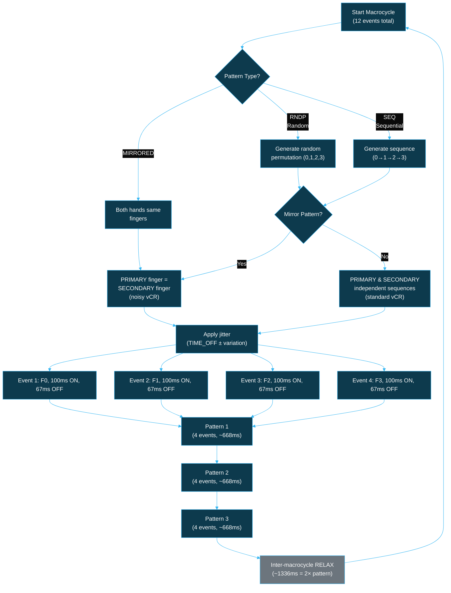

**Pattern Types:**

- **RNDP (Random Permutation)**: Finger order randomized each pattern
- **SEQUENTIAL**: Fingers activate in order (0→1→2→3)
- **MIRRORED**: Both hands use the same random finger order, regardless of the mirror setting

**Timing:**

- Event duration: TIME_ON (100ms) + TIME_OFF (67ms) + jitter
- Pattern duration: 4 events × ~167ms = ~668ms
- Macrocycle: 3 patterns + 1336ms relaxation = ~3.3s

---

## 8. Battery & Error Handling

Battery checks and connection-loss recovery flows:

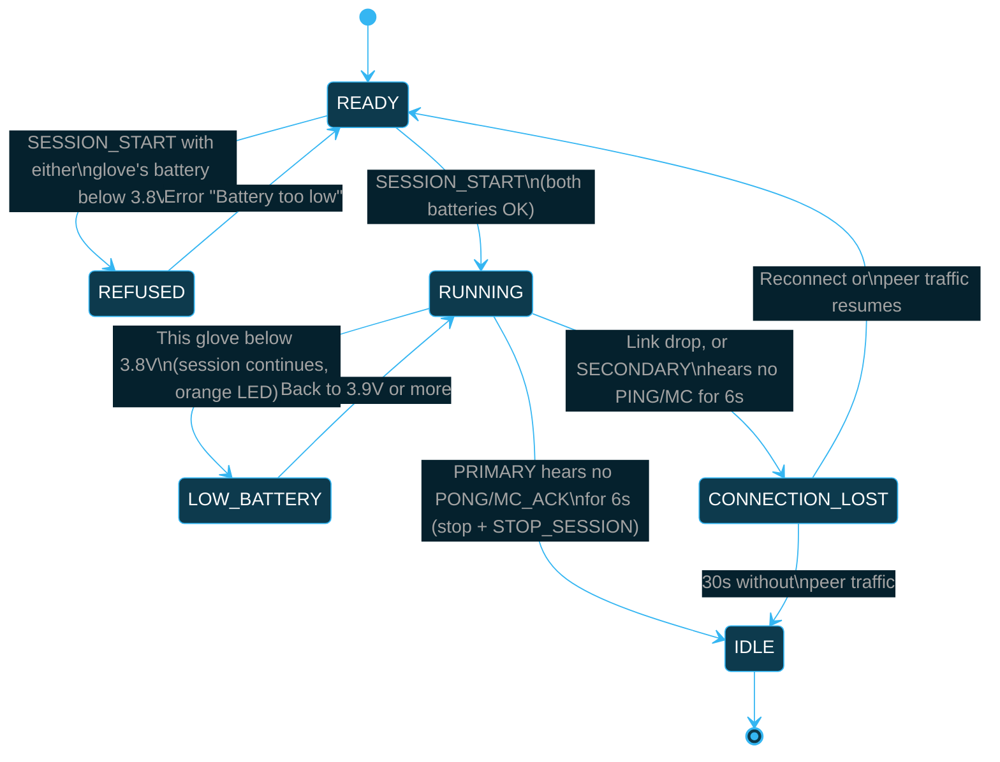

**Battery Thresholds:**

- **Low**: two readings in a row below 3.8V (`BATTERY_LOW_VOLTAGE`, per board in `board_config.h`; provisional until bench-calibrated, see [CALIBRATION_GUIDE.md](./CALIBRATION_GUIDE.md#low-battery-threshold)): the glove can't finish a 2-hour session. Its LED turns orange and a running session continues as LOW_BATTERY. While either glove is low, `SESSION_START` is refused with `Battery too low` and the PRIMARY doesn't auto-start. Clears at ≥3.9V (`BATTERY_LOW_HYSTERESIS_V`)
- **Critical**: two readings in a row below 3.3V (`BATTERY_CRITICAL_VOLTAGE`, `BATTERY_CRITICAL_CONFIRM_READINGS`): the glove enters CRITICAL_BATTERY (motors off, red urgent blink; a critical SECONDARY acknowledges macrocycles but plays none), and the PRIMARY ends the session (`LAST_REASON:BATTERY`) when either glove is critical; a bench `TEST` is never stopped this way. Returns to IDLE once the glove charges to ≥3.8V
- Each glove checks its battery every 60s between pulses, on its first idle loop after boot, and (SECONDARY) right after connecting to the PRIMARY; after each motor-idle reading the SECONDARY pushes its voltage and level to the PRIMARY (`BATRESPONSE:<volts>|<level>`), and the PRIMARY gates and stops on that level. A glove with no reading yet doesn't block a start

**Connection Loss Handling:**

- **Detection**: BLE disconnect on either glove; on the SECONDARY, 6 seconds without a PING or macrocycle (`KEEPALIVE_TIMEOUT_MS`); on the PRIMARY during therapy, 6 seconds without SECONDARY traffic stops the session instead
- **Reconnection**: Scanning/advertising continue; the peer can reconnect at any time
- **Timeout**: Return to IDLE (LED back to breathing blue) after 30s without peer traffic

---

## 9. Lead Time Calculation (Adaptive Scheduling)

Dynamic lead time adjustment based on measured BLE latency:

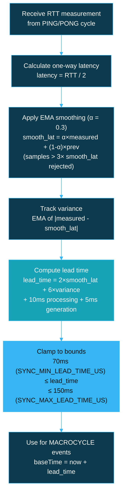

**Lead Time Formula:**

```
lead_time = RTT + 3σ margin + processing_overhead + generation_overhead
          = 2×smoothed_one_way + 6×variance + 10ms + 5ms
lead_time = clamp(lead_time, 70ms, 150ms)

// Before 3 latency samples: 35ms + 10ms + 5ms = 50ms (not clamped)

// From config.h:
// SYNC_MIN_LEAD_TIME_US = 70000  (70ms minimum)
// SYNC_MAX_LEAD_TIME_US = 150000 (150ms maximum)
```

**Purpose:** Ensures SECONDARY has sufficient time to receive, deserialize, and schedule events before activation. The 70-150ms range accounts for:
- BLE round-trip time (~16-24ms for 2M PHY)
- Processing overhead (SYNC_PROCESSING_OVERHEAD_US = 10ms)
- Generation overhead (SYNC_GENERATION_OVERHEAD_US = 5ms)
- Safety margin for BLE retransmissions

---

## 10. Complete BLE Command Sequence

Full message flow from phone command to synchronized motor execution:

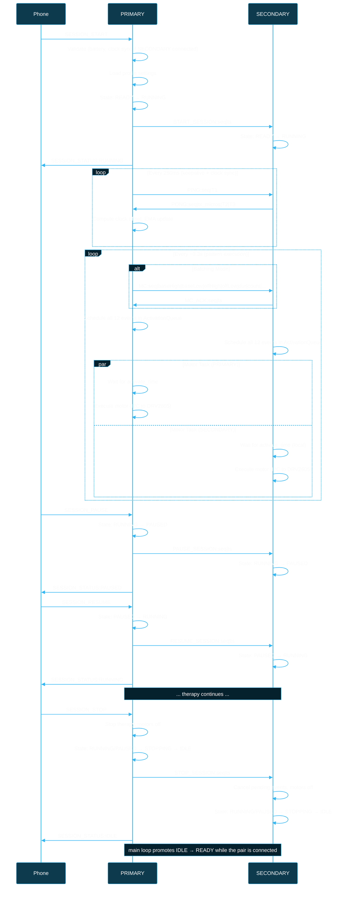

---

## Firmware Responsibilities

| Responsibility                        | PRIMARY | SECONDARY |
| ------------------------------------- | :-----: | :-------: |
| **Pattern generation**                |    ✓    |     ✗     |
| **Phone communication**               |    ✓    |     ✗     |
| **Clock synchronization (initiator)** |    ✓    |     ✗     |
| **Clock synchronization (responder)** |    ✗    |     ✓     |
| **Lead time calculation**             |    ✓    |     ✗     |
| **Therapy command distribution**      |    ✓    |     ✗     |
| **Therapy command execution**         |    ✓    |     ✓     |
| **Battery monitoring (both gloves)**  |    ✓    |     ✗     |
| **Battery voltage reporting**         |    ✓    |     ✓     |
| **Motor activation**                  |    ✓    |     ✓     |
| **Session state authority**           | Master  | Follower  |

---

## Technical Parameters

### Timing Values

| Parameter             | Value   | Description                               |
| --------------------- | ------- | ----------------------------------------- |
| TIME_ON               | 100ms   | Motor activation duration (per event)     |
| TIME_OFF              | 67ms    | Inter-burst interval (base value)         |
| Lead time             | 70-150ms | Adaptive scheduling margin (config.h bounds) |
| Pattern duration      | ~668ms  | 4 events × (TIME_ON + TIME_OFF + jitter)  |
| Macrocycle duration   | ~3.3s   | 3 patterns + inter-macrocycle relaxation  |
| Relaxation period     | ~1336ms | 2× pattern duration (between macrocycles) |
| PING/PONG frequency   | 70ms / 250ms / 1s | Keepalive and clock sync refresh rate (acquiring / therapy / idle) |
| Connection timeout    | 6s      | SECONDARY: no PING/MC for 6s → connection lost; PRIMARY: no SECONDARY traffic for 6s during therapy → session stopped |
| Connection-lost window | 30s    | Purple LED before returning to IDLE (reconnect still possible) |

### Synchronization Accuracy

| Metric                 | Value                     | Notes                                   |
| ---------------------- | ------------------------- | --------------------------------------- |
| Target accuracy        | <2ms                      | Bilateral synchronization (both gloves) |
| Synchronization method | IEEE 1588 PTP 4-timestamp | Clock offset calculation                |
| Confidence threshold   | RTT < 60ms                | For accepting offset samples            |
| Minimum samples        | 5                         | Before declaring sync ready             |
| Smoothing algorithm    | EMA (α = 0.1)             | Exponential moving average              |
| Update frequency       | ~14 Hz / 4 Hz / 1 Hz      | Every PING/PONG cycle (acquiring / therapy / idle) |

### Message Efficiency

| Mode                | Message Size | Messages/Macrocycle | Total Bytes | Efficiency        |
| ------------------- | ------------ | ------------------- | ----------- | ----------------- |
| Individual messages (removed) | 60 bytes | 12            | 720 bytes   | Removed (legacy)  |
| MACROCYCLE batching | 200 bytes    | 1                   | 200 bytes   | **72% reduction** |

### Battery Thresholds

| Level    | Voltage Range | Action                                            |
| -------- | ------------- | ------------------------------------------------- |
| Normal   | ≥3.8V         | Normal operation                                  |
| Low      | 3.3-3.8V      | After two readings in a row: orange LED; a running session continues as LOW_BATTERY; `SESSION_START` refused (`Battery too low`) and no auto-start if either glove is low; clears at ≥3.9V |
| Critical | <3.3V         | After two readings in a row: CRITICAL_BATTERY (red urgent blink) until charged to ≥3.8V; the PRIMARY stops a running session if either glove is critical |

---

## Related Documentation

This document complements the following technical documentation:

- **[ARCHITECTURE.md](./ARCHITECTURE.md)** - Complete firmware architecture overview
- **[SYNCHRONIZATION_PROTOCOL.md](./SYNCHRONIZATION_PROTOCOL.md)** - Detailed PRIMARY ↔ SECONDARY sync protocol specification
- **[BLE_PROTOCOL.md](./BLE_PROTOCOL.md)** - Phone ↔ PRIMARY BLE command protocol

---

## Summary

The BlueBuzzah firmware implements a sophisticated bilateral synchronization system:

1. **Dual-glove architecture** with PRIMARY/SECONDARY roles for coordinated therapy
2. **IEEE 1588 PTP-style clock synchronization** achieving <2ms bilateral sync accuracy
3. **Adaptive lead time scheduling** that decouples sync accuracy from BLE latency variability
4. **Message batching (MACROCYCLE)** reducing BLE bandwidth by 72%
5. **Graceful error handling** with automatic reconnection and a battery check at session start
6. **FreeRTOS task isolation** for deterministic motor timing (<1ms activation accuracy)

This architecture enables precise bilateral haptic feedback while operating within the constraints of BLE latency (7.5-20ms typical) and embedded hardware limitations (nRF52840: 256KB RAM, 1MB flash).
